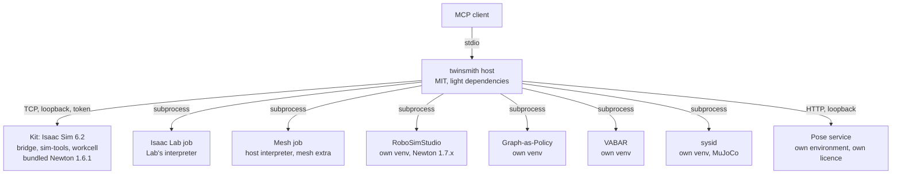

# How twinsmith works

This page explains the whole system: how an MCP client connects, what the host server, the bridge and the Kit extensions
each do, how Isaac Lab jobs, asset packs and RoboSimStudio fit in, and where each setting is read. For setup steps see
[Linux setup](LINUX-SETUP.md) and [MCP server](MCP-SERVER.md); for every tool see the [tool arguments](TOOLS-ARGUMENTS.md).
The page describes `main` as it is; the last section, [Target layout](#target-layout-planned), is the plan.


The diagram source is [`architecture.drawio`](architecture.drawio) (open it at [diagrams.net](https://app.diagrams.net)).

## In one minute

The [Model Context Protocol](https://modelcontextprotocol.io) (MCP) is how an AI agent's client (Claude Code, Codex,
OpenCode and others) uses outside tools. The client starts an **MCP server** as a child process, asks it which tools it
has, and calls them by name with JSON arguments. The server does the work and returns text or images.

`twinsmith` is such a server. It is a small Python program that starts in about a second and needs no simulator to
start. Its tools are grouped into [toolsets](TOOLSETS.md), and a client is shown only the enabled ones; only `core` is on by
default. A tool is one of three kinds:

| Kind | Examples | Where the work happens |
|---|---|---|
| Host tool | `help`, `screenshot`, `join_videos`, `robosim`, `sysid`, `hardware`, `gap`, `vabar` | In the server process itself |
| Simulator tool | `sim__*`, `assets__*`, `status`, `run_python`, the work cell's `workcell__*` | Inside a running Isaac Sim, reached over a local TCP connection |
| Job tool | `isaaclab__launch`, `run_script` | In a separate process the server starts and watches |

## The pieces

| Piece | Where | What it is |
|---|---|---|
| MCP client | Your agent | Starts the host server and speaks MCP to it on stdin and stdout. |
| Host server | `mcp/twinsmith/` (command `twinsmith`) | The MCP server. Speaks MCP to the client; is a TCP client of the bridge; runs the host tools and the job tools. |
| Bridge | `exts/twinsmith.bridge/` | A Kit extension inside Isaac Sim: a TCP server that runs tool calls on Kit's main thread. Robot-agnostic. |
| Scene tools | `exts/sim-tools/` | A Kit extension that registers the generic `sim.*` and `assets.*` tools on the bridge. |
| Work cell | `exts/workcell/` | One lab's UR5e Jenga work cell: the `workcell.*` tools on the same bridge. Its assets come from an [asset pack](ASSET-PACKS.md). See its [README](../exts/workcell/workcell/README.md). |
| Isaac Lab jobs | `mcp/twinsmith/isaaclab/` | Train, evaluate, play and record in separate processes the host starts. |
| RoboSimStudio bridge | `mcp/twinsmith/robosim/` | Runs RoboSimStudio in its own Python environment from one grouped tool. |
| System identification | `mcp/twinsmith/sysid.py`, `sysid_driver.py` | Fits model parameters with `mujoco.sysid` in its own environment; the driver is the only file that imports MuJoCo. |
| Hardware | `mcp/twinsmith/hardware.py` | Runs `kicad-cli`, KiKit and Blender beside twinsmith. |
| Planning and evaluation | `mcp/twinsmith/gap.py`, `mcp/twinsmith/vabar.py` | Run Graph-as-Policy and VABAR from their own pinned checkouts. |
| Tools beside twinsmith | `mcp/twinsmith/sibling.py` | What `hardware`, `robosim`, `gap` and `vabar` share: a scrubbed environment, bounded runs, jobs, and a pinned checkout's commit. |
| Launch and checks | `run.sh`, `install.sh`, `scripts/` | Start Isaac Sim with the extensions, install the host, run checks. |

They are separate on purpose. The host must start instantly and must never need the 20 GB simulator environment just to
take a screenshot or manage a job. The bridge knows nothing about robots, so any Kit app and any tool package can use it. The
scene tools know nothing about the UR5e. The work cell keeps its robot-specific logic to itself, and its USD assets are not in
the repository: they live in packs in the local asset root.

## How a client connects

The client's configuration names a command to run (see [client configuration](MCP-SERVER.md#4-client-configuration)):

```json
{"mcpServers": {"twinsmith": {"command": "twinsmith", "env": {"TWINSMITH_SIM_PYTHON": "<sim-python>"}}}}
```

The client starts `twinsmith`, and the two exchange JSON-RPC messages on the process's stdin and stdout: `initialize`,
`tools/list`, then `tools/call` for each tool the agent uses. Each client gets its own server process, so two agents do not
share a server, though they can talk to the same simulator.

The server lists the tools of the enabled toolsets from the first `tools/list`, whether or not Isaac Sim is running. The
simulator tools are listed from a snapshot packaged with the server (`mcp/twinsmith/catalogs/`); each one dials the selected
bridge only when it is called, and answers with what to do if none is there. `status` is the one check-in call: it says which
simulator answered, what else is running, the IDs the scene tools need and which toolsets are on, or that nothing is running.

## How a tool call travels

1. The client sends `tools/call` with a name such as `sim__prim` and `action="create"`. A grouped tool checks that the
   arguments belong to that action and passes the call to the single-purpose tool behind it (`sim__prim__create`, which
   can also be called by that name).
2. The server checks the arguments against the tool's schema.
3. It takes one of three routes:
   - **Host tool:** the server runs it and answers.
   - **Simulator tool:** the server sends one JSON line to the bridge
     (`{"id": 7, "type": "sim.prim.create", "params": {...}}`) and waits for the line that echoes its `id`. The bridge runs
     the handler on Kit's main thread. For an asset import the server first checks the file is in an approved folder,
     converts it if needed, and copies a snapshot into a staging folder that Kit reads.
   - **Job tool:** the server starts a process in its own process group, records it in the jobs folder, and returns a
     `job_id` at once. A job inside the simulator writes the same kind of record to the same folder.
4. The answer goes back to the client as text (usually JSON), with MCP's error flag set when the tool failed.

**Names.** Inside Kit a tool is `<namespace>.<tool>`: `sim.stage.info`. MCP tool names cannot contain dots, so the server
registers them as `sim__stage__info`. A client is shown related tools as one grouped tool with an `action` (`sim__stage`).
[TOOLS-ARGUMENTS.md](TOOLS-ARGUMENTS.md) lists every grouped tool with its actions, by toolset. Tools built into the bridge
(`status`, `run_python`, the file tools), the gateway tools (`use_bridge`, `refresh_tools`) and the desktop tools
(`screenshot`, `windows`, `doctor`, `computer`) have no prefix: they work on any X11 window, not only Isaac Sim. `sim__` marks
tools that need Kit, such as `sim__ui`.

**Long work.** A call that would take longer than a moment returns a `job_id` instead of blocking. Inside the simulator that
is `run_python` with `background=true`, `sim__simulation(action="run")` and `sim__simulation(action="replay")`; on the host it
is every `isaaclab__launch` action and `run_script`. `jobs` (with `wait_s`) follows and stops either kind, and both kinds keep
their record in one folder in one format, so a job can still be read after the simulator has exited.

## How the server reaches Isaac Sim

**The bridge.** `twinsmith.bridge` listens on one TCP port per Kit process, on loopback by default. The protocol is one JSON
object per line each way ([protocol](../mcp/docs/protocol.md)). Tool packages register their tools on it under a namespace, so
two projects can each have a `play_scene` (`arm.play_scene`, `rover.play_scene`). Three rules decide when a call runs: tools
that only read the bridge's own state (`status`, `job_status`) are answered at once, off the main thread; a tool that advances
the app itself (`run_python`) runs alone; every other tool runs in arrival order. The bridge also keeps background jobs.

**Who may connect, and what they may do.** Every connection presents a token. The bridge writes it to a file only your account
can read, and clients on that account read it from there. Started with `TWINSMITH_READ_ONLY=1`, the bridge runs only tools that
change nothing and refuses the rest, for every client. Toolsets do not replace either: they only change what is listed.

**Starting a simulator.** `./run.sh` (add `--headless` for no window) starts Isaac Sim with the bridge, the scene tools, the
work-cell extension and NVIDIA's bundled ROS 2 bridge enabled, on port 8766 unless told otherwise. `simulators`, when the
user has selected the `computer` toolset, does the same for the agent, on a free port with its own ROS domain and output folder, after
checking GPU and memory headroom. The server never starts a simulator on its own.

**Finding it.** A running bridge writes a small portfile (`$XDG_RUNTIME_DIR/twinsmith/`, or `/tmp/twinsmith-<uid>/`) with its
PID and port. The server picks the bridge to dial in this order:

1. An explicit choice: `use_bridge(port)` in the session, or `--port` on the command-line client.
2. `TWINSMITH_PORT`.
3. Portfile discovery, when exactly one bridge is advertised. With several and no explicit choice it refuses to guess and
   lists them.

| Port | Used by |
|---|---|
| 8766 | The default bridge port of `run.sh` and client configurations. |
| 8767 | Convention for a second bridge, such as the Isaac Lab bridge example. |
| any | `./run.sh --port 0` asks the OS for a free port; `simulators` picks one in `TWINSMITH_PORT_RANGE`. |

A configured port that is already taken refuses at startup rather than moving somewhere no client could predict.
`TWINSMITH_BIND` can change the bind address; the bridge runs arbitrary Python by design, so beyond loopback use an SSH tunnel or
a private network, and give the client the token ([protocol](../mcp/docs/protocol.md#several-simulators-and-other-machines)).

**The physics engine.** Each Kit process runs one engine for its lifetime; `status` reports the stage's `physics_engine`.
The target engine, the current default and how to choose are in [COMPATIBILITY.md](COMPATIBILITY.md#target-engine).

## Loading the bridge in another Kit app

`./run.sh` enables the bridge by itself. For another Kit app, or a plain Isaac Sim install:

```bash
python3 scripts/install.py            # --dry-run to preview, --remove to undo
```

This edits the app's `user.config.json`, as the Extensions window's autoload checkbox does: it adds `exts/` to the search path,
enables `twinsmith.bridge`, and stores the port (8766). Close the app first; with several Kit apps installed, name one with
`--config`. A script that is not an MCP client can use the bridge too, with the standard-library client:

```python
from twinsmith.client import BridgeClient, call

call("status")                                       # one call
with BridgeClient(port=8766) as bridge:              # many calls on one connection
    bridge.call("run_python", {"code": "result = 1"})
```

```bash
python3 mcp/twinsmith/client.py --list-bridges
python3 mcp/twinsmith/client.py <tool> ['{"json": "arguments"}'] [--port N]
```

`client.py` uses only the standard library and can be copied on its own. Exit codes: 0 success, 1 the bridge answered with an
error, 2 unreachable or bad usage. Your own tools are an ordinary Python package that the bridge imports; see
[tool authoring](../mcp/docs/tool-authoring.md) and the template in `mcp/templates/demo_tools/`.

## Isaac Lab jobs

The `isaaclab__*` tools never go through the bridge. They run Isaac Lab's own scripts (train, play, and this project's
evaluation, check and record runners) with the interpreter of an Isaac Lab install, as separate processes. Each job gets a
folder with its command, log, exit code and results; the server's job tools read that folder, so a job outlives the client and
the server that started it. An install is chosen once by `ISAACLAB_PYTHON` and `ISAACLAB_ROOT`, or per call with `install=`. A
job starts its own Kit and uses the GPU, so by default one runs at a time and none starts beside a running simulator.
`run_script` uses the same job system for any Python script, with no GPU guards. Isaac Lab chooses its own physics engine from
the task, which these tools do not override. See [Isaac Lab tools](TOOLS-ISAACLAB.md).

## Asset packs

Assets are not in the repository. They live in an **asset root** of versioned **packs**, each a folder with one `pack.yaml`
that lists every file with its hash, source and licence (`mcp/twinsmith/pack_manifest.py` reads it; the host tools in
`asset_packs.py` list, check, adopt, pin and build packs), and in project folders the user has approved. The server will only
read a file inside one of those; only the user can approve a folder. `assets__import_path` picks the format, converts URDF,
xacro, SDF and MuJoCo files on the host without running any code from them, and hands Kit a verified snapshot in a staging
folder both processes can read. Kit then references the snapshot into the scene's session layer, so source files never change.
See [Asset packs](ASSET-PACKS.md) and [importing](ASSET-IMPORT.md).

## RoboSimStudio

`robosim` is one grouped tool, registered by the `real2sim` toolset (off by default). It does not use the Kit bridge: it runs
RoboSimStudio commands with RoboSimStudio's own Python environment, so the host never imports it, and keeps each run's files
under `<workspace>/runs/robosim/`. See [ROBOSIM.md](ROBOSIM.md). The same toolset registers `sysid`, which runs MuJoCo's
system identification in its own environment as a job and writes under `<workspace>/runs/sysid/`. See [SYSID.md](SYSID.md).

## Hardware

`hardware` is one tool, registered by the `cad` toolset (off by default). Authoring a board, an enclosure or a scene in
Blender stays in the servers beside twinsmith; `hardware` only runs the deterministic steps (`kicad-cli` checks, KiKit fab
files, a headless Blender render) on files in an approved folder, and writes each result to a new folder under
`<workspace>/runs/hardware/`. See [HARDWARE.md](HARDWARE.md).

## Graph-as-Policy and VABAR

`gap` (toolset `planning`) and `vabar` (toolset `eval`), both off by default, wrap two more pinned checkouts the same way:
the checkout is found under `<workspace>/tools/`, its commit is reported against a `PIN` in the code, arguments are typed
and allow-listed, long work is a job in the shared jobs folder, and run files go under `<workspace>/runs/gap/` and
`<workspace>/runs/vabar/`. `gap` refuses anything that would reach Graph-as-Policy's real-hardware option. See
[PLANNING-EVAL.md](PLANNING-EVAL.md).

## Seeing and recording

| Source | Tools | Needs |
|---|---|---|
| A window on the desktop | `screenshot`, `screen_recording` | An X11 display. A window is read by its id, so it works when the screen is locked, and when covered if the window manager composites (`doctor` says). |
| Acting on a window | `computer` (explicit-only `computer` toolset); `sim__ui` for Isaac Sim's own UI | `computer`: an unlocked X11 desktop. `sim__ui`: a running windowed Isaac Sim; works when locked. See [computer use](TOOLS-HOST.md#computer-use-workflow). |
| A camera in the scene | `sim__camera`; `camera=` on `sim__simulation` runs and replays | A running simulator. Works headless. |
| An Isaac Lab task | `isaaclab__launch` with `record`, or `play` with `--video` | An Isaac Lab install. Works headless. |
| Saved clips and frames | `join_videos` (join, contact sheet, frames to MP4) | Nothing but the files. |

Screenshots and recordings go to `~/Pictures/twinsmith` and `~/Videos/twinsmith`. Camera captures, frames and controller
logs go to the simulator's output folder (`TWINSMITH_SCENE_OUTPUT`).

## Where each setting is read

Settings are read by the process they concern: the server (set them in the client's entry), Kit (set them where `run.sh` runs;
`simulators` passes the server's on), or an Isaac Lab job. [ENVIRONMENT.md](ENVIRONMENT.md) lists every variable once, with
its default and reader, and a test keeps it exact. The ones that shape the system:

| Setting | Read by | Purpose |
|---|---|---|
| `[tools] toolsets` in the config files, `TWINSMITH_TOOLSETS`, `--toolsets` | Host server | Which toolsets are on. These control visibility, not security. |
| `[sim] physics_backend`, `TWINSMITH_PHYSICS_BACKEND`, `run.sh --physics-backend` | Host server, `run.sh`, Kit | The physics engine of a new simulator. |
| `TWINSMITH_PORT` | Host server, Kit | The bridge port to dial, and to listen on. |
| `TWINSMITH_SIM_PYTHON` | `run.sh`, the host (`simulators`) | The Isaac Sim interpreter to start. |
| `TWINSMITH_ASSET_ROOT` | Host server, Kit | The asset root. |
| `TWINSMITH_SCENE_OUTPUT` | Kit | Where scene tools write captures, saves and logs. |
| `ISAACLAB_PYTHON`, `ISAACLAB_ROOT` | Host server | The default Isaac Lab install. |
| `TWINSMITH_READ_ONLY`, `TWINSMITH_AUTH`, `TWINSMITH_TOKEN` | Kit (the token also by clients) | Enforced by the bridge: read-only mode, and the token connections must present. |
| `TWINSMITH_ENABLE_SCENE_SCRIPTS` | Kit | Opt in to tools that run the caller's Python inside Kit. |

The server reads two files for settings: `~/.config/twinsmith/config.toml` and the nearest `twinsmith.toml` above the
working directory. Precedence is: defaults, user file, project file, environment, command line.

## Tool groups

A group is a toolset: one switch, one row in the README. Every group is off by default except `core`. The registry is
`mcp/twinsmith/toolsets.py` (one line per group) and `mcp/twinsmith/tool_groups.py` (the actions of each grouped tool).

| Group | Default | Holds | Kind |
|---|---|---|---|
| `core` | always on | `status`, `help`, `refresh_tools`, `use_bridge`, `jobs`, `toolsets` | Native |
| `computer` | explicit only | The desktop and its processes: `screenshot`, `screen_recording`, `windows`, `join_videos`, `doctor`, `computer` (mouse and keyboard), `simulators` (start and stop managed Isaac Sim processes) | Native |
| `sim` | off | Everything for Isaac Sim and Isaac Lab: the stage, prims, physics, joints, sensors, code in Kit, Kit's log and UI, simulator-side ROS 2, the UR5e Jenga work cell (`workcell__*`), Isaac Lab jobs (`isaaclab__*`, `run_script`), and the tools a project's own Kit extension registers | Native |
| `assets` | off | Import, packs, mesh preparation, validation | Native |
| `cad` | off (on in the owner's configuration) | `hardware`: checks, fabrication files and renders around the CAD servers beside twinsmith | Wrapped |
| `real2sim` | off | `robosim` (RoboSimStudio runs) and `sysid` (system identification) | Wrapped |
| `planning` | off | `gap` (Graph-as-Policy) | Wrapped |
| `eval` | off | `vabar` (VABAR) | Wrapped |

`computer` is the only explicit-only group: a user selects it at startup (`+computer` in `TWINSMITH_TOOLSETS`,
`tools.toolsets` in `config.toml`, or `--toolsets`); `toolsets(action="enable")` refuses it and the `all` profile leaves it
out. It moves the mouse, types into windows, sees the screen and starts GPU processes, so an agent never turns it on itself.

`cad` holds no authoring: FreeCAD, KiCad and Blender run as separate MCP servers beside twinsmith. Its one tool checks and
packages what they produce; importing their meshes into a scene stays a format on `assets__import_path`.

Profiles: `default` is `core` alone and `all` is every group except `computer`. Old toolset names are not aliases: a
configuration that names one stops the server at startup with the list of valid names. [TOOLSETS.md](TOOLSETS.md#renamed-toolsets)
has the table of old names to new.

**Names.** The `sim__` prefix is only on tools that run in Kit. Tools that work without a simulator carry a plain name
(`screenshot`, `windows`, `computer`, `simulators`, `jobs`, `robosim`, `gap`). Isaac Lab keeps `isaaclab__`, the work cell
`workcell__` and assets `assets__`: each names the system the tool belongs to.

## Naming rules

| Entity | Rule | Examples |
|---|---|---|
| Kit extension ID and folder | The folder under `exts/` is the extension ID | `workcell`, `sim-tools`, `twinsmith.bridge` |
| Python package | The ID with underscores | `workcell`, `sim_tools`, `twinsmith_bridge`, `twinsmith` |
| Command and server name | One name, no aliases | `twinsmith` |
| Tool | `<namespace>.<tool>` in Kit, `<namespace>__<tool>` in MCP | `sim.stage.info`, `sim__stage__info` |

## ROS 2 and DDS

The simulation and every ROS 2 client that talks to it must use the same DDS settings: `./run.sh` sources
[`config/ros_dds.env`](../config/ros_dds.env) (Cyclone DDS, loopback only, multicast off), and every ROS client or inspection
script must source the same file. A client that does not discovers nothing: its nodes report no error, and messages publish
into the void. The rules, the publishing tool and the doctor are in [ROS 2 and RViz 2](ROS2-RVIZ.md).

## Target layout (planned)

Everything above describes `main` today. This section is the layout the [roadmap](ROADMAP.md) builds toward; nothing in it
exists until the pull request in [plans/](plans/README.md) that adds it has merged. Proposed tools are written as a namespace
and a tool, in separate columns: the MCP name joins them by the naming rule above (`<namespace>__<tool>`), and the plans spell
each one in full.

### Proposed tools

| Namespace | Tool | Actions | Runs in | Plan |
|---|---|---|---|---|
| none | `perception` | `status`, `pose` | A separate pose service | Later |
| none | `status` | Adds the loaded and pinned versions of every wrapped tool; today each wrapped tool's own `status` reports its pin | Host | Later |
| none | `use_bridge` | Adds `hold` and `release`: a lease on one Kit for one caller | Host | Later |

A wrapped tool takes the upstream tool's name, bare, and is one grouped tool. A new asset format is an option on
`assets__import_path`, never a new tool: STEP and IGES (`format="step"`, through Isaac Sim's CAD converter) and visual-only
Gaussian splats come that way.

### Wrapped, native, beside

| How | What | Why |
|---|---|---|
| **Native** (code in this repository) | Computer use, scene and physics tools, asset import, packs, mesh preparation, validation rules, the bridge lease | Stable patterns; small; worth owning |
| **Wrapped** (pinned sibling checkout, its own environment, its own command line) | RoboSimStudio, Graph-as-Policy with its skill library, VABAR, MuJoCo system identification | Young and fast-moving; an import would chain this repository to their dependencies |
| **Service** (separate process, reached over loopback) | FoundationPose; any other model with a restrictive licence | Research-only or custom licences must not touch an MIT repository |
| **Beside** (another MCP server in the client's configuration) | FreeCAD, build123d or agentcad, Blender, NVIDIA's documentation servers | Mature servers; twinsmith only receives their output as files |
| **Library, in the `mesh` extra** | CoACD (MIT), fast-simplification (MIT), trimesh (MIT) | Used as dependencies, not copied |
| **Not used** | ROS control servers such as ros-mcp-server; MoveIt servers | They give an agent publish, service and action tools. twinsmith does not wrap them and none is installed on any of the owner's machines. See [safety](#safety-boundaries) |

Every wrapper follows one contract, the one `robosim` already has:

1. The checkout is found by `TWINSMITH_<NAME>_ROOT`, by default `<workspace>/tools/<name>`. The wrapper never installs or
   updates it; a missing checkout answers with setup steps.
2. It runs the upstream command line with the checkout's own interpreter. The host never imports the tool.
3. A `PIN` in the code names the tested commit. Every answer carries the checkout's commit and says when it differs.
4. Arguments are typed and allow-listed. No free-form argument string reaches the command line.
5. Long work is a job in the shared jobs folder, followed and cancelled with `jobs`. GPU work is guarded as Isaac Lab jobs are.
6. Run files go under `<workspace>/runs/<name>/`.

### Process boundaries



| Process | Environment | Boundary to the host | May import the host? |
|---|---|---|---|
| Host server | Its own `uv` environment; starts in about a second | stdio to the client | — |
| Kit | Isaac Sim's interpreter and its bundled packages, never changed | TCP on loopback, one JSON line each way, token | The extensions import a few dependency-free `twinsmith` modules |
| Isaac Lab job | The Lab install's interpreter | Process group, job folder | No |
| Mesh job | The host's interpreter with the optional `mesh` extra | Process, job folder | Yes, it is host code |
| Wrapped tool | The checkout's own `.venv` | Process, allow-listed arguments, run folder | No |
| Pose service | Its own container or environment | HTTP on loopback, a small documented contract | No |

Two rules follow. Nothing is ever installed into Kit's environment: a different Newton, Warp or MuJoCo beside the bundled
ones can break the simulator. And the environments are never reconciled: each tool resolves its own dependencies, and
twinsmith only reports them.

### Version pins

| Component | Pinned or loaded | Source |
|---|---|---|
| Isaac Sim | 6.2.0.0, Python 3.12 | This repository's lock |
| Newton inside Kit | 1.6.1 (`isaacsim.physics.newton` 1.1.1), with Warp 1.17.0 | Loaded versions recorded in [compatibility](COMPATIBILITY.md) |
| Isaac Lab | 3.0.0 with Sim 6.2; 2.3.2 with Sim 5.1 (PhysX only) | [Compatibility](COMPATIBILITY.md) |
| RoboSimStudio | `ba3650c`, upstream `main` on 2026-11-13 | `mcp/twinsmith/robosim/bridge.py` |
| RoboSimStudio inside VABAR | VABAR's own pin, the `KeplerC/robosimstudio` fork at `39b7a6e`, in VABAR's environment | VABAR's project file |
| Newton inside RoboSimStudio | `newton[sim]>=1.7,<1.8` | RoboSimStudio's project file |
| Newton, latest release | 1.8.0, released 2026-11-11; used by nothing here | Upstream |
| CoACD | 1.0.11, the same pin RoboSimStudio uses, so both stacks cut the same hulls | Plan 01 |
| Graph-as-Policy and its skill library | The commits VABAR 1.0 names: `06dd619` and `b15859a`. Both forks have newer commits (`964bb8a`, `752dfbd` on 2026-11-13) that VABAR does not use | `mcp/twinsmith/gap.py` |
| VABAR | `64b594e`, the 1.0 release. Upstream's one later commit (`cc9e2d3`) changes only its README | `mcp/twinsmith/vabar.py` |
| MuJoCo for `sysid` | 4.0.1, in its own environment | `mcp/twinsmith/sysid.py` |

Three Newton versions are in play and that is intended. `status` reports them side by side; nothing unifies them.

Which machine runs which of these processes, and what each machine cannot run, is in the roadmap's
[hardware and hosts](ROADMAP.md#hardware-and-hosts).

### Safety boundaries

1. **No agent runs on the real robot.** No tool here connects to robot hardware. The two PCs twinsmith runs on are
   simulation-only: neither is connected to the UR5e. The owner's laptop is the only machine that is, and it runs only ROS 2
   code the owner has approved ([hardware and hosts](ROADMAP.md#hardware-and-hosts)). The simulator's ROS 2 traffic uses the
   loopback-only DDS settings in `config/ros_dds.env`.
2. **Data crosses one way at a time, by hand.** Recordings leave the laptop as files the owner exports and approves; they are
   used offline. Code reaches the robot only as ROS 2 code the owner has reviewed and starts in person.
3. **The `gap` wrapper refuses real hardware.** Graph-as-Policy's `run` accepts `--real franka` and `--real ur_zed`. The wrapper
   builds its command line from typed arguments, has no argument that maps to `--real`, and refuses any value that contains
   it, with `REAL_ROBOT_REFUSED`. A test proves it.
4. **No agent-facing ROS MCP server, on any machine.** A server such as ros-mcp-server gives an agent tools to publish, call
   services and send action goals. None is installed on the ASU PC, the home PC or the robot laptop, and twinsmith does not
   wrap one. The only agent path to ROS 2 is twinsmith's own simulator-side ROS 2 tools in `sim`: off by default, on the two
   simulation-only PCs, and never on the laptop, where twinsmith is not installed at all. ROS 2 itself stays on the PCs.
5. **Restrictive licences stay outside.** FoundationPose (research-only) and SAM 3D (custom licence) run as separate services
   or offline steps. No code or weights from them enter this repository; only files and poses come back.
6. **Wrapped tools that spend money say so first.** A tool that calls a paid model, or drives another agent, runs only with
   configuration the owner wrote. Secrets are passed through by name from the server's environment; a status reports only
   whether each is set.
7. **No fiducials.** No plan adds a marker to the cell or the scene.
8. **Listing is not permission.** Groups decide what a client is shown. The bridge token and `TWINSMITH_READ_ONLY=1` are what
   refuse a call, as today.
