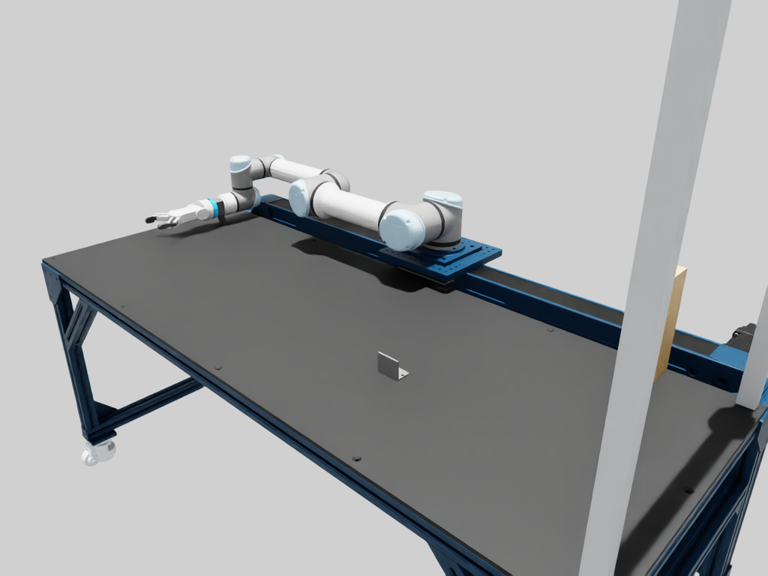

# Hardware: PCB checks, fab files, parts and renders

The `cad` toolset holds one tool, `hardware`. It runs the deterministic steps that turn KiCad, SolidCraft and mesh files
into checked outputs: `kicad-cli` ERC and DRC, a KiKit fab package with `board.step` and `board.glb`, a SolidCraft part
rebuilt from its parameters (STEP, STL and a USD in metres), and a headless Blender render.
Authoring (schematic, layout, routing, enclosure modelling, interactive Blender) stays in the servers that run **beside**
twinsmith; a client lists them as separate servers. twinsmith does not proxy their tools, vendor their code or install
them, with one owner-run exception: `scripts/install_solidcraft.sh` (below). It needs no Isaac Sim or Kit bridge.

`cad` is off by default, like every toolset but `core`. Turn it on at startup with
`TWINSMITH_TOOLSETS=default,+cad` (or add `+cad` to `tools.toolsets` in `~/.config/twinsmith/config.toml`), or for one
server process with `toolsets(action="enable", names=["cad"])`.

## What runs beside twinsmith

Each is the owner's to install, under `<workspace>/tools/<name>` with its own environment, at these pins.
`hardware(action="status")` reports every version and commit against them and never installs anything.

| Area | Server or tool | Pin |
|---|---|---|
| PCB authoring | `kicad`: mixelpixx/KiCAD-MCP-Server (MIT) | `v2.9.0` (`9dd467c`) |
| PCB checks and exports | `kicad-cli` from KiCad 10 (`ppa:kicad/kicad-10.0-releases`) | 10.0.x |
| Autorouting | Freerouting jar, called by the `kicad` server, with a Java 25 JRE in `<workspace>/tools/jre/current` | 2.5.0 |
| Fab hand-off | KiKit `fab jlcpcb` / `fab pcbway` (MIT) | 1.8.1 |
| Enclosure | `freecad`: neka-nat/freecad-mcp (MIT), `freecadcmd` on `PATH` | as installed |
| Parametric parts | `solidcraft`: tangency-labs/solidcraft (MIT OR Apache-2.0), `solidcraft-cli mcp --headless` | `v0.42.0` (`1b1e940`), tarball sha256 `5c05463c…4424b` |
| Render | Blender, `blender -b` (no add-on, port or GUI) | 5.2.x |
| Render, interactive | `blender`: the Blender Foundation's `blender_mcp` (GPL-3.0) | `v1.0.3` (`2cea8d5`) |
| Firmware | `platformio`: jl-codes/platformio-mcp (MIT), PlatformIO Core | `v3.1.0` (`29d4900`), Core 6.2.0 |

Setup notes the owner follows once:

- **KiKit.** KiKit 1.8.1 resolves numpy 2.3 by default, which needs Python 3.11, while KiCad's `pcbnew` on Ubuntu 22.04 is
  Python 3.10. Make a Python 3.10 environment that sees the system `pcbnew`, and name numpy explicitly:
  `uv venv --python /usr/bin/python3.10 --system-site-packages <workspace>/tools/kikit/.venv`, then
  `uv pip install --python <workspace>/tools/kikit/.venv/bin/python kikit==1.8.1 numpy==2.2.6`.
- **KiCad library tables.** Headless KiCad has no global library tables (the GUI writes them on first run). Copy
  KiCad's templates: `cp /usr/share/kicad/template/{sym,fp}-lib-table ~/.config/kicad/10.0/`. `status` reports them.
- **Freerouting.** Run it with `FREEROUTING__USAGE_AND_DIAGNOSTIC_DATA__DISABLE_ANALYTICS=true`; its online API is never
  used.
- **`kicad` server.** `KICAD_MCP_TOOLBOXES=core` keeps its list short; toolboxes open on demand.
- **`platformio` server.** Run it with the `build_only` policy profile, which refuses flash and the serial monitor, and
  with `--disable-dashboard`. Its `run_tests` compiles native tests without running them; run `pio test -e native`.
- **SolidCraft.** `scripts/install_solidcraft.sh --register` downloads the pinned Linux x86_64 tarball, checks its
  SHA-256 (the Linux packages are unsigned and carry no attestation, so the pinned digest is the only check), unpacks it to
  `<workspace>/tools/solidcraft/`, points `current` at it and links `solidcraft` and `solidcraft-cli` into `~/.local/bin`,
  without sudo. `--register` then runs `scripts/register_solidcraft_mcp.py`, which adds
  `solidcraft-cli mcp --headless --allow-path <workspace>/projects` to Claude Code, Codex, OpenCode, Claude Desktop,
  Antigravity and T3's Antigravity copies (whichever exist; an existing entry is kept). Headless needs no control-channel
  token; it renders screenshots on the GPU. Not `--allow-any-path`: the server then reaches only that folder, its
  scratch folder and the folders of designs it opens or saves. The desktop app, when started, adds a plain
  `solidcraft-cli mcp` entry (bridged when the app runs) to clients that have none and leaves entries it did not write
  alone; Settings › Assistant turns that off. To
  move to a new release, change the two pins in the script, run it again and repeat the smoke check (a 40×30×5 mm
  plate with a 4 mm hole: `measure` gives 5937.17 mm³; export STEP and STL; `screenshot`).
- **`blender` server and FreeCAD.** Their sockets are localhost and unauthenticated: start them only while in use.

## Client configuration

`hardware` comes with twinsmith; add `+cad` to the toolsets of the twinsmith entry the client already has
([client configuration](MCP-SERVER.md#4-client-configuration)):

| Client | Where |
|---|---|
| Claude Code | `"TWINSMITH_TOOLSETS": "default,+cad"` in the `env` of the `twinsmith` entry (`~/.claude.json` or `.mcp.json`) |
| Codex | `TWINSMITH_TOOLSETS = "default,+cad"` under `[mcp_servers.twinsmith.env]` in `~/.codex/config.toml` |
| OpenCode | `"TWINSMITH_TOOLSETS": "default,+cad"` in the `environment` of the `twinsmith` entry in `opencode.json` |

Keep any toolsets the entry already names (`default,+sim,+cad`). The beside servers are separate entries, each started
the way its own README says at the pin above.

## Actions

Every answer is `{ok, tool, action, versions, result | error, warnings}`.

| Action | Runs | Answer |
|---|---|---|
| `status` | Only `--version` probes and `git rev-parse` | The path and version of `kicad-cli`, KiKit, `freecadcmd`, `blender`, Java, Freerouting, `pio` and `solidcraft-cli`; the beside checkouts' commits against the pins; whether KiCad's global library tables exist; what is missing, and this page |
| `check` | On the board's own schematic: `kicad-cli sch erc` and `kicad-cli pcb drc --schematic-parity --refill-zones`, JSON, in a temporary folder | Counts by severity for each, unconnected and parity counts, and the first violations, errors first. `ok` is false when there is any error. The board is not saved |
| `fab` | `check`, then `kikit fab <vendor> --assembly --schematic <sch> --field LCSC --missingError <pcb> <folder>/<vendor>`, then `kicad-cli pcb export step` and `glb` | A new folder with the vendor's Gerber zip, BOM and CPL, `board.step`, `board.glb` and the two check reports. Refuses with `CHECK_FAILED`, and writes nothing, on any check error |
| `render` | `blender -b --factory-startup -P hardware_render.py -- --out <folder>/render.png --size WxH --samples N <inputs>` | A `job_id`: follow it with `jobs(action="status", job_id=..., wait_s=30)` and stop it with `jobs(action="cancel")`. Uses the GPU |
| `part` | `solidcraft-cli run parameters.json --in <design.sc> --out part.step --out part.stl`, then `eval` and `snapshot` with the same script; then `part.stl` to `part.usda` in the mesh worker | A new folder with `part.step`, `part.stl` (millimetres), `part.usda` (metres, Z up, one mesh, no physics), `measure.json`, `preview.png` and `parameters.json`; each body's volume and bounding box; the changed parameters (from, to, unit); the design's sha256; the next call. A few seconds, no job |

`part` takes `design`, an absolute `.sc` path, and `parameters`, `{name: number}` in each parameter's own unit (mm or
deg). Each must be a user parameter the design already has: a name it lacks is refused with `UNKNOWN_PARAMETER` and the
list of its names, before anything runs (SolidCraft itself would add it as a new, unused parameter). A feature that no
longer builds fails the rebuild with `PART_FAILED` and its message, and leaves no folder. `output` puts the folder inside an
approved folder instead of `runs/hardware`, so the `assets` tools can read it. The design file is not copied there: a `.sc`
file is a zip, and any zip in an approved folder makes `assets__import_path` refuse that folder (`UNSUPPORTED_ARCHIVE`).
Without the `mesh` extra `part` still writes STEP and STL, and its warning says why `part.usda` is missing.

`board` is an absolute `.kicad_pcb` path; its schematic is always the `.kicad_sch` beside it with the same name (no other
schematic is accepted, so ERC, the DRC parity check and the BOM read the same file). `fab` fingerprints both files before
the check and refuses with `INPUT_CHANGED` if either changes before KiKit runs. `vendor` is
`jlcpcb` (default) or `pcbway`. A part without an `LCSC` field fails `fab` (`--missingError`); leave a part out of
assembly in KiCad (exclude it from the BOM and position files) rather than guessing a number.

`render` takes up to eight `.glb`, `.gltf` or `.stl` inputs. GLB and glTF are read in metres (KiCad's `board.glb` is);
STL is read in millimetres and scaled to metres. Convert a STEP file to GLB first (`kicad-cli pcb export glb` for a
board). The template sets a floor, three area lights and a camera from the front right, uses Cycles on OptiX when a
device answers and the CPU otherwise, and writes only the PNG. Like `isaaclab__launch`, it refuses to start next to
another GPU job or a running simulator unless `allow_concurrent_gpu=true`.

**Limits.** Only the board, its schematic and the render inputs are checked against the approved folders. Files those name
(hierarchical sub-sheets, project library tables, 3D models embedded in `board.step` and `board.glb`, glTF buffers) are read
from wherever they point. The child environment keeps `PATH`, `HOME`, the GPU selection, KiCad's `KICAD*_DIR` and
`KICAD_CONFIG_HOME`, `XDG_CONFIG_HOME` and the locale; everything else, credentials included, is dropped.

**Into the twin.** `board.glb` and an enclosure's STL or glTF are mesh props that `assets__import_path` already imports
([formats](ASSET-IMPORT.md)). STEP through Isaac Sim's CAD converter is not supported.

## From a SolidCraft part to the work cell

The design is made in the `solidcraft` server beside twinsmith (its own MCP tools: `set_parameter`, `batch`, `measure`,
`save`); twinsmith takes the saved file from there. Keep two approved folders, one for designs and one for what the twin
loads, because a design is a zip (above):

```
<project>/cad/   bracket.sc                      approved: hardware part reads it
<project>/twin/  part-h50/  usd-decimated/  usd-split/   approved: assets tools write and import here
```

1. In `solidcraft`: name every size a user parameter, `measure` against the numbers you expect, `save` to `<project>/cad/`.
2. `hardware(action="part", design="<project>/cad/bracket.sc", parameters={"H": 50}, output="<project>/twin/part-h50")`.
3. `assets__mesh(action="decimate", source_path=".../part-h50/part.usda", ratio=0.5, output="<project>/twin/usd-decimated")`
   (optional: render cost only), then `assets__mesh(action="split", source_path=".../part_decimated.usdc",
   output="<project>/twin/usd-split", collision={"method": "coacd"})`. Both are jobs: wait with `jobs(action="status")`.
4. `assets__validate(source_path=".../usd-split/part_decimated.usda", engine="newton")`.
5. In the scene (`sim` toolset): `workcell__cell(action="quick_start")`, `assets__import_path` with that file, then
   `sim__prim(action="set_transform")`, and `sim__physics(action="apply", rigid_body=true, mass=...)` for a loose part. Set
   it on its support or at most a centimetre above it. Initialise the timeline (`sim__timeline` play, then pause) before
   `sim__simulation(action="step")`.

Checked on 2026-11-14 with SolidCraft 0.42.0, Isaac Sim 6.2.0.0 and Newton 1.6.1: a 60 × 40 × 50 mm wrist-camera bracket
stub (698 triangles, 348 after decimation, 10 CoACD hulls, `assets__validate` with no errors or warnings) rested on the
cell's bench at 500 Hz with a contact force of 0.245 N for its 25 g. Dropped from 5 cm, the same thin-walled part was
thrown off the bench, which is why step 5 says a centimetre.



## Safety

- No action orders, quotes, uploads or flashes, and none opens a network connection. There is no `extra_args` and no
  free-form argument: every command line is built from the arguments above.
- The child process gets a scrubbed environment: only `PATH`, `HOME`, the GPU selection variables
  (`CUDA_VISIBLE_DEVICES`, `NVIDIA_VISIBLE_DEVICES`, `NVIDIA_DRIVER_CAPABILITIES`) and the Freerouting analytics opt-out.
  No credentials, no `ROS_DOMAIN_ID`, no Python environment of the server.
- Inputs must be inside a folder the user approved for asset import (`TWINSMITH_ASSET_CONFIG`, listed by
  `assets__library(action="roots")`); a path outside them is refused with `ROOT_NOT_APPROVED` and the command that
  approves it. Only the user can approve a folder.
- Outputs go to a new folder, `<workspace>/runs/hardware/<name>` (default a timestamp and the board's or design's name),
  or for `part` to a new `output` folder inside an approved folder. An
  existing folder is refused with `OUTPUT_EXISTS`; nothing is overwritten, and `kicad-cli` never gets `--force`.
- `fab` output is a set of files for the owner. Sending it to a fab house is the owner's step, outside twinsmith. JLCPCB
  rotation corrections and stock lag the live site: check them before ordering.

## Configuration

`kicad-cli`, `blender`, `freecadcmd` and `pio` are found on `PATH`, KiKit at `<workspace>/tools/kikit/.venv/bin/kikit`,
Java at `<workspace>/tools/jre/current/bin/java`, the Freerouting jar in `<workspace>/tools/freerouting/` and
`solidcraft-cli` on `PATH`, else at `<workspace>/tools/solidcraft/current/bin/solidcraft-cli`. Three overrides:
`TWINSMITH_KIKIT`, `TWINSMITH_BLENDER` and `TWINSMITH_SOLIDCRAFT` ([environment](ENVIRONMENT.md)). `TWINSMITH_WORKSPACE` selects the
workspace.

## KiCad 11

KiCad 11 (expected early 2027) removes the SWIG `pcbnew` module that KiKit and the `kicad` server's headless backend use.
Keep KiCad on 10.0.x and these pins until both support KiCad 11, then repeat the checks on a known board.
