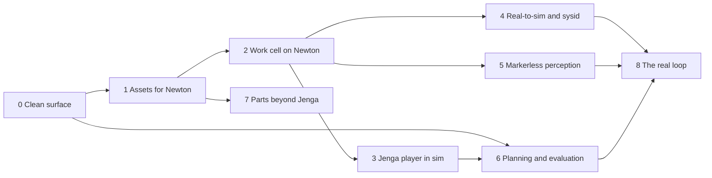

# Roadmap

Where twinsmith is going, as phased milestones. Each phase has a goal, a scope, exit criteria that can be checked, and what it
depends on. The target tool layout is in [How it works](ARCHITECTURE.md#target-layout-planned); the next pull requests are
specified in [plans/](plans/README.md); unfinished details stay in [open items](OPEN-ITEMS.md).

Checked against `origin/main` at `33ff56e` on 2026-11-13, and updated after the computer-use pull request (#108) merged as
`6e8a3e2`. A phase is a goal, not a queue position: the order of work is the
[pull request queue](#pull-request-queue).

## The thesis in one paragraph

A UR5e plays Jenga. The simulated cell is the lab's cell: the Vention bench, the Bota force-torque sensor, the OnRobot RG2 with
its finger pads, a wrist and an overhead D415, and 54 blocks that each differ a little in size, mass and friction, as real
blocks do. It runs on Newton's MuJoCo-Warp solver. Perception is markerless. Real recordings tune the simulation offline
(system identification), a planner and a benchmark run in simulation, and the loop closes on the real robot only through ROS 2
code the owner has approved.

## Ground rules

These hold in every phase. A plan that breaks one is wrong.

| Rule | What it means here |
|---|---|
| Lean code | Unused code is deleted, not moved aside. One name per thing: no aliases, no "legacy" folder, no stub that answers "not implemented". |
| Off by default | Every group of tools is off until asked for, except `core`. |
| Assets outside the repository | Versioned packs, referenced by id. A changed asset is a new pack version. |
| Newton first | Newton is the default engine; PhysX is an opt-in fallback, never a silent one ([statement](COMPATIBILITY.md#target-engine)). |
| Markerless | No AprilTags or other fiducials, in the cell or in the scene. |
| No agent on the real robot | The robot runs only approved ROS 2 code. Real data improves the simulation offline. The owner approves each export. |
| Wrap what moves fast | Young research tools are pinned sibling checkouts with their own environments under `<workspace>/tools/`. Nothing is vendored. |
| Replicate what is mature | Stable patterns (desktop and computer use, mesh preparation, validation) are built natively. |
| Attribute | MIT code copied in is recorded in [THIRD-PARTY-NOTICES.md](../THIRD-PARTY-NOTICES.md). Ideas from unlicensed projects are re-implemented, never copied. |

## Where things stand

What `origin/main` shows today. Each line is from the code or a recorded result, not a plan.

| Area | State |
|---|---|
| Tool surface | Eight groups: `core` (always on), `computer` (explicit only), `sim`, `assets`, `cad`, `real2sim`, `planning`, `eval`. No tool answers "not implemented". |
| Generic scenes on Newton | The 54-block tower holds for 10 s at 500 Hz (1.7 mm; Isaac Sim 6.2, Newton 1.6.1). Raycast is refused; a Franka joint move does not settle yet. |
| Work cell on Newton | Builds and holds since #112 (pack `ur5e-jenga-workcell/v2` and per-engine drives). Live on Isaac Sim 6.2 / Newton 1.6.1: the arm holds within 0.05 degrees at the presentation pose, the RG2 fingers move with the mimic followers within 0.003 degrees, and the tower drifts at most 0.54 mm over 11 s after settling. Not yet: the force/torque read, cameras, `mirror_real` and measured finger widths ([details](OPEN-ITEMS.md#work-cell-on-newton)). |
| Jenga variation | Seeded per-block variation of size, mass and friction exists (`measured_pending` profile); every number in it is unconfirmed. |
| Real-to-sim | `robosim` reproduced one real push by image displacement on CPU and GPU. It does not fit mass or friction, match rotation, or estimate the camera. Pinned to RoboSimStudio `87b5e32`. |
| Perception, planning, evaluation | Nothing. The work cell reads its camera configuration only. |
| Real robot | Nothing in this repository drives one, by design. Only the owner's laptop connects to it ([hosts](#hardware-and-hosts)). |

## Hardware and hosts

Two simulation PCs and one laptop. The ASU PC is the main host and stays on; the home PC is normally off and is used only
when the owner is at it. **Nothing on the critical path may depend on the home PC being reachable.** Neither PC is connected
to the UR5e: both are simulation-only. The owner's laptop is the only machine that connects to the real robot. Machines are
named by role here, not by hostname.

| | ASU PC (main, always on) | Home PC (normally off) |
|---|---|---|
| Runs | RoboSimStudio, real-to-sim, `sysid`, heavy simulation, Graph-as-Policy and VABAR, and the Jenga games | Development and short checks while the owner is there |
| GPU | NVIDIA RTX PRO 6000 Blackwell Max-Q Workstation Edition, 97,887 MiB, driver 595.99.02 | RTX 5080, 16 GB, as the repository's recorded test machine. Not re-verified from here |
| System | Ubuntu 22.04.5, 32 CPU threads, 125 GiB of memory | Ubuntu 24.04.5, as recorded |
| Installed | Isaac Sim 6.0.0.0 to 6.2.0.0, Isaac Lab 2.3.2 and 3.0.0, RoboSimStudio at `87b5e32`, work-cell pack `v1`, the twinsmith host | Not verified from here |

The ASU column was read on that machine on 2026-11-13 (`nvidia-smi`, `scripts/env.py find`, the checkouts themselves).

**The robot boundary** (the owner's statement of the lab's wiring; it cannot be read from either PC).

| Machine | Connected to the UR5e | ROS 2 | Agent path to ROS 2 |
|---|---|---|---|
| ASU PC | No | Installed; simulation traffic only | twinsmith's ROS 2 tools in `sim`, and nothing else |
| Home PC | No | Installed; simulation traffic only | twinsmith's ROS 2 tools in `sim`, and nothing else |
| Laptop | **Yes, and it is the only one** | Only code the owner has approved | **None.** No agent runs here and twinsmith is not installed here |

**No agent-facing ROS MCP server is installed on any of these machines**: nothing that gives an agent tools to publish, call
services or send action goals. twinsmith's own ROS 2 tools in `sim` are the only agent path to ROS 2. They are off by default, they work
inside the simulator, and they exist only on the two PCs.

twinsmith and everything in this roadmap run on the two PCs. Nothing here is installed on the laptop.

**Limits, stated plainly.**

- **The ASU PC's GPU is shared with Jenga games.** One was running when this was written (an Isaac Sim 6.2 process holding
  3.4 GiB). A running game is never disturbed: GPU runs are scheduled around games, and every GPU job uses the existing guards
  (`min_free_vram_mb`, `wait_for_vram_s`, `allow_concurrent_gpu` only when the owner says so).
- **The ASU PC's workspace is still in the old layout.** The move to `<home>/robotics-workspace` waits for a moment with no
  game running. Until then `<workspace>` on that machine is the old folder and must be named with `TWINSMITH_WORKSPACE`;
  without it `scripts/env.py find` finds no install.
- **Graph-as-Policy does not run on the home PC.** It asks for 24 GB of GPU memory and the RTX 5080 has 16 GB. It runs on the
  ASU PC only, and it and VABAR are not installed there yet.
- **The home PC cannot host anything unattended:** no scheduled job, no long run, no service another step waits for.
- **No recorded Newton result is from the ASU PC.** The work-cell probe names an RTX 5080; the tower hold does not record
  its GPU. Each is rerun on the ASU PC's GPU, driver and Ubuntu release before it counts as that host's baseline.

**Open.**

- [ ] We'll refine this as we go: per-phase GPU memory and run times once measured, and a rule for booking the GPU around games.
- [ ] Finish the ASU PC's workspace move when no game is running.
- [ ] Verify the home PC's row on that machine the next time it is on.
- [ ] Not established here: which machine the lab's D415s are attached to for recording, how recordings travel from the
  laptop to the ASU PC, and whether the ASU PC has a desktop session for the `computer` group.

## The phases

### Phase 0: a clean surface

**Goal.** One naming pass and one grouping pass, so every later tool lands in its final place and nothing is renamed twice.

**Scope.**
- Done: the computer-use pull request (#108) merged on 2026-11-13.
- Done: every group off by default except `core`, and the three work-cell stubs deleted (#120).
- Done in the tool-groups pull request: the eight final groups (`core`, `computer`, `sim`, `assets`, `cad`, `real2sim`,
  `planning`, `eval`) and the shorter names (`simulators`, `sim__timeline`, `sim__viewport`, `sim__ros2_tf`,
  `sim__occupancy_map`), with no aliases. The table of old names to new is in [TOOLSETS.md](TOOLSETS.md#renamed-toolsets).
- Done: twinsmith is the only name; the earlier names and their compatibility layer are gone (#113 and its follow-ups).

**Exit criteria.**
- A fresh install lists only `core`; `status` names every other group and how to turn it on.
- No registered tool answers "not implemented". No toolset is listed as "planned" without a plan in `docs/plans/`.
- The README has one generated table of group to tools. `check_docs.py`, `check_names.py --enforce` and the host suite pass.
- The listed size of each group is measured with `scripts/measure_tool_list.py` and recorded in [TOOLSETS.md](TOOLSETS.md).

**Depends on.** Nothing still open: #108 has merged.

### Phase 1: assets that load on Newton

**Goal.** An asset keeps its detailed mesh for rendering and gets a separate, simple collision layer, and a check says whether
it will load on Newton before a simulator is started.

**Scope.**
- `mesh` in the `assets` group: inspect, decimate, convex hulls (CoACD) or fitted boxes, and split into render and collision
  layers. `validate` in the same group: USD structure plus the Newton limits found in the probe. Done in #112.
- Rebuild the work-cell pack as a new version: the bench renders from its full mesh and collides with boxes or hulls.

**Exit criteria.**
- On a CPU, with no simulator: `validate` fails pack `v1` for the bench's triangle count, the zero-force drives and the nested
  articulation, and passes the new version.
- Live, recorded: the new pack's bench loads on a Newton session with no triangle-pair overflow, and a render of the bench is
  visually unchanged from `v1`.
- The collision layer's shape count and triangle count are in the pack manifest's `fidelity` field.

**Depends on.** Nothing in Phase 0 blocks it; the `assets` group already exists.

**Status.** Done (#112):
- `validate` flags `v1`'s faults.
- Pack `v2` has a box collision layer, and its bench loads on Newton with no overflow.
- The render comparison and the manifest's collision counts are not recorded yet.

### Phase 2: the work cell on Newton

**Goal.** The lab-faithful cell (bench, arm, sensor, gripper, both cameras, tower) builds and runs on Newton, and the refusal
is deleted.

**Scope.** The open list in [Work cell on Newton](OPEN-ITEMS.md#work-cell-on-newton): one articulation for arm and gripper,
explicit drive gains, an RG2 closed chain that Newton can move (equality or mimic constraints), the flange force and torque
read, finger contact reads from Newton's contact snapshot, per-engine friction profiles in the hardware configuration,
wrist and overhead renders, then `workcell_smoke.py` on both engines.

**Exit criteria.**
- `workcell__cell(action="quick_start")` builds on a Newton session; the refusal in `workcell/scene.py` is gone.
- The tower in the cell holds 10 s at 500 Hz with at most 1 mm block drift and no contact overflow (the probe measured 0.2 to
  0.3 mm).
- The gripper reaches measured finger widths at open, mid and closed within 1 mm.
- At rest the flange wrench equals the weight below the sensor within 5 percent, on both engines.
- Cell, wrist and overhead renders exist for Newton; the PhysX smoke still passes; both run reports are kept.

**Status.** #112 met the build and tower criteria:
- The refusal is gone, and the cell builds and holds on Newton.
- The tower drifts 0.54 mm.
- The finger widths and the Newton renders are still open. The flange wrench passes the static check on both engines.

**Depends on.** Phase 1 (the bench must load).

### Phase 3: a Jenga player in simulation

**Goal.** A full turn (choose a block, push, extract, place on top) in the Newton cell, measured across seeds with realistic
block variation.

**Scope.**
- Replace the unconfirmed variation numbers with measured ones: weigh and measure a sample of real blocks; friction comes from
  Phase 4.
- Define the thresholds the open items ask for: push and extraction success, tower stability, settling time.
- A scripted baseline turn, and a gripper command by width and force. The player itself (policies, checkpoints, run data)
  lives in its own project, not in this repository; twinsmith provides the cell, the tower, the reads and the job tools.

**Exit criteria.**
- The variation profile's fields are `confirmed` with a source, or explicitly still `unconfirmed`.
- The scripted baseline reports a success rate over at least 30 seeds, with failures classified (missed push, tower
  collapse, dropped block), on a recorded Newton run.
- One held-out variation set (geometry, pose, friction) is evaluated and reported separately.

**Depends on.** Phase 2.

### Phase 4: real-to-sim and system identification

**Goal.** Recorded real data sets the simulation's physical parameters, offline, with a number that says how much closer the
simulation got.

**Scope.**
- Bump RoboSimStudio from `87b5e32` and call its module entry point; add `sysid` in the `real2sim` group on MuJoCo's official
  system identification module ([plan](plans/04-robosim-bump-and-sysid.md)).
- First target: the arm's joint parameters (damping, armature, friction loss, gains) from recorded joint trajectories, because
  that data needs no perception. Second target: block mass and friction from push recordings, once Phase 5 gives object poses.
- A data contract for approved exports: a folder of episodes the owner copies off the laptop, the one machine connected to
  the robot. No tool reads the robot.

**Exit criteria.**
- On synthetic data with known parameters, `sysid` recovers each within 5 percent, in a CPU test.
- On real joint logs, the fitted model's tracking error is lower than the default model's on held-out episodes, and the
  fitted values enter `lab_hardware.json` as `confirmed` with their source.
- `robosim` runs at the new pin on CPU with the same push result as before, within its own tolerance.

**Depends on.** Phase 2 for the simulated arm to compare against. The `robosim` bump depends on nothing.

### Phase 5: markerless perception

**Goal.** Block poses and the tower's state from the two D415s, with no fiducials, tested in simulation first, where the truth
is known.

**Scope.**
- A pose service in its own process and environment (FoundationPose has a research-only licence, so no code or weights enter
  this repository). twinsmith holds a small client: `perception` in the `real2sim` group.
- The block mesh comes from the pack. Rendered frames from the cell's cameras are the first test set; recorded real frames are
  the second, offline.
- Tower state: which of the 54 blocks are present, and each pose.

**Exit criteria.**
- On rendered frames with ground truth: median block pose error at most 2 mm and 2 degrees for visible blocks (proposed
  thresholds; set them from what a push tolerates in Phase 3).
- On recorded real frames: reprojected block outlines overlap the image masks (reported as IoU), with failures listed.
- The service runs, stops and reports its version from one tool; with the service absent the tool says so and nothing else
  breaks.

**Depends on.** Phase 2 (the cameras) and Phase 1 (the block mesh in a pack).

### Phase 6: planning and evaluation

**Goal.** Graph-as-Policy plans in simulation and VABAR scores it, both wrapped at pinned commits, with a Jenga task of our
own evaluated the same way.

**Scope.**
- `gap` in the `planning` group and `vabar` in the `eval` group: one grouped tool each, the upstream command line in its own
  environment, simulation only ([plan](plans/03-planning-eval-wrappers.md)).
- Reproduce one published VABAR cell to prove the stack before measuring anything of ours.
- Express a Jenga turn as a skill graph and evaluate it with the Phase 3 protocol.

**Exit criteria.**
- `gap` refuses every real-robot option by name, proven by a test; no free-form arguments reach the command line.
- One VABAR cell reruns from the tool with a result recorded next to the published number.
- A Jenga skill graph runs in simulation and its results sit in the same table as the scripted baseline.

**Depends on.** Phase 0 (the groups) and Phase 3 (the task). It runs on the ASU PC only
([hardware and hosts](#hardware-and-hosts)).

### Phase 7: parts beyond Jenga

**Goal.** A new part goes from CAD to a validated pack to the cell without hand editing.

**Scope.** STEP and IGES through Isaac Sim's own CAD converter as a format on `assets__import_path`; then the Phase 1 mesh
preparation and validation; then a pack. CAD authoring stays in separate servers (FreeCAD, build123d) beside twinsmith. Parts
without CAD can come from an image-to-mesh model run outside the repository.

**Exit criteria.** One fixture designed in FreeCAD is exported, imported, validated for Newton, packed and used in the cell,
with every step a listed tool call.

**Depends on.** Phase 1.

### Phase 8: the real loop

**Goal.** Real to sim to real: the simulation is tuned from real data, behaviour is developed and scored in simulation, and
the real robot runs the result as approved ROS 2 code.

**Scope.**
- The same ROS 2 interfaces in simulation and on the robot, so approved code is the only thing that crosses.
- An export step the owner runs and approves each time, in each direction: recordings out of the lab, code into it.
- A comparison of the same turn in simulation and on the robot, feeding Phases 4 and 5 again.

**Exit criteria.**
- A complete Jenga turn on the real UR5e, started by the owner, running code that passed in simulation first.
- A written record of each export: what, when, who approved it.
- The simulated and real outcomes of the same turn compared in one report.

**Depends on.** Phases 4, 5 and 6.

## Pull request queue

| Order | Pull request | Phase | Plan |
|--:|---|---|---|
| 0 | Computer use (#108, merged 2026-11-13) | 0 | Done |
| 1 | Mesh preparation, validation, and the work-cell pack rebuild | 1 | Merged as #112 (with the work cell on Newton) |
| 2 | Toolset groups, stubs deleted, README table | 0 | Merged as #120; the final groups and names follow in the tool-groups pull request |
| 3 | `gap` and `vabar` wrappers | 6 | [03-planning-eval-wrappers](plans/03-planning-eval-wrappers.md) |
| 4 | RoboSimStudio bump and `sysid` | 4 | [04-robosim-bump-and-sysid](plans/04-robosim-bump-and-sysid.md) |

Items 3 and 4 do not depend on each other. Later candidates, not yet specified: a bridge lease so parallel agents cannot
interleave changes in one Kit (`use_bridge` with `hold` and `release`), a step that returns observations in the same call,
semantic clicks through the desktop accessibility tree, the CAD format, the pose service, and dataset export.

## Where the survey and the repository disagree

The plan was drafted from a survey dated 2026-11-13. Where it and the code differ, the code wins:

| Survey | Repository |
|---|---|
| Decimate the bench so 1.63 M triangles fit Newton's 1 M buffer | The buffer counts triangle **pairs**: 7,500,052 were needed against 1,000,000, across 385 mesh colliders. Convex hulls per mesh are what the probe showed to work. Decimation helps rendering cost, not this limit; the fix is the collision layer. |
| The work cell's perception tool is a stub | It is implemented: it reports the camera configuration. Only the `real2sim`, `planning` and `eval` tools of the work cell are stubs. |
| Add smoke checks for `screen` and `kit_debug` | Groups with no live smoke check: `assets`, `computer`, and the ROS 2, code, log and UI tools of `sim`. |
| Fit with `sysid` on RoboSimStudio's CPU runs | RoboSimStudio's own project file notes MuJoCo 3.15 in its lock; the system identification module arrives with MuJoCo 4.0.1. `sysid` needs its own environment. |
| Extend `doctor` | `doctor` arrived with #108 and checks desktop readiness only. The versions of wrapped tools belong in `status`. |
| Toolsets are off by default (owner's rule) | Done in #120: only `core` is on by default. |

Confirmed as the survey said, on 2026-11-13: RoboSimStudio `main` is `4e52e1a`, 13 commits past the pin, and requires
`newton[sim]>=1.7,<1.8` and `coacd==1.0.11`; Newton `v1.8.0` was released on 2026-11-11; Graph-as-Policy's `gap run` has a
`--real` option with `franka` and `ur_zed`; VABAR's README pins forks of Graph-as-Policy (`06dd619`) and its skill library
(`b15859a`).

## Decisions

Decided by the owner on 2026-11-13.

1. **`cad` is a group.** It holds one tool, `hardware`, which wraps `kicad-cli`, KiKit and a headless Blender
   (plan 05, in pull request #110). CAD authoring stays in the separate servers beside
   twinsmith (FreeCAD, KiCad, Blender), and STEP and mesh import stays a format on `assets__import_path`. Like every group
   except `core`, it is off in the shipped `default`; the owner's own client configurations turn it on.
2. **`default` lists only `core`.** The `minimal` profile is deleted because it equals `default`, and `extensions` is off.
3. **One Graph-as-Policy checkout**, at VABAR's pins, for both `planning` and `eval`, until a planning need forces a second.
4. **ROS 2 is part of `sim`.** It was its own group (`ros2`) until the owner's final grouping later the same day; its tools
   still work only inside the simulator, with the loopback-only DDS settings.
5. **Graph-as-Policy runs on the ASU PC.** It asks for 24 GB of GPU memory: the ASU PC has about 96 GB, the home PC's RTX 5080
   has 16 GB. See [hardware and hosts](#hardware-and-hosts).
6. **Old toolset names are not aliased.** A configuration that names `scene`, `physics` or another removed group stops the
   server at startup with the list of valid names; [TOOLSETS.md](TOOLSETS.md) gets one table of old to new.
7. **The `planned` list in `status` is deleted.** `planning`, `real2sim` and `eval` become real groups; `backend`, `params` and
   `compare` had no plan.
8. **The desktop group is `computer`.** The owner's final grouping joined `screen`, `input` and `launch` into one
   explicit-only group: screenshots, windows, mouse and keyboard, and simulator launch. `computer` is also the name of its
   mouse-and-keyboard tool.
