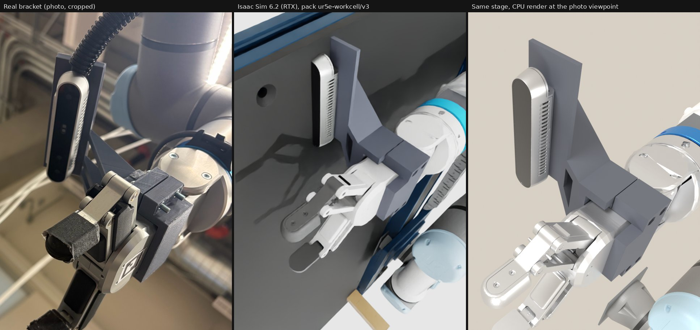

# Wrist camera bracket (CAD)

| File | What it is |
|---|---|
| `rg2_camera_bracket.py` | **Current.** Parametric FreeCAD model of the real printed bracket: a two-piece clamp on the RG2 body, a truss arm and a plate for the D415. Pack `ur5e-workcell/v3` |
| `wrist_bracket.py` | Superseded placeholder (a ring on the wrist 3 housing). Kept only so `scripts/workcell_camera_assets.py` can rebuild pack `v2` |
| `bracket_real_vs_sim.jpg` | The real bracket (photo, cropped to the wrist) beside the simulated one from the same viewpoint: an Isaac Sim 6.2 capture of the built cell, and a CPU render of the same builder output |



What still differs: the simulated arm is in its zero pose and the gripper is nearly closed (the photo has the wrist
turned up and the gripper open); the printed blocks and the truss are a reconstruction, squarer and heavier than the
real ones; the bolt ends, the hot glue at the foot of the arm, the cable and the AprilTag are not modelled; the Isaac
panel is cropped from a wider 1024 x 768 capture taken from the same point.

## What the bracket is

Read from one photo taken from below, and three photos of the wrist before the bracket was fitted. Confidence: high
that it is a clamp on the gripper, moderate on its sizes, low on the camera's tilt.

- It is a **clamp collar around the RG2 body**, not a plate between flange faces. The gray printed part sits below the
  rounded side arm of the RG2's own mounting bracket (the silver face with two countersunk screws in the photo is that
  arm, seen from the side) and above the finger pivots. So the tool stack and the tool kinematics are unchanged, and
  the camera turns with the gripper.
- Two printed pieces with a visible split, pulled together by cross bolts that run through the body's thickness; two
  bolt ends are visible on one side of the body. The piece on the front face (the face with the AprilTag) is the
  larger block and reaches down the front face to the tag; the piece on the back face carries the arm.
- A triangulated arm with an open window runs from the back piece to a thin flat plate. The D415 is screwed to the
  plate, off the face opposite the AprilTag and displaced to one side.
- The camera looks along the gripper's approach axis with its long axis along the finger-opening axis. The colour
  sensor end is nearer the gripper's centre and the USB-C end is outboard. The side with the unbroken row of vent slots
  (the top of a D415) faces the gripper, so the gripper is toward the top of the image.

The model reproduces that arrangement and the camera pose. It is not a copy of the lab's own CAD file (which has not
been seen): the shapes of the blocks and of the truss are a printable reconstruction.

## Sourced dimensions

| Value | Source |
|---|---|
| RG2 body 54 mm wide and 36 mm thick where the collar sits; 65 mm wide lower down; mounting bracket 75 mm wide; 132 mm from the mounting plane to the lower end of the body; two M3 holes 20 mm apart on the front face | OnRobot RG2 datasheet v1.8, section 1.3: <https://onrobot.com/storage/datasheets/rg2/datasheet_rg2_v1.8_en.pdf> |
| D415 body 99 x 23 x 20 mm, 64 g; two M3 mounting points on the back, 45 mm apart, maximum insertion depth 3 mm; 1/4-20 thread on the underside | Intel RealSense D400 Series Datasheet rev 017 (September 2023), table 3-51 and figure 10-8: <https://www.realsenseai.com/wp-content/uploads/2023/10/Intel-RealSense-D400-Series-Datasheet-September-2023.pdf> |
| D415 colour sensor 14.5 mm from one end of the body, back face 10.2 mm behind the optical origin | RealSense's own mesh and URDF offsets (the pack's `d415` asset, `scripts/workcell_camera_assets.py`) |
| Quick Changer robot side: diameter 71 mm, 13.6 mm from the robot flange to the tool; tool side diameter 63 mm | OnRobot Quick Changers datasheet v2.0, sections 1.3 and 1.7: <https://onrobot.com/storage/datasheets/quick-changers/datasheet_quick_changers_v2.0_en.pdf> (context only: the bracket does not touch it) |
| UR5e tool flange EN ISO 9409-1-50-4-M6, M8 8-pin tool connector | Universal Robots UR5e technical specification: <https://www.universal-robots.com/media/1807465/ur5e_e-series_datasheets_web.pdf> (context only: the bracket does not touch it) |

Not confirmed in a vendor document: the pack's RG2 mesh puts the top of the Quick Changer tool side 16 mm above the
datasheet's mounting plane, and the arms of the mounting bracket end 53 mm below that plane (read off the datasheet
drawing, which gives no number for it).

## Estimated from photo, measure to confirm

Scale and viewpoint: the photo's viewpoint was solved from four RG2 features whose positions are known (the two screws
on the mounting bracket's side arm and the two M3 holes on the front face), assuming the phone's main lens (the file
has no focal length). An overlay of the pack's RG2 on the photo from that viewpoint agrees closely at the body and the mounting bracket. Lengths were then
read against the D415 (99 mm) and the RG2 body in the same image. All values are in the CAD frame of
`rg2_camera_bracket.py`: +Z toward the fingertips, +X the finger-opening axis, +Y out of the front (AprilTag) face.

| Parameter | Value | How it was scaled | Uncertainty |
|---|---|---|---|
| Camera body centre behind the tool axis (`cam_y`) | 66 mm (48 mm from the RG2's back face to the camera's centreline) | The two ends of the 99 mm body back-projected from the solved viewpoint | 15 mm |
| Camera body centre along the finger-opening axis (`cam_x`, body centre) | 68 mm to one side of the tool axis (the side of the visible bolts) | Same | 15 mm |
| Camera glass along the approach axis (`cam_z` + 10 mm) | 21 mm above the lower end of the RG2 body | Same; mostly along the line of sight, so the weakest of the three | 15 to 20 mm |
| Camera roll (long axis along the finger-opening axis) | 0 degrees | The back-projected ends differ from that axis by 10 mm over 99 mm | 6 degrees |
| Camera tilt toward the gripper | 0 degrees | Not resolved: the plate's short edge is blurred and its direction disagrees with the solved viewpoint by more than a tilt would explain | 15 degrees |
| Camera turned 180 degrees about its optical axis (gripper toward the top of the image) | yes | Lens order on the glass, USB-C end, vent slots | A yes or no, moderate confidence |
| Collar position on the body (`clamp_z0`, `clamp_z1`) | 56 to 82 mm below the mounting plane | Between the end of the mounting bracket's arm and where the body widens; the photo shows the collar touching both | 5 mm |
| Front bar reaching down the front face (`front_bar_extension`) | 18 mm | The block hides the edge of the AprilTag nearest the Quick Changer | 8 mm |
| Bolt size and number | M4, two each side, 13 mm apart | Thread width against the countersunk screws beside it; only one side is visible | Size: one step; the far side is assumed |
| Wall beside the body (`ear_width`), bars (`front_thickness`, `back_thickness`) | 14 mm, 10 mm, 10 mm | Against the 36 mm body thickness | 4 mm |
| Plate (`plate_length`, `plate_width`, `plate_thickness`) | 100 x 41 x 3.5 mm | Against the camera in front of it (99 x 23 mm) | 5 mm, 5 mm, 1 mm |
| Plate overhang past the camera's cable end (`plate_shift_to_usb_end`) | 8 mm more than at the other end | Same | 5 mm |
| Truss shape (`truss_member`, `truss_root_x`, tip) | 6 mm members, one triangular window | Reconstruction: the photo shows a triangular gusset and an open window, not their sizes | Not measured |
| Split gap, fit clearance, nut pockets, counterbores | 0.6 mm, 0.3 mm a side, M4 | Design choices, not read from the photo | Not applicable |

## What to measure, most useful first

1. Open the wrist camera's colour image with the gripper open: are the fingertips in it, and where? With no tilt the
   model shows none of the gripper. This fixes the tilt, which changes the view more than any length.
2. Camera centreline to the RG2's back face, perpendicular to the face (model: 48 mm).
3. Camera body's end nearest the gripper to the RG2 body's side face, along the finger-opening axis, and which side
   the camera is on when you look at the AprilTag face (model: the body spans 18.5 to 117.5 mm from the tool axis).
4. Camera glass to the lower end of the RG2 body (the end the fingers come out of), along the approach axis (model:
   glass 21 mm above that end).
5. Angle between the plate and the RG2's back face (model: at right angles, so the camera looks straight ahead).
6. The collar: its length along the body, the wall thicknesses, the bolt size and whether the far side also has two.
7. The plate: length, width, thickness, and where the camera's two M3 holes are on it.

## Build, print and assemble

```
BRACKET_OUT=<folder> freecadcmd exts/workcell/cad/rg2_camera_bracket.py
```

writes `clamp_front` and `camera_arm` as STEP and STL, `wrist_bracket.step` (both as mounted) and `bracket.json` (the
parameters, volumes, bounding boxes and the interference checks). The script refuses to export unless each piece is
one valid solid, the two pieces do not overlap, and neither overlaps the RG2 body, the D415 or the slab the finger
linkage moves in. Pack `v3` is built from it by `scripts/workcell_bracket_assets.py`, which takes the camera pose from
`config/lab_hardware.json`.

| Piece | Volume | Size | Prints |
|---|---|---|---|
| `clamp_front` | 42.1 cm3 | 82.6 x 28.0 x 44.0 mm | On its front face (nut pockets down), no supports |
| `camera_arm` | 87.8 cm3 | 167.2 x 81.2 x 34.8 mm | On the plate's camera face, no supports |

Hardware: four M4 socket head screws about 55 mm long with four M4 hex nuts (pressed into the pockets of the front
piece), two M3 x 6 screws for the camera (the plate is 3.5 mm and the D415 takes at most 3 mm of thread). Slide the
front piece onto the RG2's front face and the arm piece onto the back face, below the mounting bracket's arms, and
tighten the four bolts evenly; the 0.6 mm gap between the pieces must stay open. The collar is clear of the Quick
Changer's release button and of the tool connector (both more than 50 mm away, at the other end of the mounting
bracket) and of the finger linkage at any opening (the linkage stays within 16.5 mm of the gripper's mid-plane and
below the collar; the bracket is at least 1.8 mm outside that slab).
