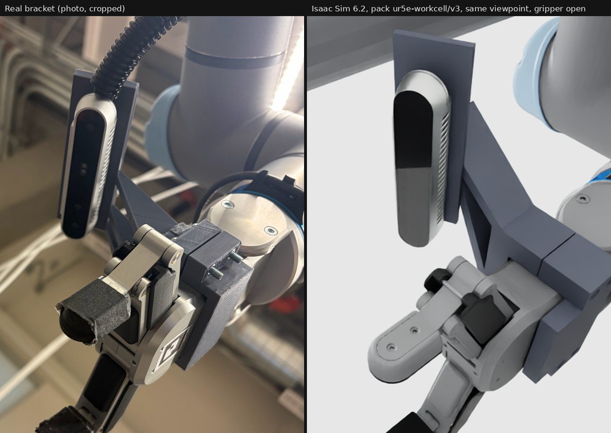
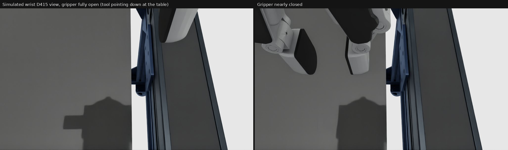

# Wrist camera bracket and the vendors' CAD

| File | What it is |
|---|---|
| `rg2_camera_bracket.py` | **Current.** Parametric FreeCAD model of the real printed bracket: a two-piece clamp on the RG2 body, a truss arm and a tilted plate for the D415. Pack `ur5e-workcell/v3` |
| `rg2_from_step.py` | Reads OnRobot's official RG2 STEP (a local copy, checked by SHA-256 by `scripts/workcell_rg2_assets.py`) and writes one mesh per link and material for the pack's RG2. Nothing of the STEP is kept here |
| `part_from_step.py` | The same for one rigid part: OnRobot's Quick Changer robot side and Bota Systems' Rokubi (`scripts/workcell_stack_assets.py`) |
| [`docs/media/workcell-rg2-front-real-vs-sim.jpg`](../../../docs/media/workcell-rg2-front-real-vs-sim.jpg) | The real RG2 from the front (photo before the bracket was fitted, cropped) beside an Isaac Sim 6.2 capture of the built cell |
| [`docs/media/workcell-base-rail-real-vs-sim.jpg`](../../../docs/media/workcell-base-rail-real-vs-sim.jpg), [`workcell-overview-real-vs-sim.jpg`](../../../docs/media/workcell-overview-real-vs-sim.jpg) | The robot's base on its rail carriage, and the whole cell, each beside an Isaac Sim 6.2 capture ([the rail](../workcell/README.md#the-rail-the-robots-base-is-a-seventh-axis)) |
| `wrist_bracket.py` | Superseded placeholder (a ring on the wrist 3 housing). Kept only so `scripts/workcell_camera_assets.py` can rebuild pack `v2` |
| [`docs/media/workcell-bracket-real-vs-sim.jpg`](../../../docs/media/workcell-bracket-real-vs-sim.jpg) | The real bracket (photo, cropped to the wrist) beside an Isaac Sim 6.2 capture of the built cell from the same viewpoint, gripper open |
| [`docs/media/workcell-wrist-view-sim.jpg`](../../../docs/media/workcell-wrist-view-sim.jpg) | What the simulated wrist D415 sees, gripper fully open and partly open |



What still differs: the simulated arm is posed with the tool horizontal, not as in the photo; the printed blocks and the
truss are a reconstruction, squarer and heavier than the real ones; the bolt ends, the hot glue at the foot of the
arm, the cable and the AprilTag are not modelled; the simulated RG2 is OnRobot's CAD with its bare standard fingertips
(the tape on the real ones is a friction value, not geometry).



The fingertips are along the top edge of the image (image down is away from the gripper). The camera is 68 mm to one
side, so with the gripper fully open the finger on the far side is just outside the image; partly open, both show.

## What the bracket is

Read from one photo taken from below, and three photos of the wrist before the bracket was fitted. Confidence: high
that it is a clamp on the gripper, moderate on its sizes and on the camera's tilt.

- It is a **clamp collar around the RG2 body**, not a plate between flange faces. The gray printed part sits below the
  rounded side arm of the RG2's own mounting bracket (the silver face with two countersunk screws in the photo is that
  arm, seen from the side) and above the finger pivots. So the tool stack and the tool kinematics are unchanged, and
  the camera turns with the gripper.
- Two printed pieces with a visible split, pulled together by cross bolts that run through the body's thickness; two
  bolt ends are visible on one side of the body. The piece on the front face (the face with the AprilTag) is the
  larger block and reaches down the front face to the tag; the piece on the back face carries the arm.
- A triangulated arm with an open window runs from the back piece to a thin flat plate. The D415 is screwed to the
  plate, off the face opposite the AprilTag and displaced to one side.
- The camera's long axis is along the finger-opening axis, and it is tilted about that axis, about 25 degrees, so it
  looks at the fingertips rather than straight ahead. The colour sensor end is nearer the gripper's centre and the
  USB-C end is outboard. The side with the unbroken row of vent slots (the top of a D415) faces the gripper, so the
  gripper is toward the top of the image.

The model reproduces that arrangement and the camera pose. It is not a copy of the lab's own CAD file (which has not
been seen): the shapes of the blocks and of the truss are a printable reconstruction. It was modelled in FreeCAD, not
SolidCraft, because the pack build regenerates the part headlessly from the config with `freecadcmd`.

## Sourced dimensions

| Value | Source |
|---|---|
| RG2 body 54 mm wide and 36 mm thick where the collar sits; 65 mm wide lower down; mounting bracket 75 mm wide; 132 mm from the mounting plane to the lower end of the body; two M3 holes 20 mm apart on the front face | OnRobot RG2 datasheet v1.8, section 1.3: <https://onrobot.com/storage/datasheets/rg2/datasheet_rg2_v1.8_en.pdf> |
| D415 body 99 x 23 x 20 mm, 64 g; two M3 mounting points on the back, 45 mm apart, maximum insertion depth 3 mm; 1/4-20 thread on the underside | Intel RealSense D400 Series Datasheet rev 017 (September 2023), table 3-51 and figure 10-8: <https://www.realsenseai.com/wp-content/uploads/2023/10/Intel-RealSense-D400-Series-Datasheet-September-2023.pdf> |
| D415 colour sensor 14.5 mm from one end of the body, back face 10.2 mm behind the optical origin | RealSense's own mesh and URDF offsets (the pack's `d415` asset, `scripts/workcell_camera_assets.py`) |
| Quick Changer robot side: diameter 71 mm, 13.6 mm from the robot flange to the tool; tool side diameter 63 mm | OnRobot Quick Changers datasheet v2.0, sections 1.3 and 1.7: <https://onrobot.com/storage/datasheets/quick-changers/datasheet_quick_changers_v2.0_en.pdf> (context only: the bracket does not touch it) |
| UR5e tool flange EN ISO 9409-1-50-4-M6, M8 8-pin tool connector | Universal Robots UR5e technical specification: <https://www.universal-robots.com/media/1807465/ur5e_e-series_datasheets_web.pdf> (context only: the bracket does not touch it) |

Checked against OnRobot's official RG2 STEP ("RG2 Tier 2 - 101631", <https://onrobot.com/storage/303_rg2_tool.step>),
which is now the pack's RG2, 2026-11-14. The frame's origin is the rim of the Quick Changer's robot side, 2.5 mm on
the robot's side of the flange plane; the datasheet's mounting plane is at Z = 16:

| What the bracket model assumed | In OnRobot's CAD | Change |
|---|---|---|
| Body section at the collar 54 x 36 mm | 54.0 x 36.0 mm from Z = 71 to Z = 104 | none |
| That section centred on the tool axis | It leans 1.0 degree toward the back: its centre is 0.39 mm behind the axis at Z = 72 and 0.83 mm at Z = 98 (front face at +17.6 to +17.2 mm, back face at -18.4 to -18.8 mm) | The collar's pocket is centred 0.6 mm behind the axis (`rg2_waist_centre_y`); with the pocket on the axis the back half overlapped the body by up to 0.5 mm |
| Mounting bracket's arms end near Z = 69 | Z = 70.7 | none: the collar starts at Z = 72, 1.3 mm below them |
| Body widens near Z = 100 | From Z = 104; 65 mm wide from Z = 120 | none: the collar ends at Z = 98 |
| Finger linkage within 16.5 mm of the mid-plane on both sides | 16.7 mm behind it and 13.9 mm in front of it, below Z = 111 | The printed front bar is 3.7 mm in front of the linkage's slab (it was taken as 1.8 mm) |
| Lower end of the body at Z = 148 | Z = 148.3 | none |

The D415's colour field of view (69.4 x 42.5 degrees, used for the simulated
view above) is the config's existing value from Max's camera model; it was not re-read in a vendor document here.

## Estimated from photo, measure to confirm

Scale and viewpoint: the photo's viewpoint was solved from four RG2 features whose positions are known (the two screws
on the mounting bracket's side arm and the two M3 holes on the front face), assuming the phone's main lens (the file
has no focal length). An overlay of the pack's RG2 on the photo from that viewpoint agrees closely at the body and the
mounting bracket. Lengths were then read against the D415 (99 mm) and the RG2 body in the same image. All values are
in the CAD frame of `rg2_camera_bracket.py`: +Z toward the fingertips, +X the finger-opening axis, +Y out of the front
(AprilTag) face.

| Parameter | Value | How it was scaled | Uncertainty |
|---|---|---|---|
| Camera body centre behind the tool axis (`cam_y`) | 66 mm (48 mm from the RG2's back face) | The two ends of the 99 mm body back-projected from the solved viewpoint | 15 mm |
| Camera body centre along the finger-opening axis (`cam_x`, body centre) | 68 mm to one side of the tool axis (the side of the visible bolts) | Same | 15 mm |
| Camera body centre along the approach axis (`cam_z`) | 31 mm above the lower end of the RG2 body (glass centre 22 mm above it) | Same; mostly along the line of sight, so the weakest of the three | 15 to 20 mm |
| Camera tilt toward the tool axis (`tilt_deg`) | 25 degrees, so the plate is 65 degrees to the RG2's back face | Two cues at the solved viewpoint, see below | 8 degrees |
| Camera roll (long axis along the finger-opening axis) | 0 degrees | The back-projected ends differ from that axis by 10 mm over 99 mm | 6 degrees |
| Camera turned 180 degrees about its optical axis (gripper toward the top of the image) | yes | Lens order on the glass, USB-C end, vent slots | A yes or no, moderate confidence |
| Collar position on the body (`clamp_z0`, `clamp_z1`) | 56 to 82 mm below the mounting plane | Between the end of the mounting bracket's arm and where the body widens; the photo shows the collar touching both | 5 mm |
| Front bar reaching down the front face (`front_bar_extension`) | 18 mm | The block hides the edge of the AprilTag nearest the Quick Changer | 8 mm |
| Bolt size and number | M4, two each side, 13 mm apart | Thread width against the countersunk screws beside it; only one side is visible | Size: one step; the far side is assumed |
| Wall beside the body (`ear_width`), bars (`front_thickness`, `back_thickness`) | 14 mm, 10 mm, 10 mm | Against the 36 mm body thickness | 4 mm |
| Plate (`plate_length`, `plate_width`, `plate_thickness`) | 100 x 35 x 3.5 mm | Its top edge is 560 to 590 pixels where the model's projection gives 17.6 pixels per millimetre; length against the camera in front of it | 5 mm, 5 mm, 1 mm |
| Plate beyond the camera's far side (`plate_beyond_camera`), and at the cable end (`plate_shift_to_usb_end`) | 6 mm; 8 mm more than at the other end | Against the camera in front of it | 4 mm, 5 mm |
| Truss shape (`truss_member`, `truss_root_x`, tip) | 6 mm members, one triangular window | Reconstruction: the photo shows a triangular gusset and an open window, not their sizes | Not measured |
| Split gap, fit clearance, nut pockets, counterbores | 0.6 mm, 0.3 mm a side, M4 | Design choices, not read from the photo | Not applicable |

The tilt fit. The D415 box and the plate were projected at the solved viewpoint for tilts of 0 to 40 degrees and
compared with the photo (the working montage is in the run folder, not in this repository):

| Tilt | Front width | Vent-slot side width | Plate top edge direction |
|---|---|---|---|
| Photo | 322 to 350 px | 68 to 85 px | 7.6 degrees |
| 0 degrees | 296 px | 99 px | 27.3 degrees |
| 10 | 318 | 89 | 19.6 |
| 20 | 337 | 70 | 13.1 |
| 25 | 345 | 58 | 10.2 |
| 28 | 349 | 50 | 8.5 |
| 30 | 352 | 45 | 7.4 |
| 35 | 357 | 31 | 4.7 |
| 40 | 361 | 16 | 2.1 |

The side width alone says 16 to 20 degrees; the plate edge alone says 30 (24 to 35 if that edge is read 3 degrees
off). 25 degrees is between them, with residuals of 10 to 27 px on the side width and 2.6 degrees on the plate edge.
Zero is excluded by both. At 25 degrees the optical axis crosses the tool axis about 140 mm ahead of the camera, 40 mm
beyond the fingertips. The tilt is about the camera's long axis through mid depth of the body, so the body centre
does not move and the optical origin moves by 0.2 mm.

## What to measure, most useful first

1. Open the wrist camera's colour image with the gripper open and compare it with the simulated one above: where are
   the fingertips? This checks the tilt and the sideways offset together.
2. Angle between the plate and the RG2's back face (model: 65 degrees, that is the camera tilted 25 degrees toward the
   tool axis; uncertainty 8 degrees).
3. Camera centreline to the RG2's back face, perpendicular to the face, at mid depth of the camera (model: 48 mm).
4. Camera body's end nearest the gripper to the RG2 body's side face, along the finger-opening axis, and which side
   the camera is on when you look at the AprilTag face (model: the body spans 18.5 to 117.5 mm from the tool axis).
5. Centre of the camera glass to the lower end of the RG2 body (the end the fingers come out of), along the approach
   axis (model: 22 mm above that end).
6. The collar: its length along the body, the wall thicknesses, the bolt size and whether the far side also has two.
7. The plate: length, width, thickness, and where the camera's two M3 holes are on it.

## Which side of the wrist

The bracket is on the RG2, so which side of tool0 the camera is on depends on how the RG2 is turned about the tool
axis. From the photos of the wrist before the bracket was fitted, the RG2's front face (logo, AprilTag) is on the side
of wrist 3's M8 tool connector, which is tool0 -Y (Universal Robots: "Y is away from the Tool connector"). The config
mounts the RG2 that way (`asset_layout.rg2.mount_pose`, status unconfirmed, from photos, confirm on the robot), so the
camera, on the back face, is on the tool0 +Y side: optical origin at (0.033, 0.066, 0.1145) m in tool0 with the shipped
stack (no Bota; 0.1625 m along the tool axis with `bota.mounted`), optical axis (0, -0.423, 0.906).

## Collision

The bracket has a collider in the built cell; the D415 body does not (a single box on it, on the same body, would be
a sensible follow-up: it is the part that sticks out furthest).

| What | Value |
|---|---|
| Shapes | Five convex hulls: `collar` (the collar's whole outer envelope), `front_bar_extension`, `truss` (the truss outline as a triangular prism, window closed), `plate_support` (a wedge for the truss where it rises under the plate), `camera_plate` (the tilted plate). Meshes of 8 or 6 points with `physics:approximation = "convexHull"` |
| In the pack | `wrist_mount/wrist_mount.usdc`, under `/Asset/Collision` (guide purpose), written by `scripts/workcell_bracket_assets.py` from `collision_pieces_mm` in the CAD report |
| In the scene | `<assembly>/rg2/onrobot_rg2_base_link/wrist_mount_collision/<shape>`, referenced there by `cameras.py` |
| Rigid body | The RG2 body, `onrobot_rg2_base_link`, which the bracket clamps. Not `wrist_3_link`, where the camera prims hang |
| Filtered pairs | None. The collar overlaps the RG2 body's own hull, and shapes of one rigid body never collide |
| Mass | The shapes add none. The RG2 body's mass, centre of mass and inertia are explicit, and the builder adds the bracket (0.100 kg with its bolts, an estimate) and the D415 (0.064 kg) to them as point masses at their centres of gravity |
| Wrench | A push on the bracket reaches the arm through the stack's joints, as on the real arm, and the bracket and camera are in the weight the wrist force/torque read reports |

Why not one hull: the bracket wraps the gripper and reaches out to the camera, so one hull would fill the space
between the arm and the gripper. Why the collar can be a solid box: what it would otherwise fill is the RG2 body
itself, the same rigid body.

Near the finger linkage the collider is deliberately smaller than the print: `front_bar_extension` stops at
Z = 104 mm (`collision_top_z_near_fingers`), 12 mm short of the printed bar. That keeps every shape more than two of
Newton's 4 mm contact gaps away from the linkage, so no contact point is created at any opening.

Minimum distances, computed on the built stage over the driven joint's whole range (-44.0 to 26.1 degrees) against the
links' own collision hulls (`mcp/tests/test_workcell_real_pack.py` repeats it):

| Shape | Finger linkage | Fingertips |
|---|---|---|
| `front_bar_extension` | 11.1 mm | 66.6 mm |
| `collar` | 12.4 mm | 68.1 mm |
| `truss` | 21.0 mm | 70.4 mm |
| `camera_plate` | 44.2 mm | 77.3 mm |
| `plate_support` | 49.0 mm | 80.7 mm |

Any shape to the Quick Changer: 55.8 mm; to wrist 3: 69.4 mm (the stack is 34 mm shorter than it was with the Bota and
the old Quick Changer height in it).

Against the bench at the two poses the cell is used in (a test repeats this for every bench collider, which now
includes the plates the robot stands on, and every other body of the robot, and requires 8 mm; the robot's base is
80 mm above the table top):

| Shape | Bench, as built (every joint at zero) | Bench, tool down (0, -80, 100, -110, -90, 0) | Tool down with `bota.mounted` |
|---|---|---|---|
| `collar` | 114.2 mm | 299.7 mm | 252.3 mm |
| `front_bar_extension` | 115.0 mm | 296.4 mm | 249.5 mm |
| `truss` | 168.7 mm | 297.0 mm | 249.0 mm |
| `camera_plate` | 197.0 mm | 262.1 mm | 218.2 mm |
| `plate_support` | 198.7 mm | 287.7 mm | 239.7 mm |
| D415 body (no collider) | 193.3 mm | 251.1 mm | 208.5 mm |

With `bota.mounted` the as-built distances are the same within 0.3 mm.

The cell is built with every joint at zero: the arm lies stretched out along the bench with the tool axis about 66 mm
above it, and the camera is on the upper side there. Turning wrist 3 at that pose swings the camera down into the
bench, as it would on a real arm that low.

## Build, print and assemble

```
BRACKET_OUT=<folder> freecadcmd exts/workcell/cad/rg2_camera_bracket.py
```

writes `clamp_front` and `camera_arm` as STEP and STL, `wrist_bracket.step` (both as mounted) and `bracket.json` (the
parameters, volumes, bounding boxes and the interference checks). The script refuses to export unless each piece is
one valid solid, the two pieces do not overlap, neither overlaps the RG2 body, the tilted D415 or the slab the finger
linkage moves in, the D415 clears the RG2 body and that slab, and a screwdriver can reach the two M3 screws behind
the plate. Pack `v3` is built from it by `scripts/workcell_bracket_assets.py`, which takes the camera pose and tilt
from `config/lab_hardware.json` (any tilt from 0 to 45 degrees).

| Piece | Volume | Size | Prints |
|---|---|---|---|
| `clamp_front` | 41.7 cm3 | 82.6 x 27.4 x 44.0 mm | On its front face (nut pockets down), no supports |
| `camera_arm` | 70.9 cm3 | 167.2 x 87.3 x 43.2 mm | On the collar's upper face (the Quick Changer side down), with supports under the tilted plate where it overhangs the truss |

Hardware: four M4 socket head screws about 55 mm long with four M4 hex nuts (pressed into the pockets of the front
piece), two M3 x 6 screws for the camera (the plate is 3.5 mm and the D415 takes at most 3 mm of thread). Slide the
front piece onto the RG2's front face and the arm piece onto the back face, below the mounting bracket's arms, and
tighten the four bolts evenly; the 0.6 mm gap between the pieces must stay open. The collar is clear of the Quick
Changer's latch and of the tool connector (both more than 50 mm away, at the other end of the mounting
bracket) and of the finger linkage at any opening (the linkage stays between 16.7 mm behind the gripper's mid-plane
and 13.9 mm in front of it, and below the collar; the printed bracket is at least 3.7 mm outside that slab, and the
camera 32 mm from the RG2 body).
