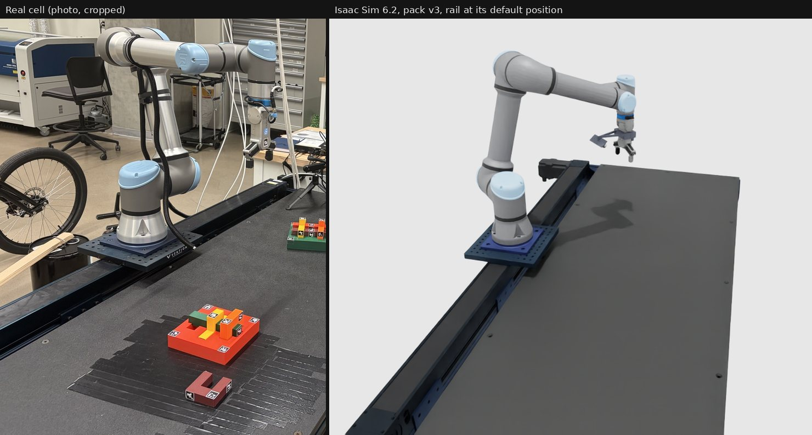
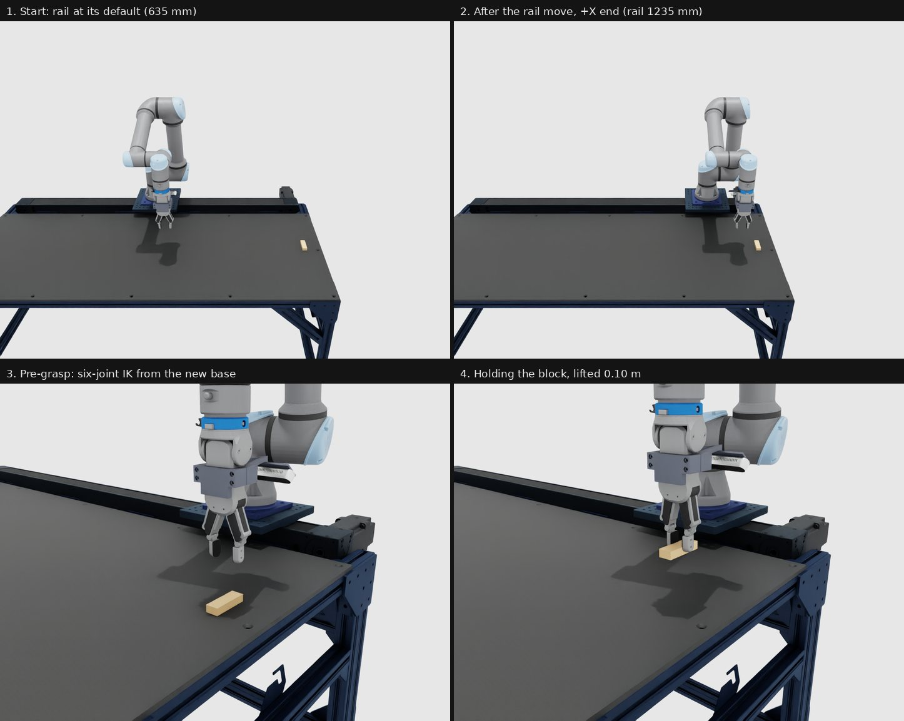
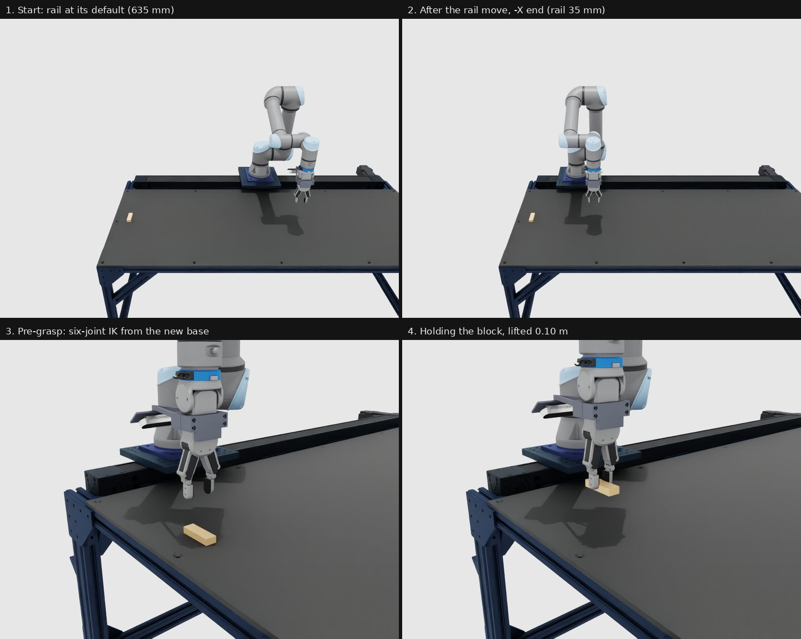

# UR5e Jenga work cell BOM and private asset pack

Status: **candidate, not runtime-qualified.** The pack-backed Workcell API is integrated
on `workcell/lab-hardware`. Integration and CPU fixture checks do
not establish a PhysX, render, sensor or lab-fidelity pass. This documentation update
does not run the simulator or inspect private assets.

## Scope

The work cell is one UR5e on the carriage of a Vention linear axis (a [seventh axis](#the-rail-the-robots-base-is-a-seventh-axis)) on a Vention bench, with an OnRobot Quick Changer, a standard OnRobot RG2
with its standard fingertips, and one camera: a D415 on a printed bracket on the gripper. That camera is the
cell's only sensor for perception and real-to-sim. The lab also owns a Bota Rokubi force/torque sensor; it is not
mounted on the arm, and the cell builds it only when `bota.mounted` is `true`
([the tool stack](#the-tool-stack-as-on-the-real-arm)). A second, overhead D415 on a removable gantry is
a proposal that is not bought and is not built (`overhead_camera.enabled` is `false` in the
config; `true` builds it).

The base cell holds no task objects. What a task adds is a **task pack** loaded on top of it:

| File | What it is |
|---|---|
| `exts/workcell/config/lab_hardware.json` | The base cell: robot, gripper stack, wrist camera (mount pose and intrinsics under `wrist_camera`), bench, mounting hardware. Asset pack `ur5e-workcell/v4` |
| `exts/workcell/workcell/bom.csv` | The base cell's BOM |
| `scripts/workcell_calibrated_camera_assets.py` | Build calibrated pack `ur5e-workcell/v4` from verified `v3`, replacing only the wrist bracket; existing versions are untouched |
| `scripts/workcell_bracket_assets.py`, `exts/workcell/cad/rg2_camera_bracket_v3.py` | Build pack `ur5e-workcell/v3` from `v2`, with v3's own bracket: the frozen v3 model at v3's pinned photo-estimated camera pose, not the pose now in the configuration (`exts/workcell/cad/rg2_camera_bracket.py` is the v4 model). The wrist bracket becomes a parametric copy of the real printed one, a two-piece clamp on the RG2 body with a truss arm and a plate for the D415 ([parameters, sources and what to measure](../cad/README.md)). The pack keeps the USD, a STEP of the assembly and a STEP and STL of each printable piece |
| `scripts/workcell_rg2_assets.py`, `scripts/workcell_stack_assets.py`, `exts/workcell/cad/rg2_from_step.py`, `exts/workcell/cad/part_from_step.py` | Called by the script above: the RG2, the Quick Changer's robot side and the Bota Rokubi from the vendors' official STEP files, read from local copies checked by SHA-256 ([the tool stack](#the-tool-stack-as-on-the-real-arm)) |
| `scripts/workcell_camera_assets.py`, `exts/workcell/cad/wrist_bracket.py` | Build pack `ur5e-workcell/v2` (superseded): RealSense's own D415 mesh (fetched at a pinned commit, checked by SHA-256, Apache-2.0) in the colour optical frame, and a placeholder bracket on the wrist 3 housing |
| `exts/workcell/tasks/jenga_tower.json` + `.bom.csv` | Task: the tower, 54 blocks of nominal 72 x 24 x 14 mm. Asset pack `jenga/v1` |
| `exts/workcell/tasks/push_block.json` + `.bom.csv` | Task: one loose block for the RG2 to push. Asset pack `jenga/v1` |
| `exts/workcell/tasks/puzzle_table.json` + `.bom.csv` | Task: the lab's two 3D-printed assembly puzzles, one assembled and one in pieces. Asset pack `puzzles/v1` ([puzzle tasks](#puzzle-tasks)) |

`workcell__cell(action="quick_start")` builds the base cell alone; `task="jenga_tower"`, `task="push_block"` or
`task="puzzle_table"` (or an absolute task file) loads that task's objects on top, and the parts audit then checks the
cell's BOM rows plus the task's. A cell configuration that holds task objects is refused. `scripts/workcell_split_packs.py`
writes the cell's pack and the Jenga pack from `ur5e-jenga-workcell/v2`; the sections below that name
`ur5e-jenga-workcell` describe that source pack.

### Puzzle tasks

A task is of one kind, named by its parameter section: `jenga` or `puzzle`. A `puzzle` task places base plates with
slots and the pieces that go into them, each as one rigid body:

- `assets` maps one role per piece to an asset of the task's pack. `puzzle.pieces` is a list; each piece has a `name`,
  its `asset` role, `position_m` and `rpy_deg` (fixed-axis roll, pitch, yaw), and optionally `parent`, the name of an
  earlier piece whose frame the pose is in. The pieces assembled into a base name it as their parent, so moving the
  base moves the assembly. Without a parent the pose is in the world (z = 0 is the bench top).
- An asset brings its own collision shapes and its solid volume (`puzzle:volumeM3` on its root). Mass is that volume
  times `puzzle.density_kg_m3`; `static_friction` and `dynamic_friction` are one physics material for all pieces.
- The BOM has one row per asset, with the number of pieces drawn from it.

`puzzles/v1` is written by `scripts/workcell_puzzle_pack.py <checkout>` from a checkout of
`github.com/inbarajaldrin/isaac-sim-mcp` at the commit the script pins: the `fmb1` (red base) and `fmb3` (green base)
objects, which are Aldrin's rescaled conversions of FMB object CAD (CC BY 4.0,
[notices](../../../THIRD-PARTY-NOTICES.md)). Each piece is a union of axis-aligned boxes, and its colliders are those
boxes (22 for a base, 1 to 5 for a piece), checked to fill the mesh's volume to 0.1 %: slots are real slots. In the CAD
a piece has 1.0 to 1.4 mm of room on each side in its slot. Colours are read off a lab photo. The fiducial tags on the
real pieces are not modelled. `pack.yaml` also records `assemblies`: per base, each piece's pose in the base's frame
when the puzzle is assembled, in the order the pieces go in.

On Newton, leave a hair of room between assembled pieces. With pieces in exact contact (a zero gap between parallel
box faces) the solver returned non-finite states for the whole scene at one yaw of the base (132.0 degrees) and not at
others (131.9, 0): the same task built cleanly with its assembled pieces 0.1 mm higher. `puzzle_scan.py` writes
assembled pieces 0.1 mm above resting for that reason.

`puzzle_table` assembles the green-base puzzle (two bars, then two forks standing across them) and lays the red base
and its four pieces loose beside it. Where things lie on the bench is a demo layout; density (solid PLA, an upper
bound for a print with infill) and friction are `unconfirmed`.

Measured on Newton (2026-11-15, Isaac Sim 6.2.0, three runs; the scripts and reports are in the puzzle project, not
in this repository): ten pieces, 27 rigid bodies, parts audit clean, no contact-buffer warning. Each piece's mesh lies
on its collision boxes exactly. Over 3 s of settling no piece moved more than 0.06 mm from where the task put it, and
no pair of pieces overlapped by more than 0.05 mm. The RG2 gripped the yellow fork by its centre tab and drew it out
of the green base: the fork rose 118.5 mm of the 120 mm asked, slipped 0.4 mm in the gripper on the way and 0.2 mm
more over a 3 s hold, and hung 0.1 to 0.5 degrees tilted; the base and its other pieces shifted 0.2 to 0.4 mm together
and nothing overlapped. Each fingertip pressed with 40 N, the force the lab's RG2 driver commands with every move (the
pack caps the finger drive at 1 N m, about 9 N at this width; with that grip the same lift slipped 0.2 mm, one run).
Fingertip friction, the piece's mass and the printed dimensions are still estimates. Once, in the first build after a
simulator start, the red bar sat 0.10 mm into its slot's floor after the arm had moved to look; two repeats did not
show it.

An earlier run of this lift slipped 9 mm and hung 2.3 degrees tilted. That was the script, not the grip: it sent the
arm a new joint target every 50 ms, and Newton's stiff drives jerked the gripper at each one. Send interpolated
targets every 10 ms or faster while something is held.

### Scan to scene

`scripts/puzzle_scan.py` turns one RGB-D look at the table into a puzzle task: which pieces of the pack are there and
where. It reads files and writes files, on the CPU, and needs neither the simulator nor a camera. Its input is a clip
folder (`rgb/`, `depth/`, `camera.json`: the folder the `sam3` tool reads) and that tool's label images for it.

| Command | Does |
|---|---|
| `match --clip C --run R --out estimate.json` | Every segment matched to a piece and given a pose |
| `task --estimate estimate.json --out DIR` | The estimate as `DIR/task.json` and its BOM, for `quick_start(task=...)` |
| `diff --estimate new.json --previous old.json` | Pieces added, removed and moved between two looks |
| `score --estimate estimate.json --truth truth.json` | The estimate against known poses |
| `colours --clip C --truth truth.json --out colours.json` | What colour each piece is to this camera, from a clip of a known layout; `match --colours` then uses them |
| `synthetic --task FILE --out DIR` | A clip and perfect label images of a task's layout, ray cast from the pack's boxes |

How a piece is recognised:

- **Shape, from depth.** A segment's points are put in the world frame (or, for a clip with no camera pose, in a frame
  fitted to the table) and reduced to a height map seen from above. Each shape has a height-map template for every
  stable way it can rest, made from its collision boxes. A template is turned and slid over the segment until the
  heights agree. Where the template expects surface and the scan shows a lower one that the camera could see, that
  counts against it; where another object is in the way or the spot is out of view, it does not.
- **Colour, among pieces of one shape.** The three bars, the two forks and the two U pieces differ only in colour.
  A candidate's colour is read off the surface its pose claims, not off its whole mask, and compared mostly by hue,
  which light and shadow leave alone, and partly by lightness, corrected by the scan's overall brightness. Lightness is
  all that separates the maroon bar from the red one, so a bar in shadow is named with the flag "could be ...". Every
  piece is used at most once.
- **Slots, from the base.** A base plate is tried both ways up and at each quarter turn. For the right-way-up poses
  each slot is checked against the scan directly, with the colour read off the surface itself, so a bar cut into three
  fragments by the forks crossing it is still found. A piece found in a slot is given the pack's assembled pose
  (`assemblies` in `pack.yaml`) and the base as its `parent`, so it does not start inside the base's walls.
- **The table, as the camera sees it.** With a camera pose, the frame's z = 0 is meant to be the table top; a real
  camera's hand-eye pose and depth put the table a few millimetres off it, and tilted. Heights are taken from a plane
  fitted to the bare table in the picture, when that plane is within 10 mm and 1 degree of z = 0; otherwise the frame is
  kept as given and `table.reference` says why. A piece's height in the estimate is its height above that table.
- **Too big to be the piece.** A shape is not tried on a segment whose footprint is more than 1.3 times the shape's,
  unless the segment's upper surface alone is the right size: a camera looking at an angle also sees the piece's walls,
  and a depth camera draws a skirt of mixed pixels down every edge, which on a thin piece adds half again to the
  footprint and nothing to the upper surface.
- **A piece that does not lie flat.** What no flat rest explains (each object alone, and objects of one colour within
  3 cm of each other together) is fitted with nothing assumed about how it lies: every face up, every turn about the
  vertical, level and tipped onto the object's own largest flat face, then refined in all six freedoms against its
  heights. Its height is whatever fits, but none of it may be under the table. The score and its limit are the flat
  fit's own. A piece the flat fit did accept, but poorly, or raised, or standing on end or on its side, or from one
  level of a mask, is tried the same way and takes that pose only when its cost is lower by 0.05. Such a piece's row
  says how it stands (`rest: tilted`, `tilt_deg`, `lowest_point_mm`, `support`), and when another pose fits nearly as
  well it is given whole (`other_pose`), not chosen between. Two poses up to 8 mm inside each other are one piece
  resting on the other when lifting the upper straight up by that much takes it out of the lower: it is moved and says
  so (`moved_up_mm`). Inside each other sideways, no lift parts them and one piece per place, below, applies.
- **Too small to be a base plate.** That fit does not try a base plate on an object that shows less than half of the
  least a plate can show from above, which is its smallest face (58 cm2 for `puzzles/v1`, so 29 cm2; the pack's largest
  other piece shows 39 cm2 lying flat). The limit is the pack's own: `BASE_SEEN_MIN` times the smallest footprint of
  the plate's boxes, with the factor of two for a plate half hidden, half out of the picture or half lost by its mask.
  It can change an answer only where that fit would have named so small an object a base plate: a plate that does not
  lie flat and of which less than that is seen as one object, or something that is no plate. A plate lying flat is
  found by the flat fit, which this does not touch. `BASE_SEEN_MIN = 0` turns it off.
- **The gripper in the picture.** A mask that is mostly more than 0.25 m above the table is the gripper the camera
  rides on, and neither it nor the mixed depth round its edge is an object.
- **What SAM 3 left out.** Raised surface in no mask is cut into regions of level height (a piece standing beside
  another, or lying on it, is a region of its own) and matched like any segment. With the first prompts tried SAM 3.1
  returned no mask at all for the base plates and the dark pieces, and this path carried much of the work; with the
  prompts below it is the fallback.
- **What the camera cannot see.** Anything more than 0.25 m above the table (the gripper the camera rides on, an arm, a
  hand) and every pixel without depth is a blind spot, not an object: nothing behind it counts for or against a pose.
- **One piece per place.** Of two matched pieces more than 3 mm inside each other, the worse fit is withdrawn and
  listed under `unexplained`, so the task never starts with interpenetrating bodies.
- **Masks that are wrong.** The same thing masked twice (by two prompts, or in one frame and not another) is one
  object. Unmatched objects of one colour within 3 cm of each other are tried together (a piece cut in two by SAM 3 or
  by the gripper across it). An object that fits nothing whole is tried as its level surfaces, one by one (one mask
  over two touching pieces at different heights). Two touching pieces of one colour and one height stay one object
  and are listed as `unexplained`.
- **Colours as the camera sees them.** A renderer's tone mapping or a real camera's white balance moves every colour
  away from the pack's nominal ones. `colours` measures them once from a clip of a known layout; `match --colours`
  uses them. With the pack's own colours the simulator's wrist picture gave 4 of 10 pieces; with measured ones, 10.

**Prompts for SAM 3.1.** It answers to the noun, not to the colour. Measured on the simulator's wrist picture of
`puzzle_table` (2026-11-15, each object against its piece's true outline, counted when their intersection over union
is 0.5 or more):

| Prompt | Pieces masked, of 10 |
|---|---|
| `block`, `plastic block` | 10, as 10 objects, each 0.88 to 0.96 of its piece; nothing else masked |
| `building block`; `toy block` | 10 (one at 0.80); 10 (two loosely, 0.51 and 0.66) |
| `toy`; `square` | 6; the 2 base plates |
| `green block`, `green box`, `green board`; `green square` | green base and green bar; green base |
| `red block`; `dark red block`; `dark green block` | red bar, maroon bar and maroon U; maroon U; green bar |
| `yellow plastic piece`; `orange plastic piece` | both forks and the yellow U; the orange fork, the orange U and the red base |
| `puzzle piece`, `object`, `green square plate`, `red square plate`, `red square`, `green tray`, `red tray`, `red board`, `bar`, `red bar`, `dark green bar`, `brick`, `brown block`, `maroon block`, `pink block`, `dark red plastic piece` | 0 |

Use `block` and `plastic block` together: each sometimes joins two touching pieces that the other separates, and the
matcher takes the same thing masked twice as one object. On four recorded pile and assembled layouts they masked 29
of 30 pieces (one fork lying against another piece was joined to it). Shadows help: without them the same prompts cut
each fork in two at its centre tab. No real picture has been tried.

**More than one process.** `match --workers N` (or `TWINSMITH_SCAN_WORKERS=N`, or `match(scan, pack, workers=N)`)
shares the fits that do not depend on each other among N processes, the calling one included. The default is 1: no
other process is started. The estimate is the same with any number, since a fit is the same arithmetic wherever it
runs. The others are the script started again (`puzzle_scan.py _helper`), not forks, and they import nothing of the
caller's, so a caller with threads, a simulator connection or no `__main__` guard is not disturbed; one that fails to
start or dies only leaves its share to the caller. The variable is capped at the processors the last minute's load
leaves idle. A function replaced in the module at run time is not replaced in the helpers; its numeric settings are
sent to them. On the 29 real wrist-camera clips of 2026-11-16 (3 to 9 objects each), reading a clip and matching it
took 5.6 s in one process and 3.2 s in four, on a 32-processor PC that simulators were also using.

The estimate lists, besides the poses: `not_seen` (pieces of the pack it did not find), `unexplained` (segments no
piece accounts for, with the reason), and per piece its `rest` (flat, on its side, on end, assembled), what it
is `touching`, and `flags` such as "could be line_red", "raised 35 mm: on top of something", "upside down", "poor fit",
and "from this view it could as well be standing another way".

Measured (2026-11-15, Isaac Sim 6.2.0 on Newton, one run each; the scripts and reports are in the puzzle project, not
in this repository):

| | Simulator: Newton scenes, wrist D415 render, SAM 3.1 masks | CPU: ray-cast pictures, perfect masks |
|---|---|---|
| Layouts (loose, assembled, piles) and pieces | 15, 112 | 45, 312 (and 45, 320 with 1 mm depth noise, a brightness change and a mask withheld) |
| Pieces named correctly | 107 as it ran; 111 on the same recordings with the matcher as it is now | 311; 319 |
| Named as another piece; reported but not there | 0; 0 | 0; 0 |
| Position error of the centre: median, 95th percentile | 0.8, 2.7 mm | 0.5, 1.3 mm; 0.6, 1.8 mm |
| Right piece, pose off by more than 5 mm or 10 degrees | 4, all flagged | 4; 9, all flagged |
| Base swaps reported exactly | 3 of 3 (25 of 25 pieces in the six scans) | 6 of 6 |
| Estimate built back on Newton | no piece moved more than 0.11 mm in 14 of 15; in one a missed base left its pieces to fall | not applicable |

The 111 is not an independent figure: three fixes were made while looking at two of those fifteen layouts. The base
swaps ran afterwards on fresh scenes. Those runs used the first prompts (a colour with `plastic piece`, `square plate`
or `bar`) and the cell's light pointing straight down.

Run again the same day on nine new layouts (59 pieces, another seed) with the tilted key light, colours measured
again under it, and the prompts `block` and `plastic block`, matcher unchanged: 57 pieces named correctly (96.6 %),
position error 0.9 mm median and 2.1 mm at the 95th percentile, how the piece lies right for all of them. One maroon
bar lying loose in shadow was named as the red bar, with the flag "could be line_brown": lightness is all that
separates those two, and a shadow now changes it. One green bar with half its length hidden under the gripper was
placed 21 mm along its own length, with no flag. One base swap, reported exactly. Built back on Newton, no piece
moved more than 0.17 mm in eight layouts and 3.4 mm in one. What remained wrong then: a piece not resting flat (tipped into a slot, leaning) was
listed as `unexplained`, not posed (it is now tried in any pose, above); a U piece standing on end looks the same from straight above whichever end is
down, so its turn about the vertical is a guess, flagged as one; two touching pieces of one colour and one height
under one mask stay one object.

**One real picture (2026-11-16).** The lab's wrist D415, held still 0.40 m above the table and tilted 23 degrees, over
the red puzzle's five parts lying loose, each with fiducial tags stuck on it; colour at 1280 x 720, depth at 848 x 480
aligned to it; the camera pose from the hand-eye calibration and the robot's own pose. One clip, no ground truth.

| | Result |
|---|---|
| SAM 3.1, `block` and `plastic block` | five objects, one clean mask each; nothing else masked but a 2.6 cm2 blob at the picture's edge |
| Depth inside the masks | 86 to 100 % valid. At 1280 x 720 depth the same view gave 24 to 92 %: everything nearer than 0.41 m was missing, the D415's minimum range at that resolution |
| Table reference | the table read 2.9 mm below the frame's z = 0 and 0.42 degrees tilted; applied |
| Matched, with the pack's own colours | 2 of 5 (the base, and one U piece named as the other with the flag "could be") |
| Matched, with colours measured on this clip | 5 of 5: shape cost 0.07 to 0.22 (limit 0.30), colour cost 0.003 to 0.02 (limit 0.40); the yellow part flagged "poor fit" |
| Each part's CAD outline drawn from the camera, against its mask | intersection over union 0.82 to 0.98; centroids 1 to 2 mm apart for four parts, 4 mm for the maroon U |
| Estimate built on Newton and rendered from the same camera pose | the five parts where the picture has them, the right way round; no part moved more than 0.1 mm settling |

Before the two changes above this picture gave one part of five: the table 2.9 mm low put the maroon U's true pose
under the table by more than the 4 mm allowed, so a pose a quarter turn off won; and the yellow part's footprint, 58 cm2
with its walls and skirt against the CAD's 38.6 cm2, was over the size limit, so its shape was never tried (its upper
surface is 38.3 cm2). What this is not: the colours were measured on the same clip they were used on (the tags' numbers
named the masks, nothing else), so the colour step is fitted to this picture; the tags are not modelled and sit inside
the masks; there is no ground truth, and a 1 to 4 mm agreement of outlines is not an accuracy; the slots' clearance is
1.0 to 1.4 mm a side. In the simulator the two changes do nothing: on the twenty recorded looks of the three v4 puzzle
builds the old and the new matcher give the same pieces at the same poses to the last digit (the table there is at
z = 0 to 0.001 degrees, and no segment was over the size limit). The simulator's own figures above were not run again.

**Real pictures of pieces lying on and against each other (2026-11-16).** The same camera and view, fourteen clips of
the red puzzle's parts as a person arranged them, colours as above (measured on the first of those clips).

| Clips | Flat fit only | With the fit in any pose |
|---|---|---|
| Eight with every part flat on the table, removed, or assembled in the base | all parts found | the same parts at the same poses, to the last digit |
| Two with the green bar lying across the orange U and the yellow part, the orange U on the maroon one | 3 of 5 | 5 of 5: the bar tilted 20 degrees and raised 14 mm, the orange U tilted 24 degrees |
| One with the yellow part leaning on the base and the bar across two U pieces | 4 of 5 | 5 of 5: the yellow part tilted 29 degrees |
| Three with the bar from the maroon U onto the base, the orange U standing, the yellow part leaning | 2 of 5 | 4 of 5; the maroon U, of which only the leg ends show under the bar, is listed and not posed |

Built on Newton at those poses and rendered from the capture's camera before any physics step, the two-part stacks and
the leaning part are where the pictures have them, the right part on top. Run for 2 s afterwards, the stacked parts
move by up to 6.7 mm and 13 degrees: the poses are near a resting arrangement, not at one. On ray-cast pictures with
perfect masks, made apart from this code with the poses hidden from it, 7 of 8 parts at random orientations came out
within 5 mm and 5 degrees; the eighth, a U a quarter turn off, was flagged with the true pose as its `other_pose`. What
one view cannot settle is reported, not resolved: a part mostly hidden under another, and poses a quarter or a half
turn apart that look alike from where the camera is. A stacked scene takes 8 to 17 s to match, a flat one 4 to 5 s.

### Building a puzzle

`scripts/puzzle_build.py` has the simulated UR5e assemble one puzzle of the pack on Newton: the pieces lie loose on the
table and the base off to one side; the robot finds them, slides the base to the middle, and picks and inserts each
piece. It talks to one simulator bridge on this machine and cannot reach a real robot.

    python3 scripts/puzzle_build.py --port <port> --out <folder> --seed 1 --mutate-stage --discard-changes \
        --allow-concurrent-gpu --table-camera --colours <colours.json> --scan-cycle <mv_cycle.sh>

For joint-constrained rehearsal add `--joint-windows <limits file or cell config>` (alias `--cable-limits`); see
[Joint windows](#joint-windows-where-the-cables-let-the-arm-turn). Omitting it uses the base cell's setting, which is
no windows, so the unconstrained benchmark is unchanged.

It replaces the bridge's stage and starts SAM 3.1 jobs on the simulator's GPU, which is what the three consent flags
say. `--perception oracle` reads the simulator's own poses in place of the camera, to tell a handling failure from a
seeing one. `--correction table` (the default), `lookahead` or `none` says how a place allows for the way the piece
sits in the hand ([below](#correcting-the-place-three-ways)). Run it with the host environment's Python (NumPy, SciPy,
Pillow).
The keep-out boxes of the gripper and the camera, and what the closed gripper hides in the wrist camera's own picture
(both in `scripts/puzzle_assembly.py`), and the measured runs below are of `ur5e-workcell/v4`, the pack with the
calibrated wrist camera. On a cell built from another pack the run stops after building it, unless
`--unqualified-cell-pack` is given; `metrics.json` then records `cell_pack_qualified: false`, and nothing measured
below describes that run.
The demo's settings are `scripts/puzzle_build.json`: the puzzle, where the base goes, the speeds, and one grasp per
piece, defined on the piece's CAD (a point, a closing axis, an approach axis, a width).

| Step | How |
|---|---|
| Layout | `puzzle_assembly.scatter`: the pieces flat at random inside what the wrist camera sees from the survey pose, apart from each other, the base 0.24 to 0.32 m to one side, the middle and the way there free. Built as a task by `quick_start`, once per layout |
| Rail, then arm | The rail is parked with its own blocking move. After that only the six arm joints move, solved from the UR base where the rail has put it (read from `sim__arm(action="fk")`) with the UR5e's closed-form solution (`workcell_session.ur_ik`; its forward kinematics agree with the simulator's to 5 micrometres). A straight line is solved waypoint by waypoint, each near the one before; a large move goes to the solution nearest the posture the cell was built in, with elbow and wrist clear of the table. `sim__arm(action="ik")` solves nearest the arm's pose now and takes no seed: along a turning line its answers jumped (the arm ended 90 degrees from its targets), and after a level insertion it led the elbow onto the table |
| Scan | The graph's first step, and the step it returns to. The wrist camera stops at the survey's own view (below); when that leaves a piece in doubt, two poses its depth does not tell apart, also at the two views from the sides of `scan` in `puzzle_build.json`, each chosen inside the real cell's limits (in 16 scans of simulated builds the view from above left no doubt, and three views cost 53 s where one costs 20). A piece of the puzzle that the view from above does not find at all is looked for from a second view straight down, over the part of the table the first picture does not reach (`scan.beyond`: the survey stands to the left to stay inside the cell's limits and its picture ends at x = 0.399; a bar knocked 50 mm to the right of x = 0.35 was out of it). The views leave as the folder a scan mover writes on the robot's side (`scan_mover.multiview/1`) and the multi-view cycle named by `--scan-cycle` (the puzzle project's `cycle/multiview/mv_cycle.sh`: SAM 3.1 and the matcher on the first view, every view's depth checked against the result) returns one estimate. From it the twin is rebuilt (the poses the lookahead simulates from, and `scans/<n>/task/`), what is already done is worked out (the base in the middle, pieces seated), and the scan says what is next. A piece the cycle leaves in doubt, or does not find, stops the build. `--perception oracle` makes the same moves and reads the simulator's poses |
| The scan's cycle | `--scan-cycle` names a command, not a file of this repository. It is called as `<command> <scan folder> --out <folder> --name answer --no-latest [--colours <file>]`, with `TWINSMITH_REPO` and `TWINSMITH_SCAN_REPO` set to this checkout, and must leave `<folder>/answer/estimate.json` in the matcher's shape (`pieces` with `name`, `position_m`, `rotation`; `doubtful` as it stands after its own check; `unexplained`; optionally `next_view`) and `<folder>/answer/real_rgb.png`. The one implementation is the puzzle project's `cycle/multiview/mv_cycle.sh` (repository `sim2real-puzzle`, private; committed there as `63f6ae3` on its branch `feat/gap-ros-bridge`, 45 unit tests of its own). On the machine it needs `<workspace>/env.sh`, the host environment, the `sam3` tool with SAM 3.1, and its `sam3_client.py` under `<workspace>/runs/demo-kit`; `TWINSMITH_SAM3_SPOOL` set to a folder of one's own keeps a build off a shared SAM worker. Without a cycle the build runs with `--perception oracle` only |
| Survey | Wrist D415 straight down from 0.75 m, gripper closed. At the calibrated camera pose the gripper fills the top middle of the picture and its fingertips end at the picture's centre, so the point looked at is 90 mm to the robot's side of the middle of the table, and 145 mm to its left so that the pose is one the real cell allows ([below](#poses-inside-the-real-cells-limits)): the base in the middle is then wholly in view, and a layout puts no piece where the gripper hides the table (`puzzle_assembly.hidden_on_table`). The `sam3` tool (SAM 3.1) masks the pieces; `puzzle_scan` names and poses them against the CAD. Every later look is the same, from the same pose |
| Build order | `puzzle_assembly.build_order`: the assembled CAD is taken apart piece by piece along directions in which nothing is in the way; reversed, that is the order, each piece's slot axis and the pieces it needs in first |
| Base | Gripped by its centre island, fingertips in the bar slots, and slid on the table to the middle. Lifted by that 7 mm island it tilted 7 degrees in the fingers. Slid, it slips in the fingers and stops short, by 3 to 20 mm: the look that follows measures where it stopped, and a base more than 10 mm (and less than 50 mm) from the middle is slid once more from there |
| Grasp check | `puzzle_assembly.choose_grasps`, on the CPU, before every pick: each way of holding the piece is tried on the CAD against a keep-out model of the gripper and the camera. The gripper is tested as it comes down (open 16 mm wider than it grips, from the hover to the piece) and as it holds the piece at the pick and along the insertion; the held piece is tested along the insertion too. Everything the robot believes is on the table counts at both ends: the base, the pieces it has placed, and the loose ones where the last look saw them. No way fits: the step is refused, with the reason in words |
| Correcting the place | A piece does not sit in the closed gripper exactly as its grasp is defined, and the place is shifted by how it does sit: from a table of one shift per piece type, from a lookahead, or not at all (`--correction`, [below](#correcting-the-place-three-ways)). The gripper is checked again at the corrected place, and a place it does not fit is refused |
| Lookahead | Only with `--correction lookahead`. Before each piece: the stage's physics state is saved, the pieces are put where the scan says they are, the pick and the insertion are simulated on Newton, and the state is put back. Over the slot the try reads how the piece sits in the hand (in the twin, where that can be read) and corrects the place by it before lowering; the real pick then uses that grasp. A try in which the arm is blocked is repeated with the next way of holding the piece; then go or abort. It says abort when the piece does not end seated, and also when any other piece ends 3 mm from where it was |
| Pick and insert | Open, pads round the piece, close at the gripper's force, lift 0.12 m, carry over the slot, lower along the slot axis at 10 mm/s, let go, back away 0.08 m and rise 0.15 m |
| Base check | While a piece is brought to the base, the base is checked from one depth picture of the wrist camera with no SAM pass (`scripts/puzzle_base_check.py`): the base's CAD, with the pieces seated in it, is fitted in x, y and yaw from its last pose to the heights seen, the table's own points included. A piece that goes in with the gripper pointing down (the bars) is checked at its pre-place hover and after every 10 mm of lowering while it is still above the slot; one that goes in with the gripper level (the forks), where the camera cannot see the base, is checked once from 0.45 m above the table, beside the base (`base_check.look`), before it is picked, the hand empty: a look with the fork in the hand swings it once more, and that swing is what makes a fork creep in the fingers (8.1 mm along them with the look, 4.9 without, measured by the placement work). A base found more than 1.5 mm or 1.5 degrees away by a fit that is trusted takes its slots and seated pieces with it; what is left of the placement is laid out again and simulated ahead on Newton, and the hand comes over the slot's new place. Found moved during the lowering, the arm first goes back up to the hover. A fit that is not trusted (too little of the base in view, heights that do not agree, a way it could slide for free, a move as far as it looks) or other pieces not where they were: the piece is put back where it was picked and the table is scanned. `--shift-base PIECE:MM:DEG[:before|descent]` slides the base at that moment, to see it |
| Look again | From the survey pose. The piece is placed when the scan finds it assembled in its slot; a piece seen loose and flat is tried once more. One look reads a piece up to 1.6 mm from where it is and a seat allows 1.5 mm: a piece read in the base less than twice the seat's tolerance from its slot sends the build to the scan once, and read that near again it counts as placed (a bar seated 1.2 mm from the CAD was read 1.63 mm off, and the build had ended there) |
| Scan again | When the jaws close on nothing or the hand stops short of the grasp, or when a look finds a loose piece more than 5 mm or 5 degrees from where the estimate had it or the base out of its place: back to the scan, which takes the table as it now stands and sends the build to the next thing it needs. At most three more scans than there are pieces. `--disturb PIECE` moves that piece 50 mm aside just before its first pick, to see this happen |

The run is a Graph-as-Policy workflow. `exts/workcell/gap` is a skill registry (made with `gap registry init` and
`gap skills new`): the tool bundle `workcell` (twelve tools, each a call to the running `puzzle_build.py`) and the
skills `scanning-the-table`, `placing-puzzle-base` and `assembling-puzzle-pieces`. `puzzle_graph.py` there
authors the workflow with `gap.builder`, one subgraph per skill and per piece, and runs it with `gap.execute` through a
small connector. The scan's subgraph is followed by a router that sends the build to the base, to a piece or to the end, by what the scan
found; a piece's subgraph that leaves by `empty`, `missed` or `changed` goes back to the scan. Between the motions of each pick it runs two stock scripts of open-robot-skills' `verifying-grasps`
(`verify_reach`, `verify_grip`), and after each placement a checkpoint compares the piece with its slot in the
simulator's truth. Two more subgraphs ask the owner's vision-language model (`[planning] vlm_url`, through
open-robot-skills' `vlm` bundle) for a second opinion: how many parts it counts after the survey, and whether the
puzzle looks complete at the end. Those answers are recorded and decide nothing: SAM 3.1 and the CAD match do.
The graph's trace (`<out>/trace/dag_trace.json`, `node_data/`) has every node's inputs and outputs.

The script exits 0 only for a build that finished: every piece seated and the graph ended in success. One that stopped
exits 1, and `stopped` in `metrics.json` says what stopped it in the build's own words (the lookahead that said abort
and why, or the last step that was refused); the graph's own error names its first failed node, which may be the
question to a vision-language model that was not up and decides nothing.

Outputs in `<out>`: `metrics.json` (per piece: named correctly, gripped, seated, final pose error against the CAD,
which correction its place had and how far what the place assumed was from how the piece really sat, what a lookahead
said; the friction coefficients Newton's own model holds for the pieces and the pads; the graph's result and
checkpoints), `build.mp4` (the table camera and the wrist camera side
by side, captioned), `key_*.png`, `look_*_masks.png` (each look with its SAM 3.1 masks), the graph, `run_log.json`
and `viewer/`.

#### The step viewer

`<out>/viewer/index.html` replays the run: what was planned, then what was done. It is a static page (open the file;
no server, nothing from the network), built at the end of the run by `scripts/puzzle_viewer.py` from the run's own
records, and `python3 scripts/puzzle_viewer.py <out>` builds it again for any finished run without a simulator.

| Panel | Shows |
|---|---|
| The build | The table camera's and the wrist D415's film at the simulation's own speed (5 frames per simulated second), with one clock for the whole page |
| Future | Every Newton lookahead try as its own clip, failed first tries included. With "play each lookahead before its step" on, the build pauses at a lookahead, its tries play here, and the build goes on when one says go |
| The workflow | The Graph-as-Policy graph: subgraphs with their skills, inner nodes, exits taken; each node grey, amber, green or red as it is not reached, running, finished or failed at the time shown, from the graph's trace |
| Steps | Every step in order (survey, base placement, lookahead and its tries, approach, close, lift, carry, lower, release, retreat, rescan, checkpoint) with its start, its simulated and wall duration and its result. Clicking one goes there |
| The step | Its plan: the grasp as defined on the CAD and which way of holding was taken, the waypoints (hover, pick, lift, carry, over the slot, place, retreat) with where the gripper points, its result, where its wall time went, and its clip |
| Joints and gripper | The six arm joints, the rail, the pad gap and the commanded grip force over time, for the build or for the lookahead try on show |
| Perception | Per look: the wrist picture with the SAM 3.1 masks, and the table from above with the scan's estimate drawn over the simulator's truth. The truth is there to score the estimate and is labelled so; the robot never reads it |
| Where the wall time went | Per kind of step and in all: seconds in the solver, rendering, bridge calls beyond those two, SAM 3.1, the scan's matching, grasp choice and the rest; and what lies outside the steps |

What the run records for it is `run_log.json`: the steps (`scripts/step_log.py`: each with its plan, simulated and
wall time, frame and sample ranges, and its share of the counters), the joints sampled every 50 ms inside Kit, the
looks, and each lookahead try's own clip, samples and captions. `viewer/timing.json` is the time breakdown alone.

The page is panels over one value. `viewer.js` keeps a registry (`Viewer.panel(id, {title, mount, update})`); the
run names the panels to show (`panels` in `run.js`), and `Viewer.load(run)` mounts them afresh, so a page fed a
growing run shows it live and a page with other panels (a lab display) reads the same records. Neither is built yet:
today the page is written once, when the run ends. The grip force plotted is the commanded limit, not a measurement.

#### Correcting the place: three ways

A piece does not sit in the closed gripper exactly as its grasp is defined on the CAD: it settles as the pads close,
and the arm hangs about 1 mm below its targets at the pick. Read over the slot in the builds of 2026-11-17, a fork sat
1.5 to 6.5 mm from its grasp as defined (median 4.1 mm, 32 picks) and a bar 0.4 to 3.4 mm (median 1.6 mm, 41 picks); a
slot leaves 1.0 to 1.4 mm a side. `--correction` says what the place does about it. Those builds carried a held
piece at the empty hand's speed; since the held piece is carried slower (**The carry**, below) a fork sits 0.5 to
2.6 mm from its grasp as defined (median 1.1 mm, 12 rehearsals).

| `--correction` | What it does | What it costs | What it does not do |
|---|---|---|---|
| `table` (the default) | Shifts a fork's place by one fixed amount, the mean of how forks sat in several rehearsals, read from `scripts/puzzle_build_corrections.json`. The bars have no entry and are placed by their grasp as defined. Nothing is simulated ahead: the lookahead step answers go at once | Nothing while building. The table is measured once, in a measuring run of about twenty minutes, and again when a grasp, the grip force, the speed a held piece is carried at, the pack or the solver's friction changes (a table measured with others is refused) | It does not know how this pick's fork sits, only how forks sit on average. And it cannot say abort: it rehearses nothing, so only the grasp check can refuse a pick |
| `lookahead` | Rehearses every pick on Newton first, reads in the rehearsal how the piece sits in the hand, corrects the place by that, and says go or abort | 36 to 45 s of wall time a piece on a GPU shared with other simulators: 178 s of a 440 s build | With the pieces at the task file's friction it stops most builds at a bar (below). A rehearsal is no check on the real cell: over 120 trials of the look-ahead study it never said abort for a scan that was off or for physics that differed |
| `none` | Places every piece by its grasp as defined | Nothing | A fork placed so seated 5 times of 9 |

**What was measured** (2026-11-17, Isaac Sim 6.2.0 on Newton, `ur5e-workcell/v4`, `puzzles/v1`, the green puzzle,
`--perception oracle`; six layouts, seeds 1 to 6, each way built in turn on one simulator on a GPU that other simulators
shared; the runs, with every build's records, are outside this repository). Every row but the last carried a held
piece at 45 degrees a second, and the two `table` rows above it used the tables measured at that speed:

| Way | Pieces' friction in the solver | Seated, of 24 | Builds finished, of 6 | Wall time of a finished build |
|---|---|---|---|---|
| `lookahead` | 1.0, as every build before the fix ran | 23 | 5 | 401 to 433 s |
| `lookahead` | 0.4, the task's | 9 | 1 | 440 s |
| `table`, a single reading for each fork (the table as first measured) | 0.4 | 23 | 5 | 251 to 272 s, and 370 s |
| `table`, one averaged entry for the forks (the table in the repository) | 0.4 | 24 | 6 | 404 to 563 s, on a busier GPU |
| `none` | 0.4 | 17 | 2 | 293 to 349 s |
| `table`, a held piece carried at 20 degrees a second, the table measured at that speed | 0.4 | 23 | 5 | 381 to 493 s, two other simulators building |

The first row is one batch; the second, third and fifth were built in turn; all at 1.0 to 1.5 ms a physics step. The
averaged table was built some hours later with the GPU busier (1.4 to 2.2 ms a step), so its wall times say nothing
about its speed: it does the same work as the row above it. The last row was built before the carry rose first
(**Seed 5's last fork**, below): the piece it lost is that fork, and seed 5 built again with the rise seated all four.
In its six builds the forks' places were 0.5 to 1.6 mm from how the forks really sat (0.7 to 4.0 mm in the row of
the averaged table at 45 degrees a second), and a build took 7 to 18 simulated seconds more (171 to 187 s against 160
to 169 s on the five layouts both finished). The six were not built again with the rise and the table measured after it.

So the table at the task's friction does as well as the lookahead did at the old one, and a build is about 160 s shorter
than a lookahead build of 400 to 440 s; where both finished at 0.4 in turn (seed 2) it was 266 s against 440 s. It is
not shown to be better than the lookahead: the lookahead's 9 of 24 comes from correcting the bars (below), and a
lookahead that left the bars alone was not run. Nor is it firmly better than no correction: that rests on the first
fork, which jammed in 3 of 8 `none` builds and in 1 of 19 with a table, and forks seated uncorrected 5 times of 9. The
sample is six layouts. A layout built again mostly repeats itself (the in-hand shifts came back to 0.01 mm on seed 3)
and sometimes does not (seed 4: four of four, then two of four with the same table), so repeats add little: count this
as about six builds a way.

- **The carry.** How far a piece sits from its grasp does not arise as the pads close or in the lift (0.1 mm there).
  It arises in the move that swings the held piece from one posture of the arm to another: the piece creeps along
  the fingertips, outward, while the wrist turns, and stays where it crept to. The creep goes with the speed of the
  swing: carried from its lift to over its slot, one fork ended 5.2 mm out at 45 degrees a second (the fastest
  joint's mean speed) and 1.8 mm at 15, the other 2.3 and 0.8 mm. It was the same to 0.3 mm with the solver's
  `impratio` at 100 for 10, with the pads' contact time constant at 0.01 and 0.004 s for 0.02, and with the pieces at
  friction 1.0 or 0.4: it is not friction giving way but the solver carrying a contact round a curve in steps of
  2 ms, and a real gripper holding a 40 N grip would not show it. Turning the hand about its own fingertips in place
  left 1.3 mm, but that straight-line turn changed the arm's configuration under way on the other fork and threw it;
  it is not used. So a held piece is carried at `speeds.held_deg_s` (20 degrees a second) and the empty hand at
  `joint_deg_s` as before; speeds between were not compared on whole builds. A fork has 1.0 mm a side in its slot
  along the fingers. Further off it still seats most times, by landing on the slot wall's top, rocking in the pads
  and slipping off the edge (seen up to 5 mm; at 8 mm it stays on top and the arm is stopped), which is why forks
  4 to 5 mm off at the old speed seated more often than not and jammed without a pattern.
- **Why the lookahead stops at a bar.** Its verdict is abort when the rehearsed piece does not end seated, and also
  when any other piece ends 3 mm from where it was. The rehearsal reads that the pads hold the bar lower than the
  grasp defines (the arm hangs about 0.9 mm below its targets at the pick) and lowers the gripper by that at the
  slot. The grasp leaves the pads 0.5 mm above the slot's 7 mm walls and the lowering stops 1 mm short, so a gripper
  lowered 1.5 mm has its pads on the walls, and when it opens they push the base. Of nine bar rehearsals, the five
  that lowered the gripper 0.3 to 1.3 mm said go and the four that lowered it 1.4 to 2.4 mm aborted, each with the
  bar seated (0.2 to 1.1 mm) and the base or the other bar moved 4 to 8 mm. Traced on another layout: with the
  correction the pads' lower edge was 0.07 mm below the walls' top before the gripper opened and the base was pushed
  3.5 mm as it opened; placed by the grasp as defined, the pads were 0.85 mm above the walls and the base did not
  move. A table entry for the bars makes the same correction with no verdict to stop it: with one, 18 of 24 seated.
  That is why the settings name only the forks (`corrected_from_table` in `puzzle_build.json`).
- **A corrected place is checked at the slot.** The grasp check passes the place as defined; a correction moves the
  gripper from there. The same test of the gripper against the base and the pieces is now made again at the
  corrected place, from the table or from a lookahead, and a place at which the gripper would be more than 1 mm into
  something is refused (in a rehearsal: abort, before the gripper is lowered).
- **The friction.** None of this showed before 2026-11-17, because the pieces' friction was not what the task file
  says. `puzzle.py` bound the contact material to each piece's root; Newton reads a collider's own binding, and its
  model held 1.0 for every collision box and not the task's 0.4. Bound to the boxes as well, the model holds 0.4.
  Every run reads it back from Newton's model (`metrics.json`, `cell.friction_in_the_solver`): the coefficients of
  the shapes under each piece that collide. (A piece's drawn mesh is a shape of the model as well, at 1.0 and
  colliding with nothing; runs recorded before the read-back left it out show `[0.4, 1.0]` for that reason.) A
  touching pair takes the larger coefficient, so the base on the bench went from 1.0 to 0.4 and is pushed far more
  easily. Every puzzle scene built on Newton changes with this, not only this script.
- **Seed 5's last fork** did not seat in any build before the carry was changed, whatever the correction: the arm
  was stopped while lowering it (5.4 to 5.9 degrees from its targets) and the fork ended 60 to 140 mm from its slot;
  a `lookahead` at the old friction said abort and left it on the table. It was not a jam at the slot. That fork
  lies beside the base, across it from its slot, and its carry was one swing of the arm that began 135 mm above the
  table and turned the hand level on the way: the fork swung down under the hand as it passed over the base and hit
  the first fork, standing 87 mm high in its slot. The base was knocked 25 mm and 6 degrees before the fork came
  down, and the fork was then lowered onto the bars. Now a piece that the hand turns level goes straight up first, to
  the height of the pose over its slot (`above` in the pick's path, about 3 simulated seconds), and swings there; the
  same build then seated all four, the last fork 0.9 mm from the CAD. Nothing checks a held piece's swing against
  what is built: the rise clears this puzzle's 87 mm, not any assembly.
- **With SAM 3.1 looking** (`--perception sam3`, each look served by a SAM 3.1 worker that was already up, 3.6 s a
  look where the build's own cold job takes about 24 s; the table of single readings that came before the averaged
  one): seed 2, `lookahead` 4 of 4 in 646 s, `table` 4 of 4 in 341 s, `none` 4 of 4 in 319 s; seed 4, `lookahead`
  1 of 4 (abort before the second bar), `table` 4 of 4 in 405 s, `none` 4 of 4 in 400 s.
- **A run that Newton ends.** Once in these builds (seed 3 with `lookahead`, as the gripper opened in a rehearsal),
  and six times in about 750 picks of the look-ahead study, Newton returned values that are not finite numbers. The session now raises a named error on any such value (`workcell_session.PhysicsStateInvalid`),
  the build writes `metrics.json` with what was known and `stopped` saying why, and exits with an error. It is not
  retried and not turned into a verdict: after it nothing the simulator returns means anything until the scene is
  built again.

**The table.** `scripts/puzzle_build_corrections.json` has one entry per piece type (pieces of one shape held by one
grasp: the two forks are one type). An entry is `in_hand`, the gripper as a piece of the type sat in it over its
slot, in the frame of the gripper as the grasp defines it, the mean of its readings; its distance from the grasp as
defined; the readings themselves and their spread; and a check of whether it helps. The forks' entry is the mean of 12 readings on six layouts with a held piece carried as a build carries it now (straight
up, then the swing at 20 degrees a second): 1.1 mm and 0.3 degrees from the grasp as defined (a fork sits 1.1 mm
further out along the fingers than the grasp defines), with a spread of 0.6 and 0.7 mm from reading to reading; with
one swing at 45 degrees a second it was 3.2 mm with a spread of 1.3 and 1.2 mm. The table records the speed and is
refused at another. Its check: a reading is 1.1 mm from the grasp as defined and 0.8 mm from the mean of the
other layouts' readings (medians; 1.2 and 0.8 mm for the first fork, 1.1 and 0.8 mm for the second), where at 45 it
was 3.3 and 1.4 mm: the slow carry does most of the work, the table the smaller part. Measure it again with

    python3 scripts/puzzle_build.py --port <port> --out <folder> --seed 11 --mutate-stage --discard-changes \
        --perception oracle --write-corrections <file>

a measuring run of about twenty minutes in place of a build: on six layouts (the seed given and the five after it; 11 to 16 are none of the
six above), the survey and the base's slide, then one lookahead per piece the settings want corrected, with the
pieces before it put in the base where the CAD has them, and nothing placed. An entry measured with the gripper half
round is turned with the gripper when a piece is held the other way round; that follows from the two fingers being
alike and has not been measured. Nothing in the table was measured on a real gripper or a real piece.

**What the grasp check refuses.** A neighbour in the way of the open gripper (the gripper is tested as it comes
down, 16 mm wider than it grips), and a loose piece that the scan saw lying in the slot (every piece the robot
believes is on the table counts at the slot, and the held piece is tested along its insertion). Until 2026-11-17 only
a lookahead caught these. On the look-ahead study's recorded layouts, the four with the other bar 14 mm beside the
piece and the four with it in the piece's slot passed the check as it was called before and are refused now, and its
other 140 trials pass both with the same first way of holding; laid out in the simulator, the build answers "no
grasp of line_brown fits: line_red is in the open gripper's way down to line_brown" and "... line_red is where
line_brown goes", and moves nothing. What geometry of believed poses cannot know stays unrefused: a piece the scan
put elsewhere, a piece wrongly believed seated, a fork read half a turn round, a grasp that drops the piece.

#### Poses inside the real cell's limits

The real arm carries the wrist camera's cord, and the puzzle project's GaP bridge (`ros2/gap_bridge` of
`sim2real-puzzle`, not part of this repository) refuses a goal that leaves the cell's joint windows or asks for more
than the cord's spare loop. Those numbers are the bridge's shipped ones, and the cable ones are placeholders that are
not measured: wrist 3 from -100 to 135 degrees, 10 cm of cord. A build replayed through the bridge, dry, says how many
of its goals such an arm would be sent (`scripts/puzzle_disturb.py`: `replay`, and `report` for a table of every case).
The build as it was could not be sent: 36 of the 52 goals of a seed-1 build were refused, all at the limits gate, from
the survey pose (wrist 3 at 141.5 degrees, 13.2 cm of cord), the scan's right view (-154), bars put in with wrist 3 at
-108 and the look above the base (153). What was changed, in `puzzle_build.json` and `Build._grasp`:

| What | Before | Now |
|---|---|---|
| Survey | over [0.02, -0.37] from 0.72 m: wrist 3 at 141.5 degrees | over [-0.125, -0.37] from 0.75 m: 114 degrees, 9.2 cm of cord. The picture ends at x = 0.399 where it reached 0.523 |
| Scan's side views | wrist 3 to -154 degrees | chosen by a search over the bridge's own limits and workspace box; each leg of top, left, right, top needs 9.2 cm of cord or less. The right view lines up poorly (cost 0.14 against 0.002) |
| Look above the base | straight above, wrist 3 at 153 degrees | 0.10 m to its left and 0.05 m nearer, from 0.45 m, rolled: 16 degrees |
| Which way a piece is held | the first way that fits and is in reach | the first of those that keeps wrist 3 where `arm` says (below), else the first of all; the run's log says which (`wrist_3_in_window`) |
| A piece no way of holding keeps there | picked as it lies | picked as it lies, or with `arm.turn_on_table` turned on the table first (`Build._turn`, step kind `turn`), when it has a grip to be turned by (`turn_grasps`). Off as shipped: see the turn, below |

Replayed after the change (SAM 3.1, the table of corrections, one build each): seed 1, 0 of 54 goals refused; seed 3,
2 of 48; seed 5, 9 of 51; seed 6, 5 of 49. All four builds seated all four pieces. Every refusal left but two is a
fork's pick, and two are a bar's carry at 10.5 and 10.6 cm of cord. A bar can be held four ways and one of them is
inside the window. A fork goes into its slot one way round and is held one way, so how it lies on the table fixes
where wrist 3 stands at its pick: 4 of the 8 forks of those builds lay outside the window (wrist 3 at 121.5, -172, -154
and -143.5 degrees). The limits are not this repository's to change, and no pose of the arm reaches such a fork inside
them: another arm configuration turns wrist 2 out of its cable window.

**Where wrist 3 may stand** (`arm` in `puzzle_build.json`) was then read off the bridge's cord model on these builds'
own moves, the pick's wrist 3 varied: a fork's approach, lift and move to the look need 9.3 cm of cord or less from -90
to 100 degrees and 10.2 cm at 110; a bar's carry to its slot (wrist 3 at 69 degrees there) needs 3.8 cm from a pick at
-20 degrees and 10.6 cm from one at -40, whatever the order the joints turn in. So wrist 3 is kept between -90 and 100
degrees at the pick and the place (`wrist_3_deg`), and turns up by a quarter turn at most from the one to the other
(`wrist_3_rise_deg`). It is a stand-in for the cord model, which this repository does not have, for these moves only.

**The turn on the table.** A fork that lies so that its one grip is outside that range is turned where it lies before
it is picked: gripped along its middle (tab end to centre prong tip, 69.9 mm; its own grip half a turn round is no help,
since when the one is outside the range the other is inside and a turn that brings the first inside takes the second
out), lifted 30 mm, turned, set down and looked at again. Where it lies is taken from that look (it slid 1.6 to 4.6 mm in the fingers); how it is turned is taken from
the gripper, whose fingers square it between its two flat ends (0.0 to 0.04 degrees from the truth in three turns,
where the look read 0.1 to 1.5 degrees off), unless the look disagrees by more than 3 degrees. A bar is turned by its
own grip. Of the angles that put its own grip's pick inside the limits with 10 degrees to spare, the one is taken at
which wrist 3 stands furthest from where it stands at the place: a held fork creeps toward the end of its tab when the
hand is swung level quickly, and that swing is quickest when wrist 3 has nothing to turn on the way (of 69 forks, the
two that sat furthest that way, 3.2 and 3.8 mm, had been turned to 9 and 15 degrees from the place's wrist 3, and the
second jammed). A turned piece has to lie wholly in the survey's picture, since the look after the turn reads it from
there (a bar turned across the picture's far edge was read 11.5 mm off); one that lies too near the edge for that is set
down up to 12 cm nearer the picture's middle. The turning grip lets go no lower than wrist 3 = -30 degrees: from -57 the
way back up to the survey pose needed 21.4 cm of cord.

**What the turn costs and gains**, on the 18 base cases of the frozen benchmark (`scripts/puzzle_benchmark.json`, SAM
3.1, Newton, the table of corrections; column `integ` without it, `integ_turn` with it and nothing else changed):

| | Turn off | Turn on |
|---|---|---|
| Pieces seated | 71 of 72 | 72 of 72 |
| Median wall time of a build | 438 s | 473 s |
| Bridge goals refused, in the builds that seated everything | 66 of 857 | 27 of 1045 |
| Such builds with every goal sent | 2 of 17 | 7 of 18 |
| Pieces turned | 0 | 20 |

A turn takes 17 to 20 simulated seconds with its look. With the turn on the bridge still refused, all at its limits
gate but four: pieces that were not turned because they lay too near the picture's edge (13 goals in 3 builds; the
set-down further in came after that column and took four of those cases from 13 refused goals to 3, one build each);
the turn's own approach in 5 builds (a pad 0.3 mm from the table at the collision gate with the turning grip 6 mm above
the fork's middle, since raised to 9 mm; and the low set-down above); bars carried with 0.5 to 1.2 cm more cord than
the spare loop although inside the rule (6 goals); and the base's own slide once (3 goals). The rule of `arm` is a
stand-in: to have none refused the build would have to ask the bridge's own check for a move before it makes it.
`arm.turn_on_table` is off as shipped; which column to ship is a choice of 35 seconds a build against those goals.

#### Earlier measurements

Everything from here to the end of this section was measured on 2026-11-16, before the above: with the lookahead
before every piece (the only way there was), and with the pieces at 1.0 in the solver and not at the task's 0.4.

Measured (2026-11-16, Isaac Sim 6.2.0 on Newton, `ur5e-workcell/v4` and `puzzles/v1`, the green puzzle: a base,
two bars, two forks; one run on each of three layouts; the runs, their videos and their viewers are in the puzzle
project, not this repository):

| Layout | Completed | Seated | Final error against the CAD | Survey error, median and max | Base after its slide | Lookahead | Simulated | Wall |
|---|---|---|---|---|---|---|---|---|
| seed 5 | yes | 4 of 4 | 0.28 to 0.94 mm | 0.51, 0.94 mm | 3.9 mm from the middle | go for all, each on its first try | 171.4 s | 330 s |
| seed 1 | yes | 4 of 4 | 0.48 to 0.93 mm | 0.47, 1.36 mm | 13.3 mm, then 3.3 mm after a second slide | go for all, each on its first try | 197.6 s | 381 s |
| seed 3 | yes | 4 of 4 | 0.74 to 1.13 mm | 0.70, 1.40 mm | 18.6 mm, then 3.2 mm after a second slide | go for all, each on its first try | 187.6 s | 373 s |

All twelve pieces were named correctly by the survey, gripped and lifted (the pads stopped 24.5 to 24.6 mm apart on
the 25.9 mm bars and 19.2 to 19.5 mm on a fork's 21 mm tab, at 40 N), and seated within 1.5 mm and 2 degrees. The
graph ended in success three times; fifteen of seventeen checkpoints passed, the two that did not being the base's
first stop in seeds 1 and 3, which the second slide put right. The vision-language model (Qwen3-VL-32B, served
locally) counted five parts where the scan had five and answered yes to "complete" on all three.

These three runs replace the ones made on `ur5e-workcell/v3` (final errors 0.48 to 1.20 mm, survey errors up to
2.22 mm, 164 to 173 s simulated), and three things differ from them. The camera keep-out box was measured again on the
v4 cell: the D415's body reaches 93 mm to the gripper's -x side, 72 to 108 mm to its -y side and 102 to 147 mm above
the pad centre. The survey looks from 0.72 m in place of 0.6 m, for the reason in the table above, so a pixel is
0.78 mm on the table, not 0.65 mm; the survey errors did not grow. And with the new hidden region seeds 1 and 3 draw
other layouts than before, with the base 0.28 and 0.29 m from the middle: over that distance it stopped 13 and 19 mm
short, more than the 10 mm the next step allows, and the first v4 runs of both ended there. The second slide is what
was added. On v3 the same move had stopped 3 to 8 mm short and passed.

The base moved under the hand (2026-11-17, the same cell and puzzle, `--perception oracle` so that only the base check
reads a picture, the lookahead as on this branch; six builds on seeds 1, 3 and 5, each with a scripted slide of the base
before or during every placement it reached: `--shift-base`, 22 slides in all). The slide is a teleport along one
direction, with what is seated in the base, not a hand pushing it.

| | |
|---|---|
| Slides of 10 mm, and of 25 mm with 5 degrees, noticed at the first check after them | 17 of 17 (6 at a bar's hover, 3 during a bar's lowering, 8 from the look above the base before a fork) |
| Slides of 2 mm, under the 3 mm threshold, left alone | 5 of 5; the piece then went in up to 1.1 mm from the CAD |
| Piece seated after its slide | 22 of 22, on the first attempt, 0.11 to 1.10 mm from the CAD (median 0.72) |
| The fit, per check (57 checks) | 84 ms median, 122 ms at most, on one core beside three other simulators; 0.24 mm from the simulator's truth at the median, 0.94 mm at most at a hover and 0.65 mm from the look |
| The fit while lowering, closer to the base and seeing less of it | up to 2.0 mm and 2.7 degrees off. It is only what sends the arm back up; the correction is measured again at the hover |
| The picture, in the simulator | 0.54 to 1.8 s, two renders each time (below). Not a camera's time: a D415 frame is 33 ms |
| From noticing to lowering again | 0.7 to 0.83 simulated seconds of motion at a hover, none after a look; 15 to 56 s of wall time, nearly all of it the Newton lookahead of what is left of the placement |
| A slide during the lowering | noticed at the next check, at most one 10 mm stage (1.2 simulated seconds) after it; in these runs the slide was made just before a check |
| Builds completed | 4 of 6. Both builds of seed 5 stopped where that layout stops without any slide: the lookahead refuses its last fork, before it is picked |

Three things these runs showed. The simulator's renderer is one picture behind whatever was last put somewhere without
moving there (the scripted slide, a rehearsal put back): the first picture after a slide showed the base where it had
been, and the check said steady. Every check now draws twice and reads the second; a real camera has no such lag. With
the gripper level the wrist camera does not see enough of the base (the fit could slide along the approach for free),
so a fork is checked from above before it is carried in, and **a base moved after that look, while a fork is carried in
and lowered, is not noticed until the look after the placement**. And the matcher's 2 mm height-map cells put the base
up to 1.2 mm and 1.5 degrees off under the hand; the check's own map has 0.5 mm cells. Not tried: a real depth picture
(at a bar's hover the camera is nearer the base than a D415 measures), a base that is still moving when the picture is
taken, a slide of more than 40 mm (the fit says unsure, the piece is put back and the table scanned; that path ran in
the first trials, and its numbers are not in this table), and SAM 3.1 perception together with the slides.

Why the base slipped, and the fingertips (the same day, after those runs). In the pictures the fingertips could be
seen inside the pieces. Measured on a grasp alone (40 N, between the colliders, after closing and after a 120 mm
lift): each fingertip's collider was 0.62 mm inside a bar and 0.65 to 0.72 mm inside a fork's tab. The fingertip's
drawn face and its collider's face are one plane and a piece is exactly its collision boxes, so that was the contact
giving way, with the solver's default softness. Measured on the base's slide alone (0.28 m, 40 N): the base slipped
20, 24 and 21 mm in the fingers at 0.02, 0.04 and 0.08 m/s, so not a creep under load. The arm's joint targets were
written every 10 ms; each jump jerks the gripper and the 1 kg base slips a little at each. Two changes follow.
`workcell_session` writes a target every physics step (2 ms): the same slide slips 7 mm. And the two fingertip
colliders get a stiffer contact of their own on Newton (`fingertips.newton_contact` in `lab_hardware.json`,
authored by `newton_cell.prepare`; no other contact in the cell changes): 0.24 mm into the bar and 0.27 mm into the
tab, and the slide slips 3 mm. A stiffer setting still, with the contact's time constant at the least the step
allows, left 0.03 mm but slipped 24 mm and failed two of three builds; it is recorded in the config and not used.

With both changes, the three layouts again, with the simulator's own poses in place of the camera (`--perception
oracle`: the changes are to handling, and the lab's live scan was using the GPU's memory): the base stopped 2.6, 1.0
and 3.7 mm from the middle after one slide each, no second slide needed; seeds 1 and 3 completed, 4 of 4 seated, final
errors 0.30 to 0.98 mm; seed 5 seated three pieces (0.64 to 1.01 mm) and its lookahead then refused the last fork,
whose insertion jammed in the twin. That fork's insertion had failed the same way once before these changes, in one of
four runs of that layout, so it is counted as the build's own unreliability and not as caused or cured here.

What the lookahead does for a fork: picked lying flat and turned upright in the hand, it sits 2.4 to 5.6 mm from the
grasp as defined. Lowered from the grasp as defined it jams (it did in the first simulated try of all six forks, 16 mm
from the slot with other pieces pushed 16 to 28 mm, while the correction was only applied in a second try). Corrected
over the slot before lowering, it seats in the first try, and the real insertion uses the same grasp.

Where the wall time goes (the viewer's last panel), and what was done about it, measured on `ur5e-workcell/v3` before
the calibrated camera. On the same three layouts the first
measurement was 1768 to 1863 s of wall time for 166 to 175 s simulated, 10.6 times slower than real time, 84 percent
of it inside the solver. Three changes, each checked on the three layouts, brought that to 329 to 340 s, 1.9 to 2.0
times slower than real time:

| Change | Wall, seeds 5, 1, 3 | What it is |
|---|---|---|
| Before | 1863, 1840, 1768 s | |
| Newton's captured CUDA graph kept for paused steps on 6.2.0.0 | 400, 414, 391 s | `sim_tools.physics.step` stepped the solver uncaptured, a workaround for faults of 6.0 and 6.1 that 6.2.0.0's own step no longer has. A step went from 7.6 ms to 0.45 ms; solver time per layout from about 1550 s to about 34 s |
| The lookahead corrects the place in its first try | 347, 347, 357 s | No second try: 4 tries per layout, down from 6 or 7 |
| Joint targets written without reading them back | 329, 331, 340 s | The loop in Kit read the target array from the GPU before each row: 3 ms a row |

No physics setting changed: timestep, substeps, solver, contacts, collision shapes and grip force are as before.

The solver's share in these numbers reads short. The loop in Kit stopped its clock when `physics.step` returned, and on
Newton that call returns while the GPU still has steps queued; the rest was booked to whatever call next waited for the
GPU ("bridge"). Since 2026-11-17 a stretch of stepping is timed as a whole and waited for once, when a film frame is due
or the call ends. Waiting after every step, which was tried first, more than doubled the cost of an arm move (a target
and a step per row): 2.5 ms a step against 1.1 ms, measured in turn. In a build so counted the solver is 125 s of 266 s
and rendering 73 s (seed 2 with the first table).
The captured step was checked three ways before the full runs: 500 steps of a moving arm end in the same state to
1e-8 with and without capture (two uncaptured runs differ by as much); a gripper closing at 3 N and at 40 N, the gains
set between steps, follows the same path in both to the 0.01 mm logged; and one fork pick and insertion differs between
the two no more than two uncaptured runs of it do. On the full layouts the same pieces seat, and the final errors
moved by -0.66 to +0.69 mm with no bias. That is the pipeline's own repeatability, not a tighter bound: two runs of
unchanged code on these layouts differed by up to 0.61 mm, because a piece comes to rest anywhere within its slot's
play, and the survey reads the symmetric base either way round from one run to the next.

Seed 5 then (on v3; on v4 it is 330 s for 171 s simulated), 329 s for 173 s simulated:

| Seconds | Share | Spent on |
|---|---|---|
| 144 | 44% | Waiting for SAM 3.1: six looks at 24 s, most of it the job starting and loading its model each time |
| 74 | 22% | Calls into Kit beyond the solver and the renderer (866 calls): writing targets, sampling joints, moving data |
| 60 | 18% | Rendering 1424 frames from two cameras (the film and the lookahead clips) |
| 25 | 8% | Inside the solver: 0.09 s per simulated second |
| 16 | 5% | Matching the scan to the CAD |
| 10 | 3% | Grasp choice, the vision-language model, the graph's own work and the rest |

The next thing to shorten is therefore the looks (a SAM 3.1 process that stays up between them), not the physics.
Simulating a lookahead in a cloned scene of only the nearby pieces, or starting it during the approach, would save
little now: the four lookaheads take 63 to 69 s of wall time together, of which 10 s is the solver.

Limits. One run per layout is three builds, not a success rate, and earlier runs of the same layouts stopped for
reasons that were then fixed: a base that is the same after half a turn was read the other way round after the first
placement (the robot now keeps the reading it placed the base with); the wrist's last joint wound past its 360 degree
limit over successive large moves (a large move now unwinds it); and the bridge's unseeded solver, as in the table
above. In one of those earlier runs a fork ended 1.68 mm and 1.76 degrees from the CAD pose although the lookahead had
said go: the twin starts from where the scan puts the pieces, 1.4 mm off for that fork, and is the same physics as the
run. On a real robot it is as good as the scan and the measured friction, mass and clearances, and no better. The
layouts are easy ones: pieces flat, 35 mm apart, the middle and the base's path free. Only the gripper is checked
against the pieces before a move; the arm's links and a held piece on its way are not (seed 5's last fork, above). A fork is
inserted with 1.0 to 1.4 mm of clearance a side after turning in the hand; what keeps it within that is the slow
carry and a table of means, on the layouts tried.
Nothing here has seen a real camera or a real robot.

Machine-readable data:

- BOM: `<repo>/exts/workcell/workcell/bom.csv`
- Human-readable BOM: [BOM.md](BOM.md) (the same logical rows and quantities)
- Hardware configuration: `<repo>/exts/workcell/config/lab_hardware.json`
- Audit helper: `<repo>/exts/workcell/workcell/bom.py`
- Audit test: `<repo>/mcp/tests/test_workcell_bom.py`

## Pack-backed Workcell API

The integration exposes four grouped tools with nine actions through `twinsmith.bridge`, in the `sim` toolset (off by
default: add `+sim`):

| Group | Actions | Purpose |
| --- | --- | --- |
| `workcell__cell` | `quick_start`, `status`, `shutdown` | Build a stopped pack-backed scene, read its report, or release workcell state without clearing the stage |
| `workcell__robot` | `status`, `wrench`, `rail` | Read the robot build report; read the simulated wrist force/torque sensor with the weight it carries (the UR5e's own flange sensor, or the Bota when `bota.mounted` is `true`); read or set the position of the rail under the robot's base, in the real axis's millimetres |
| `workcell__perception` | `status` | Read camera configuration, not captured sensor data |
| `workcell__jenga` | `build`, `status` | With the `jenga_tower` task loaded: replace the tower on a stopped timeline or read its build report |

`quick_start` accepts `config_path`, `mode` (`physics` or `mirror_real`),
`discard_changes`, `task` (a task name or an absolute task file) and `environment` (`none` or
`simple_room`), and answers with a summary;
`workcell__cell(action="status")` returns the full report. `simple_room` references NVIDIA's
Simple Room from the Isaac Sim assets server (checked before the stage is replaced) with its
ground level with the bench feet; room parts inside the bench are deactivated, every room
collider but the ground plane is off. A physics scene, joints and lights the room brings are
deactivated, its articulation roots removed, its rigid bodies made kinematic and its instanced
parts de-instanced. Physics mode uses gravity; mirror mode uses zero gravity, not a
real-robot connection. Replacing an unsaved stage requires explicit consent. There is no
extension panel or legacy ROS graph setup, and no planning,
real-hardware control or evaluation. Generic scene tools remain separate. See the
[tool reference](../../../docs/TOOLS-WORKCELL.md) for the baseline contract.

The Jenga build action accepts optional `profile` and `seed` overrides. Defaults select
`measured_pending` with seed 42: modest bounded uniform variation of mass, friction and
dimensions. All distribution numbers and the selection/seed defaults are explicitly
unconfirmed and easy to overwrite in the configuration. Placement follows sampled block
sizes, not independently randomized tower poses. Rebuild replaces the old tower;
the internal pose-reset helper restores realized initial transforms without resampling,
restoring velocities or resetting solver state. See the
[exact variation schema and limits](../../../docs/TOOLS-WORKCELL.md#seeded-jenga-variation).

## Hardware configuration and provenance

`lab_hardware.json` is the single hardware configuration. Every section field is
`{value, status, source}`; structured profiles are nested within `value`. Config statuses
are only `confirmed` or `unconfirmed`; the other labels below describe BOM/provenance
concepts, not accepted config statuses. The BOM does not replace it or silently choose between
conflicting measurements.

| Status | Meaning |
| --- | --- |
| `confirmed` | Measured, or stated by the lab owner or a datasheet. It says where the value comes from, not how accurate it is: the wrist camera pose is `confirmed` as the recorded 2026-11-16 hand-eye result, with its limits in `wrist_camera.calibration`, and has no independent accuracy check |
| `unconfirmed` | Best current value; must be measured before fabrication or fidelity claims |
| `conflict` | Sources disagree; the configured value is the default, alternatives are recorded |
| `placeholder` | Stand-in geometry or physics value, not a hardware statement |
| `to_buy` | Item is not in the lab; the value is a design choice |

The pack-backed work-cell configuration selects the pack by `pack.id` and `pack.version`
and maps every physical scene role to a **logical asset ID** under `assets`. No asset file
path is stored in the configuration, and there is no old-store path fallback.

`documentation.bom_csv.value` is `../workcell/bom.csv`, resolved relative to the
configuration directory. Preserve that layout when copying a configuration, or overwrite
this field with the appropriate BOM path; it is not relative to the process working directory.

### Joint windows: where the cables let the arm turn

`robot.joint_windows_deg` bounds where each arm joint may be sent, for a real cell whose cables go tight before the
joints reach their stops. The base cell sets it to `null` (no windows). A project's copy of the config sets either
`{"min": [6], "max": [6]}` (degrees, controller order) or `{"limits_file": "<path>"}`, relative to the config's folder
or absolute. A limits file is the one the project's ROS bridge gates the real arm on:

| Schema | Windows used |
| --- | --- |
| `gap_bridge.cable_limits/1` | `joint_windows_deg.min`/`max` as written: the inset is already applied (`inset_margin_deg` is a record) |
| `gap_bridge.cable_limits/2` | the raw ranges `joint_windows_deg.min`/`max`, each moved in by its `measurements.<joint>.margin_deg` |

`scripts/workcell_session.py` (`Session(..., joint_windows=...)`, `Session.set_joint_windows`, both also taking a
limits file directly) then refuses an initial pose outside them, keeps only IK and `reconfigure` solutions inside them
(turning a joint by whole turns to its in-window equivalent), and refuses a driven path that leaves them before
anything is sent. Any script or GaP graph that drives the cell through `Session` inherits that. `run_log.json` records
the file's path and sha256 under `joint_windows`. The windows bound targets only: they are no collision check, and the
simulated joints' own limits are left alone, since a cable is not a mechanical stop.

## BOM IDs and quantities

`bom.csv` uses one row per logical asset and instance counts in `quantity`. Every simulated
physical part must map to one of these rows.

| Area | BOM IDs and quantity |
| --- | --- |
| Scene | `bench` 1, `rail_carriage` 1 (the carriage of the bench's linear axis and the robot plate on it: what moves under the robot) |
| Robot | `robot` 1, `base_plate` 1, `bota` 1, `quick_changer` 1, `rg2` 1 (built: `robot`, `quick_changer`, `rg2`; `bota` only with `bota.mounted`, `base_plate` only with `base_plate.present`) |
| Cameras | `d415` 2, `wrist_mount` 1, `overhead_mount` 1, `overhead_release` 1, `overhead_shelf` 1 (built: one `d415` and `wrist_mount`; the overhead rows only with `overhead_camera.enabled`) |
| Jenga (task packs, not the cell) | `jenga_block` 54 for `jenga_tower`, 1 for `push_block` |
| Puzzles (task pack, not the cell) | one each for `puzzle_table`: `base1`, `base3`, `line_green`, `line_brown`, `line_red`, `inverted_u_yellow`, `u_orange`, `u_brown`, `fork_orange`, `fork_yellow` |

Both cameras use the single `d415` logical asset; the BOM records two physical units. A partial tower may instantiate
fewer blocks than the BOM quantity, but each instantiated block maps to `jenga_block`.

## Pricing

`bom.csv` separates money from hardware provenance:

- `price_status=verified_web_list`: a public manufacturer or store list price captured on
  2026-11-12 with its URL in `price_source`. It is a list price, not a quote.
- `price_status=quote_required`: no verified public price for the required configuration.
  `unit_price` is intentionally blank, never zero and never invented.

The only known item prices recorded for this BOM are the D415 body (272.00 USD each,
two units) and the Thorlabs KB3X3 release (117.27 USD, one unit). These are recorded
list prices, not newly checked prices or procurement quotes. Every other row, including
the complete overhead gantry, remains `quote_required`. No complete workcell total is
available; missing prices are not zero.

No purchase, order or financial action is performed by this documentation or its tests.

## Private asset pack

The pack is external to the repository:

- Pack ID and version: `ur5e-jenga-workcell/v1`
- Default root: `<workspace>/assets`;
  `<workspace>` is `TWINSMITH_WORKSPACE`, else the folder that holds the checkout (when it has `envs/` or an asset folder), else `<home>/robotics-workspace`
- Pack directory: `<workspace>/assets/ur5e-jenga-workcell/v1`
- Override: set `TWINSMITH_ASSET_ROOT` to a different asset root; the loader appends the
  pack ID and version.

All pack binaries are private, untracked lab data. They are not committed to the
repository and are not redistributable.

`pack.yaml` is JSON-compatible YAML with this shape:

```yaml
id: ur5e-jenga-workcell
version: v1
qualification: candidate; no PhysX, render, or lab-fidelity pass yet
files:
  - asset_id: robot
    path: robot/robot.usdc
    sha256: <64 lowercase hex characters>
    source: <where the CAD came from and its source hash>
    license: <license or private-use statement>
    redistributable: false
    fidelity: <what is genuine, flattened or proxied>
```

`asset_id` is optional in the schema and defaults to the parent directory name. The current
pack declares it for every file. Every referenced file needs `path`, `sha256`, `source`,
`license` and a boolean `redistributable`.

Loader contract:

- `asset_pack.AssetPack.asset(logical_id)` returns the absolute path for a logical ID.
- `asset_pack.resolve_pack(config)` resolves the configured pack ID and version.
- `asset_pack.verify_dependencies(pack)` reports the dependency closure and unresolved
  references.

The scene integration uses those functions. It must not fall back to an old store, a
previous checkout or a path in the configuration.

## Making or updating a pack

1. Work from a lab-authorized source copy. Do not delete or move an existing asset store.
2. Flatten the chosen USD, remove instanceable prototypes, keep the default prim and set
   metres, kilograms and Z-up. Replace proprietary MDL materials with USD Preview Surface
   materials when the MDL cannot ship in the private pack.
3. Remove external asset references that cannot be resolved inside the pack. The final
   file must be self-contained.
4. Write the file under
   `<root>/ur5e-jenga-workcell/v1/<asset_id>/<asset_id>.usdc` (or `.usda`).
5. Hash the final bytes with SHA-256 and record the source hash, license and
   `redistributable` flag in `pack.yaml`.
6. Run the dependency closure check. Each file should report one layer (the `v2` bench: its file and the two layers it
   sublayers), no external asset references and no unresolved references. A dependency failure blocks the pack; it is not
   worked around with a fallback path.
7. Load the pack through `AssetPack.asset` and `resolve_pack`, then run the BOM audit and the
   PhysX smoke before claiming runtime qualification or making any old-store report.

The BOM audit checks structural manifest fields and, when given a pack root, the actual file
hashes. It also requires every non-`materials` pack asset to have a BOM row and every BOM
asset to exist in the pack.

## Pack v2

`v2` is built from `v1` by `scripts/workcell_pack_v2.py` (CPU only; run it from `mcp/` with
`uv run --locked --isolated --python 3.12 --extra scene-test python ../scripts/workcell_pack_v2.py`). `v1` is only read, and
`v2` is written by the pack library's staged, verified writer. Each changed file's record names the `v1` file and hash it came
from. The changes:

- **Bench.** `bench/bench.usda` composes `bench_render.usdc` (the original meshes) and `bench_collision.usdc` (one oriented box
  per mesh, purpose `guide`), made with `assets__mesh` split. The work cell keeps a bench's own collision layer, so the 385
  triangle-mesh colliders (1.63 M triangles) that overflow Newton are no longer created.
- **RG2.** The gripper has no articulation root of its own and joins the arm's articulation through its mount joint. The
  massless `gripper_center` body and its fixed joint are a plain frame. The two loop-closing joints, excluded from the
  articulation, are removed together with the zero-force drives of the passive joints. Each finger's inner joints follow
  its driven knuckle through `NewtonMimicAPI`, which PhysX (Isaac Sim 6.2) and Newton 1.6 both read. The ratios are solved
  from the asset's own joint frames over the knuckle's limits: inner finger -0.9897 and inner knuckle +0.9919 times the
  driven joint, with a worst closure gap of 0.037 mm for the linear fit. `pack.yaml` records them under `mimic`. PhysX
  accepts a mimic only on revolute joints with finite limits, so each follower's limits are its leader's range mapped
  through the ratio, plus 5 degrees.
- **UR5e.** The disabled `robot_gripper_joint` (no second body) is removed. **The drive gains are unchanged.** They are stiff
  enough for PhysX with gravity on, and `assets__validate` warns (`DRIVE_GAIN`) that they are too stiff for a 500 Hz explicit
  solver; the gains Newton needs are a per-engine setting for Phase 2, not a pack edit.

`assets__validate` passes on the bench and the RG2, and gives only the six `DRIVE_GAIN` warnings on the UR5e.

**Live on PhysX (2026-11-14, Isaac Sim 6.2.0, headless, RTX PRO 6000 Blackwell, physics at 600 Hz).**
- `scripts/workcell_smoke.py` passes. The arm and gripper form one articulation, and nothing is patched at build time.
- Twelve DOFs: six arm joints, two driven knuckles and four mimic followers. Every value stays finite.
- With gravity on, the arm drifts at most 0.0002 degrees over 960 steps.
- Both knuckles were commanded to -20 degrees and reached -17.7 degrees after 360 steps, held back by the 1 N m drive.
- The four mimic followers matched their ratio to within 0.001 degrees.
- Kit logged no warnings or errors.
- The 54-block tower settled by at most 0.95 mm over 2 s.
- Not tested: Newton, grasp contact and cameras.

## The tool stack, as on the real arm

The default cell is the arm as it stands in the lab (photos of 2026-11-14): wrist 3's flange, the OnRobot Quick Changer,
the RG2 with its standard fingertips, the printed camera bracket and the D415. Nothing else hangs from the flange, and
nothing that is not on the real arm is built.


What still differs in the picture: the photo was taken before the camera bracket was fitted; the simulated gripper has
no logo, AprilTag, tape or cables, and its materials are look only.

| Part | Geometry | Source |
|---|---|---|
| Quick Changer, robot side | Official CAD: 13.6 mm from the flange to its face toward the tool, 71 mm across. The large cable holder of the file is left out (the photos show the connector free); the small clip opposite the connector is kept | OnRobot "Quick Changer Robot side" v2, <https://onrobot.com/storage/quick-changer-robot-side_v2_with_cable_holder.step>, linked from <https://onrobot.com/en/products/quick-changer>; datasheet v2.0 gives the same 13.6 mm |
| RG2 with the Quick Changer's tool side | Official CAD, 107,599 triangles after decimation | OnRobot "RG2 Tier 2 - 101631", <https://onrobot.com/storage/303_rg2_tool.step>, linked from <https://onrobot.com/en/products/rg2-finger-gripper> |
| Camera bracket | Parametric copy of the printed part, estimated from one photo ([CAD](../cad/README.md)) | `exts/workcell/cad/rg2_camera_bracket.py` |
| D415 | Vendor mesh | RealSense ROS description (Apache-2.0) |
| Bota Rokubi (only with `bota.mounted`) | Official CAD, 32 mm high, 48 mm across | Bota Systems "Rokubi/Medusa Gen 0 Series Side" (ROK-A000), <https://shop.botasys.com/shop/rokubi-medusa-gen-0-series-kit-1877/document/180>, listed on <https://shop.botasys.com/shop/rokubi-medusa-gen-0-series-kit-1877> |

The vendors' STEP files are not in this repository and not in the pack. Neither OnRobot nor Bota Systems states
redistribution terms for them, so `scripts/workcell_bracket_assets.py` reads each from a local path
(`TWINSMITH_RG2_STEP`, `TWINSMITH_QC_STEP`, `TWINSMITH_BOTA_STEP`), checks it against a pinned SHA-256, and writes the
converted geometry into the private pack only; the pack's manifest records the URL, the hash and "do not redistribute".
A STEP is parsed as data by FreeCAD; nothing in it is run.

OnRobot's RG2 STEP also holds the Quick Changer's robot side, in place on the gripper. That fixes how the two meet:
the robot's flange plane is 2.5 mm into the RG2 body frame (`onrobot_rg2_base_link`, whose origin is the rim of the
robot side) and the robot side ends 13.6 mm further (`asset_layout.rg2.mount_pose`, `quick_changer.standoff_m`). The
15.92 mm the cell used before was a CAD value of unknown origin.

### One switch for the Bota

The lab owns a Bota Rokubi force/torque sensor (BFT-ROKS-SER-M8, to be confirmed); it is not mounted on the arm.
`bota.mounted` in `lab_hardware.json` is `false`. Setting it to `true`, and editing nothing else, puts an adapter plate,
the sensor and a second adapter plate between the flange and the Quick Changer; everything below follows from
`exts/workcell/workcell/stack.py`:

| | `bota.mounted: false` (default) | `bota.mounted: true` |
|---|---|---|
| Stack from the flange | Quick Changer, RG2 | plate, Bota, plate, Quick Changer, RG2 |
| Bota prims | none | `<assembly>/bota`, `bota_robot_plate`, `bota_tool_plate` |
| Flange plane to the RG2's inlet | 13.6 mm | 61.6 mm (8 + 32 + 8 + 13.6) |
| RG2 body frame origin in tool0 | (0, 0, -2.5) mm | (0, 0, 45.5) mm |
| Tool centre point in tool0 (centre of the fingertip pads, pads together) | (0, 0, 216.1) mm | (0, 0, 264.1) mm |
| Wrist camera optical origin in tool0 | (-35.0, 127.0, 99.5) mm | (-35.0, 127.0, 147.5) mm |
| Payload below the flange | 1.004 kg, centre of gravity (0.2, 10.1, 75.9) mm in tool0 | 1.251 kg, (0.1, 8.1, 104.2) mm |
| `workcell__robot(action="wrench")` | the UR5e's own flange sensor | the Bota's reading, with the flange reading under `flange` |

The tool centre point moves along the tool axis as the fingers open: 216.1 mm with the pads together, 199.3 mm at
joint zero (pads 75 mm apart) and 178.0 mm fully open, from the flange, without the Bota. Before this change the
simulated stack had the Bota in it and a 15.92 mm Quick Changer: the RG2's inlet was 47.92 mm from the flange and the
same point 266.5 mm from it.

With the switch on, two things are **not measured** and the build report says so (`robot.tool.unmeasured`,
`robot.proxies`): the two adapter plates. No drawing or part exists for them and Bota publishes none for this flange
(its Universal Robots kit is built on the SensONE, which bolts to the flange directly). Each is a labelled placeholder
disc from `bota.robot_side_plate` and `bota.tool_side_plate`: 63 mm across, 8 mm thick, 67 g. Which face of the sensor
is toward the tool and where its connector points are not confirmed either.

### Payload

What hangs from the flange, as a pendant wants it (`robot.tool.payload` in the build report; tool0's origin is the
centre of the flange plane, +Z along the tool axis; fingers at joint zero):

| Item | Mass | Centre of gravity in tool0 (mm) | Source | Status |
|---|--:|---|---|---|
| Quick Changer, robot side | 0.060 kg | (2.4, 0.6, 4.3) | OnRobot Quick Changer datasheet v2.0; centre of volume of the official CAD | datasheet; not weighed |
| RG2 with the Quick Changer's tool side | 0.780 kg | (-0.2, 0.0, 78.5) | OnRobot RG2 datasheet v1.8; centre from the link masses in `inertials` | datasheet; taken to include the tool side (it is part of OnRobot's RG2 CAD): weigh it |
| Camera bracket with its four M4 bolts | 0.100 kg | (1.8, 19.4, 84.1) | CAD volume 99.1 cm3 (123 g solid PLA), about 80 g as printed, plus 20 g of bolts | estimate: weigh it |
| D415 | 0.064 kg | (0.0, 127.1, 99.3) | Intel D400 datasheet rev 017, table 3-51 | datasheet, within 10 percent |
| **Total** | **1.004 kg** | **(0.2, 10.1, 75.9)** | | cables not included |

With the Bota mounted the two plates (0.067 kg each, placeholders) and the sensor (0.113 kg, datasheet) are added:
1.251 kg at (0.1, 8.1, 104.2) mm.

The simulation carries the same mass. The bracket and the D415 have no rigid body of their own (their prims hang from
tool0 and their collider is on the RG2 body), so their masses are added to the RG2 body's mass properties as point
masses at their centres of gravity (`robot.carried_on_rg2`). A test sums the masses below the flange on the built
stage and compares them with this table.

### Force/torque read

`workcell__robot(action="wrench")` reads the cell's wrist force/torque sensor. Its reply names the sensor in `source`.

- **Default: the UR5e's own tool flange sensor** (`source: "ur5e_tool_flange_sensor"`, `flange_ft_sensor` in the config).
  The value is the reaction at the fixed joint between wrist 3 and the first part bolted to the flange: force and
  torque exerted on the tool by the arm, at the centre of the flange plane, in tool0's axes (`frame_id` `tool0`, the
  stock `ur_robot_driver` name; the lab's own files do not subscribe to that topic, so this is not confirmed for the
  lab). It carries everything below the flange, and `load_below_sensor` gives that mass and weight.
- **With `bota.mounted`: the Bota's reading** (`source: "bota_rokubi"`): the reaction at the sensor's tool-side face, in
  the sensor frame (`bota_ft_sensor`), carrying everything below the sensor. The flange reading comes with it under
  `flange`.
- **Raw, not what the real controller publishes.** The simulated value holds the whole weight below the sensor. The
  real controller reports the force at the tool centre point after subtracting the payload set on the pendant, so
  compare the two after removing the payload's weight, or with the pendant's payload at zero. The real driver's sign
  convention has not been checked against this one.
- **Not modelled:** noise, drift, range and accuracy. The UR5e's sensor is specified at 50 N range, 3.5 N precision
  and 4.0 N accuracy in force, and 10 N m, 0.2 N m and 0.3 N m in torque (Universal Robots, UR5e technical details,
  <https://www.universal-robots.com/media/1807465/ur5e_e-series_datasheets_web.pdf>); the config records these as the
  error bars for a comparison with the real reading. A 15 g Jenga block (0.147 N) is far below them.

Measured (2026-11-14, Isaac Sim 6.2.0, one run each; arm joints in degrees):

| State, engine | Pose | Reading | Force | Expected (mass below) |
|---|---|---|--:|--:|
| off, Newton | as built (all zero) | flange | 9.8492 N | 9.8492 N (1.003999 kg) |
| off, Newton | tool down (0, -80, 100, -110, -90, 0) | flange | 9.8492 N, (0.0000, 0.0209, -9.8492) | 9.8492 N |
| off, Newton | tool horizontal (0, -80, 100, -10, -90, 0) | flange | 9.8492 N | 9.8492 N |
| off, PhysX | as built / tool down / tool horizontal | flange | 9.8496 / 9.8527 / 9.8498 N | 9.8492 N |
| on, Newton | tool down | Bota | 10.5065 N, (-10.5065, 0.0000, 0.0235) | 10.5065 N (1.070999 kg) |
| on, Newton | tool down | flange | 12.2723 N | 12.2723 N (1.250999 kg) |
| on, PhysX | as built / tool down / tool horizontal | Bota | 10.5072 / 10.5147 / 10.5064 N | 10.5065 N |
| on, PhysX | as built / tool down / tool horizontal | flange | 12.2732 / 12.2813 / 12.2723 N | 12.2723 N |

At tool down without the Bota the torque is (-0.1004, 0.0005, 0.0000) N m: the weight acting at the payload's centre
of gravity, 10.1 mm off the axis on the camera's side. `scripts/workcell_static_wrench.py` repeats the check (both
readings when the Bota is mounted) and passed on both engines in both states. In every run the RG2 body had 0 contact
pairs at the built pose and with the tool down, with and without `task="jenga_tower"` on Newton. All of these are from
the pack as rebuilt with the camera at its present place (2026-11-14).

### Where the robot stands

The bench asset is Vention's CAD of the lab's bench (`VentionAssembly_393251_v88`) and already holds what the photo of
the base shows: a rail along one long side of the table with its belt (`MO_LM_024`), the carriage plate on it
(`MO_LM_027_0001`, 268 x 268 mm, top face 58 mm above the table top) and the robot plate (`ST_RB_001_0002`,
180 x 180 x 22 mm, top face 80 mm above the table top, centred within 1 mm of the robot's axis). The robot's base
sits on that plate (`robot.placement` z = 0.080 m), the carriage and the plate move with it
([the rail](#the-rail-the-robots-base-is-a-seventh-axis)), and the 5 mm proxy plate is not built (`base_plate.present` is
`false`; `true` builds it again for a bench without plates). Until 2026-11-14 the base sat 5 mm above the table top,
inside these parts. The 80 mm is the CAD's, not a lab measurement: measure the underside of the base flange above the
table top.

### What quick_start builds

| Prim group (default build, no task) | On the real cell? |
|---|---|
| `/World/Bench` (frame, table top, the rail with its belt and motor, the controller boxes under the table) | Yes; Vention's CAD. The rail, the table top and the frame's top edge are in the photos; the motor, the frame below the table and the controller boxes are not visible in any photo and are kept as the CAD has them. Colliders are one box per part; the top's colour and friction are placeholders |
| `/World/RobotAssembly/rail` (the carriage's gantry plate and the robot plate) | Yes (photos); Vention's CAD, split out of the bench so it can move |
| `/World/RobotAssembly/robot` (UR5e) | Yes (photos); vendor mesh |
| `/World/RobotAssembly/quick_changer` | Yes (photos); OnRobot's CAD. Its connector plug and cable are not modelled |
| `/World/RobotAssembly/rg2`, with its fingertips | Yes (photos); OnRobot's CAD. The tape on the fingertips is a friction value, not geometry |
| `<tool0>/wrist_d415/bracket` and `<rg2 body>/wrist_mount_collision` | Yes, **proxy shape**: a parametric copy estimated from one photo; the collider is five convex hulls |
| `<tool0>/wrist_d415/body` and the camera prim | Yes (photos); vendor mesh. No collider |
| `/World/RobotAssembly/joints`, lights, physics scene, materials | Not hardware |

Not on the real cell, and no longer built by default (each stays available behind its switch): the Bota and its adapter
plates (`bota.mounted`), the 5 mm base plate proxy (`base_plate.present`), the overhead camera with its gantry, release
plate and shelf (`overhead_camera.enabled`, already off). The add-on finger pads are gone altogether: the real gripper
has none. Task objects (Jenga blocks) appear only with `task=`.

Left out of the bench (`scripts/workcell_rail_assets.py`): **the cable carrier**. Vention's CAD has a drag chain beside
the rail (27 links, `MO_DC_001`), its bracket on the carriage (`ST_GP_001_0004`) and, below the rail's outer side, the
tray it lies in with the tray's supports (one 1260 mm extrusion, three 135 mm cross pieces, five end caps, four corner
plates and three connectors: 18 prims in all). The photos of the real cell show no drag chain, and cable management is
not modelled. The chain and its bracket are absent in the photos; the tray is below the table's edge, where no photo
looks, and goes with the chain it serves: say so if the real bench has it. Cables, wires and conduits are not modelled
anywhere.

Looks follow the photos and change nothing in the physics: grey anodised aluminium and black covers on the RG2, a
blue Quick Changer ring, the UR's grey tubes, silver housings and light blue caps (`looks.robot_materials`, applied to
the robot asset's own materials on the stage), a black rail, a dark blue carriage plate and a blue robot plate.

Light is a demo preset, not the lab's: a dome and one key light (`lighting` in the configuration). The key light is
tilted 35 degrees from vertical (`lighting.key_direction`, the direction it travels; `key_angle_deg` sets how soft a
shadow's edge is), from beyond the table's far edge toward the robot. Pointing straight down, as it did until
2026-11-15, an object resting on the bench cast its shadow under itself: the arm had a shadow and a block had none.

**Rebuilding in one simulator process uses GPU memory that does not come back.** Measured on 2026-11-15 (Isaac Sim
6.2.0, Newton, `task="puzzle_table"`): six `quick_start` rebuilds added 1.1 GB, about 0.19 GB each, with or without a
camera capture; twelve captures on one stage added 0.19 GB once. In a run of about 36 rebuilds over 70 minutes GPU
memory grew from 5 to 14 GB, Kit logged `[Fatal] [omni.rtx] Out of resource descriptors!`, and scene calls then timed
out. The cause is inside Kit's renderer and is not fixed here: restart the simulator every 20 or so rebuilds, or move
objects in place instead of rebuilding.

## The rail: the robot's base is a seventh axis

On the real cell the UR5e is bolted to the carriage of a Vention linear axis that runs along the table's long edge, and
the lab moves it (`RISL_vention_ros`). The cell models it as a driven joint under the robot's base.




What still differs: cables, conduits and the objects on the table are not modelled; the arm's pose is only roughly the
photo's; looks are approximate.

### Specification

Status says where a value comes from: **lab code** (the lab's public packages, read at the commits named below),
**CAD** (Vention's CAD of the lab's bench, the bench asset in the private pack), **Vention** (its public
documentation), **assumed** or **chosen** (not from any source, and labelled so in the config), **not found**.

| Item | Value | Source and status |
|---|---|---|
| Actuator | Vention heavy-duty enclosed timing belt actuator, 1530 mm extrusion (MO-LM-027 family); belt 20 mm HTD8, 208 mm per motor turn | CAD: carriage group `MO_LM_027_0001`, 268 x 268 mm gantry plate, extrusion `ST_EXT_007_0585_1530`, belt `MO_LM_024_XXXX_1720`, 1777 mm overall. Vention: the heavy-duty version has a 270 x 270 mm gantry and is extrusion + 247.5 mm long (<https://docs.vention.com/docs/enclosed-timing-belt-actuator>). Not read off the actuator's label |
| Motor | Motor and gearbox at the +X end (`MO_SM_012_0001`) | CAD. Type and gear ratio not read |
| Controller | Vention MachineMotion, TCP port 9999 | Lab code (`vention_socket_control.py`) |
| Travel | 1270 mm between the home and end sensors; 1285 mm between the hard stops | Vention: extrusion length - 260 mm for the heavy-duty version, including 15 mm for the sensors. CAD agrees within 1 cm (1262 mm before the carriage passes the extrusion's ends). **Not confirmed for the lab's unit**: the sensors can sit in any of four ports |
| Simulated limits | -0.635 to +0.635 m about the built pose | Chosen: Vention's travel centred on the carriage's position in the CAD (the middle of the extrusion). Inside what the geometry allows. The lab's own soft limits: **not found** |
| Axis direction in the cell | World +X, along the table's long edge, beside the table top's +Y edge; the motor is at the +X end | CAD and photos |
| Sign convention of the real axis | Positive toward +X | **Assumed.** Not found in lab code or Vention's documentation |
| Zero (home) of the real axis | At the -X end of the travel, so the built pose is 635 mm | **Assumed.** Lab code shows only that 0.0 mm is reachable (the test moves to 100.0 and back to 0.0) and that the README's example is 650.0 mm, which is 15 mm from the middle if zero is at an end. Vention: homing runs to the home sensor and sets zero there; where that sensor is on this rail is not known |
| Default position | Joint zero: the carriage where the CAD has it, the middle of the travel, the robot's axis at the cell's origin | CAD. The real resting position: **not found** |
| Speed | 0.25 m/s | **Chosen** for the simulation. Not found: lab code sets none; Vention gives performance curves, not a number |
| Acceleration | 0.5 m/s2 | **Chosen** for the simulation. Not found |
| Force | 1240 N, the position drive's limit | Vention: maximum peak axial force |
| Repeatability, backlash | 0.3 mm, 0.25 mm | Vention. Not modelled |
| Real interface | Topic `/vention/axis1_position_cmd`, `std_msgs/msg/Float64`, an absolute position of axis 1 in **millimetres**; the node sends `SET im_move_abs_1/<mm>/` and polls `isReady` and `isBusy` | Lab code, <https://github.com/MaxlGao/RISL_vention_ros> at `ac9c7da23cf7daeacd5c9ecc37c7d5d699c1e53b` (Apache-2.0). Mirrored in `interfaces.rail_position_command` |
| How the carriage holds the robot | Rail top 35 mm above the table top; gantry plate 268 x 268 x 23 mm (`MO_LM_025_0004`), top at 58 mm; Vention robot plate 180 x 180 x 22 mm with two locating pins (`ST_RB_001_0002`), top at 80 mm; the robot's base on it, four screws | CAD for the sizes and heights, photo for the stack and the four screws. Bolt pattern not read from the CAD; nothing measured in the lab |
| Moving mass | 4.6 kg for the carriage and the robot plate | Estimate: CAD volumes as aluminium. Vention gives only the whole actuator's 27.31 kg |

The other four lab packages (`RISL_ur` at `011539ab`, `RISL_onrobot_ros` at `7f86a05a`, `RISL_simulation` at `d659f7d4`,
`risl_assembly_workspace` at `82b9a510`) do not mention the rail beyond listing the Vention package. Vention's current
socket document (<https://docs.vention.com/docs/application-programming-interface-low-level-sockets-for-machinemotion>,
MachineMotion 3.1 and newer) confirms port 9999 and millimetres, mm/s and mm/s2; the older command set the lab's node
uses was not found in Vention's public documentation.

**To be read from the controller or measured on the real axis:** the travel between its sensors and its soft limits;
which end is home and which way positive runs; the configured speed and acceleration; where the carriage rests; the
height of the robot's base above the table top; the moving mass.

### How it is built

- The pack's bench is split (`scripts/workcell_rail_assets.py`): `bench` is the static bench with the rail, and
  `rail_carriage` is what moves, the carriage group and the robot plate, referenced from the same vendor meshes.
- One articulation, as before, with one more joint. The arm's root joint keeps its path (`<assembly>/robot/root_joint`)
  and now fixes a geometry-free **rail link** to the world; a prismatic **`rail_joint`** carries the carriage; a fixed
  joint holds the robot's base on the carriage. The rail must be in the arm's articulation for the carriage's motion to
  act on the arm, and both engines want it this way round: Newton keeps the base fixed when the root joint itself is
  made prismatic, and refuses a joint written child first.
- **The arm's kinematic chain still starts at the UR base.** A disabled marker joint (`<assembly>/robot/arm_base`) names
  `base_link` as the body the arm hangs from, so the arm tools' default chain is the six arm joints from `base_link` at
  its current pose, exactly as with a fixed base, and nobody passes an argument to get that. The rail is moved by its
  own command, then the arm is solved from wherever the base now stands, as the lab does on the real cell
  (`RISL_vention_ros`: an absolute position in millimetres, a separate move). Coordinated seven-axis inverse kinematics
  is not provided.
- The joint is in **metres, zero at the built pose, positive along world +X**, limits -0.635 to 0.635. Its position
  drive is per engine (`rail.drive`): 200,000 N/m and 6,000 N s/m on both, with a 5 kg armature on Newton
  (`dt^2 k / armature` = 0.16 against a limit of 4), limited to 1240 N.
- The carriage's gantry plate and bearing blocks ride on the rail and have no collision; the robot plate and the screws
  beside it keep theirs.
- `rail.moving: false` builds the base fixed at the built pose, with the carriage as scenery.

### What changes for callers

"Before" is `main` (pack `v2`: fixed base, Bota in the stack, two driven gripper joints). "Now" is the default build
of this branch. Checked on Newton and PhysX unless a row says otherwise.

| What | Before | Now |
|---|---|---|
| Joint names and count | 12: the six arm joints, two driven gripper joints (`finger_joint`, `right_outer_knuckle_joint`) and four followers | 13: `rail_joint`, the same six arm joints, `finger_joint` and five followers (`left_inner_finger_joint`, `left_finger_knuckle_joint`, `right_outer_knuckle_joint`, `right_inner_finger_joint`, `RevoluteJoint`). No arm joint was renamed |
| Order in array results (`names`, `positions`, `velocities` of `sim__joints(action="state")`) | arm joints at indices 0 to 5 | `rail_joint` is index 0. **Every arm joint moved up by one**: `shoulder_pan_joint` 1, `shoulder_lift_joint` 2, `elbow_joint` 3, `wrist_1_joint` 4, `wrist_2_joint` 5, `wrist_3_joint` 6; `finger_joint` is 7. Every result carries `names`: address joints by name. Code that indexes by position reads the wrong joint and gets no error |
| Calls that take `rail_joint` | none | `sim__joints` by name, in **metres from the built pose, positive along world +X**, limits -0.635 to 0.635 (`state`, `command`, `teleport` exercised; `move`, `drive`, `gains` and `inspect` address joints the same way and were not exercised). `workcell__robot(action="rail")` in the real axis's unit: **millimetres, absolute from the axis's home**, 0 to 1270, 635 at the built pose (the mapping is assumed, see the specification). Without `position_mm` it reads; with it, it sets the position target and returns. It does not step and does not wait, where the real node blocks until the axis has arrived: step the simulation and read it back |
| Arm IK and FK (`sim__arm`) | six arm joints, from the UR base | **Unchanged: same arguments, same six joints in `joint_targets`, base `base_link`** (`chain.base` in the reply). The base is taken where the rail has put it, so a `frame="world"` target is solved from wherever the carriage now stands and a `frame="base"` target moves with the carriage. `rail_joint` is never in an IK answer and never moves in an IK move. Coordinated seven-axis inverse kinematics is not provided |
| Cartesian moves (`sim__arm(action="ik", move=true)`, with or without `speed`) | six arm joints | Unchanged; the rail holds its position while the arm moves |
| A reach beyond the arm | not reachable | Move the rail first with its own command, then call the arm as before: the same call that answers `reached: false` from the default base answers `reached: true` from the new one ([acceptance run](#acceptance-run-rail-move-arm-from-the-new-base-grasp)) |
| Default rail position and world poses | base fixed with the robot's axis at the cell's origin, 5 mm above the table top on a proxy plate | Joint zero is the built pose: the robot's axis at the cell's origin in x and y, as before. **The base is 80 mm above the table top** (on the bench's own carriage and robot plates), so with the same arm joint values every world z of the arm is 75 mm higher than on `main`; x and y are unchanged while the rail is at zero. `rail.moving: false` builds the base fixed at that pose |
| Tasks (`task="push_block"`, `task="jenga_tower"`) | objects placed in the cell's frame, in reach of the fixed base | Task files unchanged. They place objects in the cell's (world) frame and assume the rail at its default position; they neither read nor move the rail, and objects do not move with the carriage. Both build with 0 unexpected contact pairs; the `push_block` grasp passes at the default position |
| Gripper | two driven joints: command `finger_joint` and `right_outer_knuckle_joint` together | **One driven joint: command `finger_joint` only** (-44.0 degrees closed to 26.1 degrees fully open; 0 is 75.3 mm between the pads). `right_outer_knuckle_joint` still exists, as a follower: a command to it is accepted (`status: ok`) and has no effect of its own (in the 2 s after it, all six gripper joints moved together by 0.004 degrees on Newton and 0.07 degrees on PhysX); it follows `finger_joint` |
| Wrist force/torque read (`workcell__robot(action="wrench")`) | the simulated Bota's reading, in the sensor frame | Default source is the UR5e's own flange sensor (`source: "ur5e_tool_flange_sensor"`, frame `tool0`), carrying everything below the flange (1.004 kg). With `bota.mounted: true` the reply is the Bota's (`source: "bota_rokubi"`) with the flange reading under `flange`. Read `source` before using the numbers |
| Tool length | flange to tool centre point with the Bota and the old Quick Changer height in the stack | 216.1 mm (`robot.tool.tcp_in_tool0_m`), 50.4 mm shorter than the 266.5 mm of the old stack and RG2 model (34.3 mm of that is the stack: no Bota, and a 13.6 mm Quick Changer in place of 15.92 mm); the build report carries it, do not hard-code it |
| Calls that now refuse | | A `rail_joint` target outside its limits: `JOINT_LIMIT`, as for any joint (`clamp=true` uses the limit). `workcell__robot(action="rail", position_mm=...)` outside 0 to 1270: "outside the simulated travel". The same action with `rail.moving: false`: "This cell's robot base is fixed", and before the cell is built: "Build the workcell before using its rail". Nothing that worked on `main` was found to refuse now, apart from what the rows above change |
| Not provided | | Coordinated seven-axis IK; a blocking rail move; a ROS subscriber on `/vention/axis1_position_cmd` (the config's `interfaces.rail_position_command` records the real interface, nothing listens on it) |

### Measured (2026-11-14, Isaac Sim 6.2.0, one run each)

The arm held tool down (0, -80, 100, -110, -90, 0 degrees) while the rail was sent along a trapezoid at 0.25 m/s and
0.5 m/s2, a new target every 20 ms.

| Engine | Move | Reached, error | Arm's worst joint error during the move | Drift over 2 s after | RG2 body, carriage and base link contact pairs | Flange force (9.8492 N expected) |
|---|---|---|--:|--:|--:|--:|
| Newton | 0 to +0.635 m (3.04 s) | 0.6349998 m, 0.0002 mm | 0.062 degrees | 0.0000 mm | 0 | 9.8492 N |
| Newton | +0.635 to -0.635 m (5.58 s) | -0.6349998 m, 0.0002 mm | 0.054 degrees | 0.0000 mm | 0 | 9.8492 N |
| Newton | back to 0 (3.04 s) | -0.0000000 m, 0.0000 mm | 0.062 degrees | 0.0000 mm | 0 | 9.8492 N |
| PhysX | 0 to +0.635 m (3.04 s) | 0.6349950 m, 0.0050 mm | 0.008 degrees | 0.0000 mm | 0 | 9.7953 N |
| PhysX | +0.635 to -0.635 m (5.58 s) | -0.6349726 m, 0.0274 mm | 0.008 degrees | 0.0000 mm | 0 | 9.8535 N |
| PhysX | back to 0 (3.04 s) | 0.0000153 m, 0.0153 mm | 0.008 degrees | 0.0000 mm | 0 | 9.8531 N |

On Newton the carriage lagged its moving target by at most 4.8 mm. On PhysX the flange force read 9.7953 N two seconds
after the move to +0.635 m, 0.5 percent under the static weight, and was within 0.05 percent again after the next two
moves; this was not investigated. At the built pose (every joint at zero, rail at 0):
0 contact pairs on both engines. Limits: the joint tools refuse a target beyond the limit on both engines
(`JOINT_LIMIT`), and the work cell's tool refuses 1300 mm ("outside the simulated travel [0, 1270] mm");
650.0 mm put the joint at 0.015000 m. **A step command is not a move at the configured speed on Newton**, which
applies no joint velocity limit: a 0.3 m step peaked at 3.3 m/s (PhysX capped it at 0.24 m/s). Send intermediate
targets, as the acceptance script does.

With the rail at 935 mm (joint 0.3 m) on Newton, `sim__arm(action="ik", move=true)` answered with six arm joints from
`base_link`, put the link within 1.0 mm of a target 112 mm away, and the rail stayed at 0.3000000 m (PhysX: within
0.1 mm, rail at 0.3000055 m). The straight-line form (`speed=0.05`, Newton only) ended 1.2 mm from its target 100 mm
away with the rail at 935.0000 mm (from 934.9999 mm). At the default rail position the static wrench check passes on
both engines ([force/torque read](#forcetorque-read)), and the `push_block` grasp passes on Newton with the arm's IK
called as before the rail existed (flange force +0.14715 N for a 0.14715 N block, 0.14 mm of slip in the lift and
0.14 mm over 3 s). Host tests repeat the guard distances with the carriage at both ends of the travel.

### Acceptance run: rail move, arm from the new base, grasp

One continuous scenario on Newton, run by [`scripts/workcell_rail_acceptance.py`](../../../scripts/workcell_rail_acceptance.py)
against a disposable simulator (`--port <port> --mutate-stage --discard-changes --end plus|minus|both`), once toward each
end of the rail (2026-11-14, Isaac Sim 6.2.0, one run each, a fresh simulator for each end). The cell is built with one
Jenga block lying flat that the arm cannot reach from the rail's default position: it is 0.948 m from the robot's base
in the table plane, beyond the UR5e's 0.85 m reach, and the arm call of step 2 answers `reached: false` from there.
The rail is then sent 0.60 m toward the block, which leaves the block 0.49 m from the base, and the same arm call is
made again. Each number below is what the script recorded; nothing was adjusted between the two ends.

| | +X end | -X end |
|---|---|---|
| **Setup** |  |  |
| Rail default: joint, real axis | 0.000 m, 635.0 mm | 0.000 m, 635.0 mm |
| Block (72 x 24 x 14 mm, 15 g), world | (0.850, -0.420, 0.007) m | (-0.850, -0.420, 0.007) m |
| Block from the default base, in the table plane | 0.948 m; UR5e reach 0.85 m | 0.948 m; UR5e reach 0.85 m |
| The step 2 call from the default base | `reached: false`, 40.6 mm short | `reached: false`, 40.8 mm short |
| **1. Rail move** | pass | pass |
| Commanded (`workcell__robot(action="rail")`) | 1235.0 mm (joint +0.60 m) | 35.0 mm (joint -0.60 m) |
| Reached; error | 1234.9998 mm; 0.0002 mm | 35.0002 mm; 0.0002 mm |
| Time: move at 0.25 m/s and 0.5 m/s2, then settling | 2.9 s, 1.0 s | 2.9 s, 1.0 s |
| Drift over the next 2 s | 0.0000 mm | 0.0000 mm |
| Arm's worst joint error from its commanded pose while the rail moved (static droop included) | 0.054 degrees | 0.055 degrees |
| Flange force before, after (static weight) | 9.8492 N, 9.8492 N (9.8492 N) | 9.8492 N, 9.8492 N (9.8492 N) |
| **2. Arm from the new base** | pass | pass |
| Joints in the IK answer; chain base | 6 arm joints, no `rail_joint`; `base_link` | 6 arm joints, no `rail_joint`; `base_link` |
| Target tool centre point, world | (0.850, -0.420, 0.017) m, tool down, fingers across the 24 mm side | (-0.850, -0.420, 0.017) m, tool down, fingers across the 24 mm side |
| Reached tool centre point, world | (0.8497, -0.4190, 0.0168) m | (-0.8493, -0.4193, 0.0168) m |
| Position error (IK's own figure) | 1.04 mm (0.43 mm) | 1.04 mm (0.43 mm) |
| Orientation error: tool axis off vertical, finger axis off the block's narrow side (IK's own figure) | 0.23 degrees, 0.00 degrees (0.005 degrees) | 0.21 degrees, 0.00 degrees (0.005 degrees) |
| `rail_joint` during the arm moves | moved 0.0005 mm | moved 0.0005 mm |
| **3. Grasp, lift 0.10 m, hold 3 s** | pass | pass |
| Closed with | `finger_joint` alone, stalled at -32.28 degrees | `finger_joint` alone, stalled at -32.08 degrees |
| Pad gap on the 24 mm block; penetration per side | 22.27 mm; 0.87 mm | 22.63 mm; 0.69 mm |
| Fingertip normal forces before the lift | 8.80 and 8.80 N | 5.98 and 5.82 N |
| Fingertip normal forces holding | 9.38 and 9.38 N | 9.42 and 9.42 N |
| Block lifted | 0.0992 m | 0.0992 m |
| Slip in the gripper during the lift; over the 3 s hold | 0.09 mm; 0.06 mm | 0.14 mm; 0.06 mm |
| Flange force free, holding; rise (block weight) | 9.8492 N, 9.9964 N; +0.1471 N (0.1472 N) | 9.8492 N, 9.9964 N; +0.1471 N (0.1472 N) |
| **Release** | pass | pass |
| Fingertip contacts with the block after letting go; block from its start | 0; 0.37 mm | 0; 0.92 mm |

The arm call in step 2 is `sim__arm(action="ik", path=<articulation root>, link="wrist_3_link", position, orientation,
offset, frame="world")`: no base link, no rail argument, as a caller would have written it before the rail existed. The
rail is moved with `workcell__robot(action="rail", position_mm=...)` along a trapezoid, a new target every 20 ms (a
single step command would not be a move at the configured speed on Newton). Limits of this run: one block, one grasp
pose (tool down, across the block's 24 mm side), Newton only, block friction and mass as the `push_block` task has them
(unmeasured), and the grasp's pre-shape (pads 40 mm apart) and tool height chosen for this block.





## One Jenga turn: look, predict, push, look again

[`scripts/jenga_robot_loop.py`](../../../scripts/jenga_robot_loop.py) runs one robot turn at the tower against a
disposable simulator on Newton (`--port <port> --task <tower task file> --out <folder> --mutate-stage --discard-changes
--allow-concurrent-gpu`). Simulation only; nothing in it reaches a real robot. It uses three things outside the cell:
the [`sam3`](../../../docs/SAM3.md) tool for the blocks' poses from the wrist camera, the `robosim`
[tower template](../../../docs/ROBOSIM.md#the-tower-template) as the lookahead, and a Kit-side recorder
([`jenga_robot_loop_kit.py`](../../../scripts/jenga_robot_loop_kit.py)) that writes colour, depth and the camera's
pose.

1. **Rail, then arm.** The rail is parked with its own blocking move (a trapezoid of targets, then a check that it
   holds). The arm is then solved from the UR base (six joints) so that the wrist D415 faces the tower from 0.45 m.
2. **Look.** `sam3` finds the blocks in the clip and gives each visible block a pose in the world; the blocks are put
   into layers and slots. The push is aimed at the block the camera found, not at where the task file put it.
3. **Lookahead.** The tower template pushes each candidate block on Newton's MuJoCo-Warp; the candidate with the least
   predicted lean among towers that stay standing is chosen.
4. **Push.** One fingertip of the open RG2 pushes the block slowly while the wrist camera records.
5. **Look again and compare** what the cell's tower did with what the lookahead predicted and what the camera saw.

Two things the cell forced, both worth knowing before a real game:

- **The RG2 cannot poke one block with its fingers closed.** The two fingertips together are 22.8 x 20.5 mm against a
  block end of 24 x 14 mm. One fingertip is 11.4 x 20.5 mm (measured on the stage from its collision shape). The script
  opens the gripper, turns it so the fingers are one above the other, pushes with the lower one and lets the upper one
  pass over the top of the tower. That works only for a block in the upper third of the tower (layer 12 of 0 to 17 and
  up), and it leaves 1.3 mm above and below the fingertip.
- **The pack's block cannot be told apart in a picture.** It is a plain one-colour box with sharp edges, so a tower
  renders as a featureless slab and SAM 3 returns it as one object. The script draws each block 1.5 mm smaller in its
  own shade, on the stage's session layer only (the block's own mesh stays the collider). With that SAM 3 finds the
  blocks. A block asset with rounded edges and grain would replace this.

**Result (2026-11-15, Isaac Sim 6.2.0 on Newton, pack `v3`, one run; a second run repeated every number within 0.1 mm;
made with SAM 3, before the `sam3` tool moved to SAM 3.1).** On the recorded clips of this run SAM 3.1 finds 35 of the
36 blocks of the first look, the five candidates among them, and loses the blocks in the moving clip of the push
([the comparison](../../../docs/SAM3.md#sam-31-against-sam-3)).
The tower is the `jenga_tower` task with the first real-to-sim run's block values (13 g, friction 0.392, per-block
spread), which are one clip's best point and not measurements. "Real" below is this cell, standing in for the lab.

| | Value |
|---|---|
| Rail | parked at 435.0 mm (joint -0.20 m), reached 435.0001 mm |
| Blocks found by the camera before the push | 36 of the 36 a face-on view shows (27 ends, 9 sides), 18 layers |
| Block centre from the camera against the simulator | median 0.93 mm, largest 1.19 mm |
| Lookahead, predicted lean per candidate | L12_0 1.05, L12_2 1.99, L14_1 3.73, L12_1 5.20, L16_1 6.00 degrees; all standing; chosen L12_0 (about 2 minutes a candidate beside the simulator) |
| Aim: perceived end face against the true one | 1.11 mm; fingertip reached its asked end point within 0.2 mm after a 1.2 mm correction for the arm's droop |
| Wrist clip of the push | 132 frames; SAM 3 followed 45 to 47 blocks through it, each with a pose in most frames |

| What the push did | Lookahead | Cell ("real") | Camera, before and after |
|---|--:|--:|--:|
| Pushed block along the push (25 mm asked) | 25.1 mm | 21.3 mm at rest (27.1 mm while held) | 21.3 mm |
| Tower lean | 1.05 degrees | 4.87 degrees | |
| Top layer's shift | 4.5 mm | 20.4 mm | 20.5 mm |
| Largest shift of another block | 7.0 mm | 23.0 mm | 23.0 mm |
| Tower stands | yes | yes | |

**The lookahead was wrong about this push by a factor of four to five, and the cell says why.** In the cell the tower
from layer 11 up went with the pushed block (the block under it included, 17 mm), and the layers below sheared a
little under it. The contact report at the end of the push shows the fingertip pressing on the block *below* the pushed
one with 0.42 N along the push, and nothing on the pushed block itself: a fingertip 11.4 mm high in a 14 mm slot acts
on its neighbours in this cell. The lookahead pushes with an 8 x 8 mm rod that touches one block. So the prediction is
of another pusher, and the ranking of candidates was not tested (one push was made). The camera, on the other hand,
measured what happened to within 0.1 mm of the simulator's own numbers.

The cell's tower also creeps on its own (0.05 mm/s at the top, see [open items](../../../docs/OPEN-ITEMS.md#work-cell-on-newton));
over the 33 s between the two looks that is at most 1.7 mm and 0.4 degrees of the cell's numbers.

Not done: more than one push, a push on PhysX, a pusher as thin as the lookahead's, the lookahead with the cell's own
fingertip and contact settings, and anything on the real robot.

## A person's turn: watch, look again from all sides, rebuild the twin

[`scripts/jenga_human_turn.py`](../../../scripts/jenga_human_turn.py) is the other half of a game, with the same
arguments and the same rules (simulation only).

1. **Watch pose.** The arm holds the wrist D415 on the tower from the robot's own side of it, above it and 0.6 m away:
   the tower and a hand at it are in the picture, and the arm is not between the person and the tower.
2. **Waiting.** A scripted turn draws one block out of the tower and carries it off, with a stand-in hand that only a
   camera sees. **The hand-present signal is the script's own timer.** Finding a real hand is `sam3`'s
   [zone](../../../docs/SAM3.md#is-a-hand-at-the-tower-zones), which is to be validated on real camera footage, not here.
3. **Rescan.** Rail and arm take the camera to the tower's two faces along the rail, to the face toward the rail and
   to a view from above (each view: fold the arm, park the rail, point the camera). A camera enabled in
   [`scripts/jenga_cameras.json`](../../../scripts/jenga_cameras.json) is recorded too: any RGB-D camera that stands
   still, given by its intrinsics, depth scale and pose in the world. The file's `tripod` example is off by default and
   is not part of the pack or of `lab_hardware.json`; what calibrating a real one takes is in
   [SAM3.md](../../../docs/SAM3.md#a-second-camera-and-its-calibration).
4. **Fuse and rebuild.** `sam3(action="fuse")` merges every view into one pose per block. The blocks become the
   `robosim` tower template's `blocks`, and the twin's tower is started from them on Newton's MuJoCo-Warp.

**Result (2026-11-15, Isaac Sim 6.2.0 on Newton, pack `v3`, the tower in the middle of the bench, `tripod` enabled,
one run; made with SAM 3).** The recorded looks of this run through SAM 3.1 rebuild the same 53 blocks, a median
0.71 mm (largest 2.4 mm) from the simulator's ([the comparison](../../../docs/SAM3.md#sam-31-against-sam-3)). The scripted turn took block L15_1 (the middle block of layer 15) in 10 s; the rest of the tower moved by
at most 8.9 mm and stood.

| View | Camera | Blocks found | Block centre against the simulator at that moment: median, largest |
|---|---|--:|---|
| tripod (0.59 m, the far corner) | fixed, 1280 x 800, depth in mm | 53 | 1.06 mm, 33 mm |
| front | wrist D415 | 35 | 0.96 mm, 1.2 mm |
| above | wrist D415 | 36 (35 with a pose) | 1.27 mm, 13 mm |
| rail side | wrist D415 | 38 (37) | 0.86 mm, 30 mm |
| back | wrist D415 | 37 | 0.89 mm, 1.2 mm |

The large values are faces read wrongly: a block's long side seen in part looks like an end, which puts its centre
tens of millimetres off. The fusion and the tower-building step leave them out: 58 fused boxes, of which 3 contradicted
their layer's direction and one was the removed block lying on the bench 0.25 m away, seen and set aside.

| The twin against the cell's tower | Value |
|---|---|
| Blocks | 53 in the twin, 53 in the tower; none missed, none made up; the removed block is absent |
| Position in the plane | median 0.85 mm, largest 2.08 mm |
| Yaw | median 0.12 degrees, largest 0.79 degrees |
| Height as the cameras saw it | median 0.16 mm, largest 0.64 mm |
| Height in the twin | median 1.9 mm, largest 3.3 mm too high: the template stacks layers at 14 mm, and the cell's softer contacts let its tower sink |
| Settling the twin for 2 s | stands; largest block shift 2.6 mm |
| The two cameras on the blocks both saw (52) | median 1.5 mm apart, largest 2.8 mm |
| Wrist views alone | the same 53 blocks, median position error 0.56 mm |

Reading it: the rescan rebuilt the tower completely and to about a millimetre. The wrist camera's four views were
enough for this tower; the fixed camera added a second look at 52 blocks and nothing new. Its numbers are worse than
the wrist's because the cell's tower creeps (2.5 mm at the top during the 45 s rescan) and the fixed camera's look was
the first, so the fused result is of a tower that moved while it was being measured. The fixed camera's pose is the
simulator's own, so its agreement with the wrist camera is the method's floor, not a calibration result.

Not done: a real hand, a real second camera or its calibration, a turn that leaves the tower leaning or partly
fallen, a block left half out, and re-running the lookahead on the rebuilt twin.

## Physical fidelity

The current candidate contains:

- Genuine UR5e and Vention bench meshes, flattened from preserved local vendor CAD, and the OnRobot Quick Changer
  (robot side), the OnRobot RG2 and the Bota Rokubi converted from the vendors' official STEP files
  ([the tool stack](#the-tool-stack-as-on-the-real-arm)). Materials are preview materials, so appearance is not
  vendor-accurate.
- No gantry CAD is available: it is a dimensioned, unconfirmed proxy, and so are the Bota's adapter plates. The D415 body is
  the vendor's mesh; the wrist bracket is a FreeCAD copy of the lab's printed bracket estimated from one photo
  ([what was sourced and what must be measured](../cad/README.md)), not the lab's own CAD.
- With `overhead_camera.enabled` (off in the shipped config), the overhead support is the pack's three-member gantry (two posts and a cross-member).
  The posts stand on the bench top panel (inside its measured footprint, x up to 0.9436 m,
  y -0.811..-0.091 m), outside the arm's reach, and the camera hangs under the
  beam through the stacked pack proxies (camera, printed shelf, KB3X3 release plate, beam
  underside), each touching the next within 2 mm. The stack heights come from the proxy
  dimensions, the pack scales member thickness with the post span, and the real attachment
  details are unconfirmed, so this does not establish mounting feasibility. The KB3X3 is a
  camera-only release, not a load-bearing gantry base. Printed mounts and shelf remain proxies.
- The wrist D415 is on a printed bracket clamped to the RG2 body, opposite the AprilTag.
  Pack v4 uses the 2026-11-16 hand-eye colour optical pose: RG2 offset (87.424, 1.192, 92.739) mm,
  extrinsic XYZ (29.423733, -0.881226, -89.900407) degrees. Housing and lens origins differ;
  vendor geometry preserves their offset. The full measured matrix, hashes and accuracy limits are in
  `wrist_camera.calibration`. The bracket was rebuilt around this pose and remains photo-estimated.
  All 15 real images and recorded joint poses were checked offline; see [calibration and frame conversion](../cad/README.md#calibration-and-frame-conversion).
  Tests check bracket/body clearance against the bench and the rest of the robot at zero and tool-down
  poses, rail endpoints, and with and without Bota.
  The bracket has a collider; the D415 body has none. The pack's bracket asset carries five convex hulls (`collar`,
  `front_bar_extension`, `truss`, `plate_support`, `camera_plate`, each with `physics:approximation = "convexHull"`),
  and the builder references them under the RG2 body it clamps, at
  `<assembly>/rg2/onrobot_rg2_base_link/wrist_mount_collision`. Because they belong to that body, they cannot press on
  the gripper body they wrap (shapes of one body never collide; no pair is filtered), and a push on the bracket
  reaches the arm through the stack's joints, as on the real arm. The shapes add no mass themselves: the bracket's
  and the camera's masses are on the RG2 body from the config, so both weigh what they should in the wrench. Near the
  finger linkage the collider stops 12 mm short of the printed front bar, so it stays at least 11.1 mm from the
  linkage over the whole stroke, more than two of Newton's 4 mm contact gaps; a test sweeps the driven joint over its
  limits against the links' and fingertips' own collision hulls. The render
  bracket and the camera body under tool0 stay visual only ([details and measurements](../cad/README.md#collision)).
- Pack leftovers that PhysX warned about are fixed in `v2` itself: the geometry-free `gripper_center` body is a plain
  frame, the UR5e's disabled `robot_gripper_joint` is gone, and the RG2's own articulation settings (16 velocity
  iterations) went with its articulation root. The assembly builder still patches them in the session layer when it loads
  `v1`. The RG2 is the standard gripper; between its standard fingertips it opens to 100.8 mm, not the datasheet's 110 mm.
- A plain Jenga block proxy without measured chamfers.

This is not a high-fidelity-qualified model. Flattening preserves mesh and articulation
layout from the vendor files, but material appearance, collision behavior, mass properties
and alignment still require validation. Proxy dimensions come from the hardware
configuration or a design envelope and are not vendor drawings.

## Measurements still needed

| Item | Configured value | Status |
| --- | --- | --- |
| Bench height | 0.885 m default; 0.801 m alternative | `conflict` |
| Bench top | 1.4 x 0.9 m | `unconfirmed` |
| Robot base height | 0.080 m above the table top, on the bench asset's own robot plate | `unconfirmed`: the bench CAD's height, not measured in the lab |
| Base plate (not built: `base_plate.present` is `false`) | 0.005 m proxy | Superseded by the plates in the bench asset |
| Bota diameter / length / mass (not built: `bota.mounted` is `false`) | 0.048 m / 0.032 m / 0.113 kg; sensor frame on the tool-side face (0.032 m) | size `confirmed` (Bota's STEP and datasheet); the model of the lab's unit is to be confirmed |
| Bota adapter plates (only with `bota.mounted`) | 0.063 m across, 0.008 m thick, 0.067 kg each | `unconfirmed` placeholder: measure both |
| Quick Changer standoff | 0.0136 m (13.6 mm) | `confirmed` (OnRobot datasheet v2.0 and official STEP) |
| Quick Changer mass | 0.06 kg, the robot side | `confirmed` as a datasheet value; the tool side (0.14 kg) is taken to be in the RG2's 0.78 kg; not weighed |
| RG2 mass and link split | 0.78 kg total, split by pack-v2 hull volume (base 0.639 kg, CoM z 0.064 m) | total `confirmed` (OnRobot datasheet v1.8); split `unconfirmed` |
| Bracket and D415 mass | 0.100 kg (estimate) and 0.064 kg (datasheet), on the RG2 body | bracket `unconfirmed`: weigh it with its screws |
| UR5e link inertials | 3.761 / 8.058 / 2.846 / 1.37 / 1.3 / 0.365 kg with UR's CoMs and inertia tensors | `confirmed` (Universal Robots ROS 2 description `physical_parameters.yaml`; UR's DH article) |
| RG2 maximum opening | 0.110 m in the datasheet; 0.1008 m between the standard fingertips' pads in OnRobot's CAD | CAD and datasheet width `confirmed`; **measure the fully open gap between the fingertips** on the real gripper |
| Rail travel, home end, positive direction, speed, acceleration, resting position | 1.27 m, -X end, +X, 0.25 m/s, 0.5 m/s2, the middle | travel from Vention's documentation; the rest assumed or chosen: read them from the MachineMotion controller ([the rail](#the-rail-the-robots-base-is-a-seventh-axis)) |
| Fingertip | block 9.9 x 20.5 x 29.9 mm with a 1.5 mm rubber pad (OnRobot's CAD) | `confirmed`; the real fingertips are wrapped in tape |
| Fingertip friction | 0.7 static, 0.6 dynamic | `unconfirmed` estimate for the tape, no source found: measure with a tilt test |
| D415 body | 0.099 x 0.020 x 0.023 m | `confirmed` (Intel RealSense D400 Series Datasheet rev 017, table 3-51) |
| Wrist camera offset | 0.0874237834, 0.0011915214, 0.0927394851 m in RG2 | Measured optical estimate, full precision and limitations in config; not the housing centre |
| Wrist camera rotation | 29.423733, -0.881226, -89.900407 degrees, extrinsic XYZ in RG2 | Measured estimate; classical/refined flange Z disagree by about 11 mm |
| Wrist camera image | 1280 x 720; full precision fx/fy/cx/cy from the recorded colour profile | Confirmed provenance; zero recorded distortion, ideal pinhole simulation |
| Overhead camera position (not built) | 0.91, -0.2, 1.02 m, under the gantry beam | `unconfirmed` |
| Gantry post positions and height | (0.91, -0.79) and (0.91, -0.10) m; 1.0944 m | `unconfirmed` |
| Shelf and release stack offsets | +0.0205 m and +0.0305 m above the camera (from proxy dimensions) | `unconfirmed` |
| Printed shelf | 0.1 x 0.06 x 0.008 m | `placeholder` |
| Jenga nominal block size | 0.072 x 0.024 x 0.014 m (72 x 24 x 14 mm) | Nominal dimensions `confirmed`; tolerances `unconfirmed` |
| Jenga block mass and friction | Not measured | `unconfirmed` |
| Jenga tower | 54 blocks, 18 layers | `confirmed` |

`wrist_camera.color_intrinsics` (also accepted under `overhead_camera`) holds `width`, `height`, `fx`, `fy`, `cx`,
and `cy`. When present it overrides `color_fov_deg`; its resolution must match `resolution` exactly, with no implicit
rescaling or fallback on invalid values. The builder authors USD film offsets as well as focal length and apertures,
so the authored USD camera and the reported CameraInfo describe the same principal point: a test projects points
through the USD frustum and compares them with K. That is USD's own camera math, not rendered pixels. Whether the RTX
renderer draws the principal point at the reported `cx`, `cy` (17.1 px left of and 8.2 px above the image centre for
the wrist camera) has not been measured from a rendered image: the one stopped-stage viewport comparison was by eye.
Until a rendered pixel check is recorded, treat pixel-to-ray results from rendered frames as unverified to that amount.
Without it, older configurations
still derive a centred pinhole from the nominal FOV. Lens distortion is not modeled: compare undistorted real images
using the same K, not raw distorted pixels. The separate measured extrinsics and their limits are retained in `wrist_camera.calibration`.

The 2026-11-16 side photos and wrist preview show both open fingertips at the upper image corners and challenge the
old assumption that the camera housing is centred on the gripper. A centred optical view places the housing to one
side because the colour lens is near one end. The completed ChArUco result fixes the optical pose; the rebuilt bracket geometry remains approximate.
Changing the optical pose requires rebuilding matching bracket geometry.

Confirmed nominal Jenga dimensions do not confirm manufacturing tolerances, mass, friction or chamfers.

Measure the bench, the height of the robot's base above the table top, the masses of the gripper, the bracket and the
Quick Changer, the tape's friction, the camera offsets and, if the Bota is to be mounted, its adapter plates, before
calling the model dimensionally faithful.

## BOM audit

`workcell.bom.audit_parts(parts, rows, stage)` accepts a report's `parts` list and an
optional USD stage. It checks that:

- every part has a nonempty `prim_path`, `asset_id` and `bom_id`;
- the BOM row exists and its logical `asset_id` matches the report;
- a supplied stage has the part prim and matching `workcell:asset_id` and
  `workcell:bom_id` attributes;
- every mesh, collider or rigid-body prim has a mapped BOM ancestor, including camera mount
  pieces and every Jenga block instance;
- every BOM row has at least one mapped physical part.

The audit walks the stage instead of trusting a manually curated list. A mesh anywhere
outside a mapped part, or a report part whose prim is missing, fails the audit.

## Newton

The cell builds on the session's engine and never switches it. On PhysX it keeps the pack's drives. On Newton (MuJoCo-Warp
integrates a drive's stiffness explicitly, so the pack's 9400 N m per degree diverges at 500 Hz) `newton_cell.prepare` authors,
on the stage and never in the pack:

- the config's `newton.drives` for the six arm joints. Each joint gets stiffness and damping in SI per radian, written in USD's
  per-degree units, and an armature of 0.1 kg m² on both `newton:armature` and `physxJoint:armature`. The gains keep
  `dt² k / armature` at or below 2, against an explicit-spring limit of at least 4:

  | Joints | Stiffness (N m/rad) | Damping (N m s/rad) |
  |---|--:|--:|
  | Shoulder pan | 25,000 | 300 |
  | Shoulder lift | 50,000 | 600 |
  | Elbow | 25,000 | 250 |
  | Wrists | 5,000 | 50 |

  Their maximum forces are the pack's 150 and 28 N m. The report's `stability` lists the margin per joint.
- the tower's settings at `newton.physics_hz` (500 Hz): an elliptic friction cone, 100 iterations, `impratio` 10 and a 4 mm
  contact gap on every collider;
- contact buffers sized for the bodies in the scene.

On Newton the build also refuses, before replacing the stage:
- a `newton` section that does not name all six arm joints with positive gains;
- `mirror_real` (gravity off on the robot);
- an RG2 with its own articulation root.

It also refuses a bench without its own collision layer, as in pack `v1`.

**Live on Newton (2026-11-14, Isaac Sim 6.2.0, Newton 1.6.1 / MuJoCo-Warp, headless, RTX PRO 6000 Blackwell, 500 Hz, pack
`v2`).**
- `scripts/workcell_smoke.py` passes: 70 bodies, contact buffers of 2240 and 17920 with no warnings, 455 colliders with the gap.
- At the presentation pose `[0, -80, 100, -110, -90, 0]` degrees, with gravity on, every joint holds within 0.05 degrees, creeping
  about 0.0002 degrees per second.
- A 0.05 rad step on each joint in turn settles within 0.2 s to the same offset, with no oscillation.
- The RG2 fingers move (they were locked on Newton with `v1`), and the four mimic followers stay within 0.003 degrees of their
  ratios.
- After a 1.2 s settle the 54-block tower drifts at most 0.54 mm (median 0.23 mm) over 11 s.
- No physics warnings in Kit's log.
- Commanding every joint at once from the zero pose (arm stretched out) drove the arm into the cell, so start from a pose
  inside the workspace.
- Not qualified on Newton: the cameras and `mirror_real`. The wrist force/torque read passes the static check on both
  engines (`scripts/workcell_static_wrench.py`).

**Gripping on Newton (2026-11-14, Isaac Sim 6.2.0, pack `v3`, the stack without the Bota, `task="push_block"`, through
the bridge; one run each).**
- The gripper is OnRobot's CAD and grips with its own fingertips. There are no add-on pads: the collision shape that
  touches a part is the fingertip (the 9.9 mm block with its 1.5 mm rubber pad), bound to the `FingertipTape` physics
  material, whose friction the cell sets from `fingertips` (0.7 static, 0.6 dynamic: an estimate for the tape on the real
  fingertips, no source found, measure it).
- **One driven joint, as the real gripper has one motor: command `finger_joint` only.** The other five joints follow it
  through `NewtonMimicAPI` at exactly 1 or -1 (the linkage is an exact parallelogram in OnRobot's CAD); they stayed within
  0.004 degrees of it over a full stroke. Limits: -44.009 degrees, where the rubber pads meet, to 26.065 degrees, the
  datasheet's 149 mm overall width. The gap between the pads runs from 0 to 100.8 mm (75.3 mm at joint zero): the
  datasheet's 110 mm is not reachable between the standard fingertips, whose mounting faces are 123.6 mm apart fully
  open. Measured: 100.68 mm open after 1.44 s, 0.38 mm closed after 1.68 s.
- Why the open limit is where it is: (1) the datasheet's dimensions are 213 x 149 x 36 mm, and 149 mm is the overall
  width at 26.07 degrees; (2) in OnRobot's CAD the inner link closes onto the outer arm there (their clearance is
  0.55 mm at 24 degrees and nothing from 27 degrees on), a mechanical stop at the same angle; (3) with these
  fingertips the pads could never be 110 mm apart: with the arms horizontal, 44 degrees, the gap would be 106.1 mm.
  The datasheet calls its 0 to 110 mm stroke "adjustable" and does not say between which faces it is measured, so it
  must refer to another fingertip position or mounting than the CAD's. The limit stays at 100.8 mm; the fully open gap
  between the real fingertips is on the list of things to measure.
- The fingertips move on an arc: they are 38.1 mm further along the tool axis closed than fully open (16.8 mm from
  joint zero to closed). Approach with the fingertips a few millimetres wider than the part and their ends clear of
  the table once closed, or the tips press on the bench and the 1 N m drive stalls.
- Grasp: fingertips 39.7 mm apart over the 24 mm side of a block lying flat, tool down, RG2 body origin 232.9 mm above
  the table top, closed with `finger_joint` at its lower limit. The drive stalled at -32.28 degrees with the pads
  22.25 mm apart: each pad sank 0.87 mm into the block (MuJoCo's soft contact), so a width read from the joint is about
  1.7 mm small. Each fingertip pressed with 8.9 N before the lift and 9.4 N after it, and held 0.07 to 0.08 N of
  friction each. The block was lifted 0.0999 m with 0.14 mm of slip and held for 3 s with 0.14 mm more and no rotation;
  the arm stayed within 0.05 degrees. The flange force rose from 9.8492 N to 9.9964 N, by 0.14715 N for a 0.14715 N
  block.
- Arm: a ramped joint move (3 s) and Cartesian moves through `sim__arm(action="ik")` end within 1 mrad and about 1 mm. A
  1.57 rad step on four joints at once overshoots (wrist 1 reached 13 rad/s): Newton does not apply the pack's 180 deg/s joint
  velocity limit, so send interpolated targets.
- Tower (`task="jenga_tower"`): 3.9 mm of settling in the first second at the top block, then 0.12 mm over the next 9 s
  (measured with the earlier stack; not repeated).
- Wrist camera: its picture follows the arm. A camera first captured after the arm had moved used to look from its pose at
  build time (the robot drawn where physics had it), with no warning: a paused capture now publishes Newton's poses to the
  renderer first. Checked live: the first capture after a tool-down move shows the bench from above.
- Not done: a grasp on PhysX, a grasp on the 14 mm side, a tower pull, and any comparison with the real gripper.

## Authoring/BOM smoke

The cell builds on the session's engine (`run.sh --physics-backend physx|newton`). Run the smoke only against an explicitly
selected bridge and configuration:

```bash
python3 <repo>/scripts/workcell_smoke.py --host 127.0.0.1 --port <port> \
  --config <absolute-config-path> --mutate-stage
```

`--config` must be absolute on the Kit host. `--discard-changes` is allowed only with
explicit authorization because the smoke replaces the stage. The smoke checks the backend,
stopped timeline, units, gravity, Jenga layout and per-part attributes. Pair it with the BOM
audit on the returned parts before claiming a pass. Global gravity remains 9.81 m/s² in
both modes; mirror mode disables gravity only on robot assembly rigid bodies. This is
**stopped-stage authoring/BOM validation only**: no physics steps or rendered captures
are performed. Dynamics and full-cell, wrist and overhead captures require separate
home-PC qualification before claiming a runtime pass.

## Current status and gaps

- Earlier pack preparation reported 14 declared files with checked manifest fields,
  hashes and dependency closure. This documentation update does not recheck that private
  pack; those structural results do not establish a PhysX or render pass.
- The integrated baseline includes a BOM contract and stage-mapping audit with CPU
  fixtures. No real-stage BOM audit, PhysX smoke or render pass is claimed here.
- No gantry CAD is available and the wrist bracket is a copy estimated from a photo; the Quick Changer, the RG2 and the Bota are the vendors' CAD and the D415 body is the vendor's mesh.
- The old-store unreferenced report must wait until the pack loads, PhysX smoke passes,
  renders are reviewed and the BOM audit passes on the real stage. It is intentionally not
  produced here.
