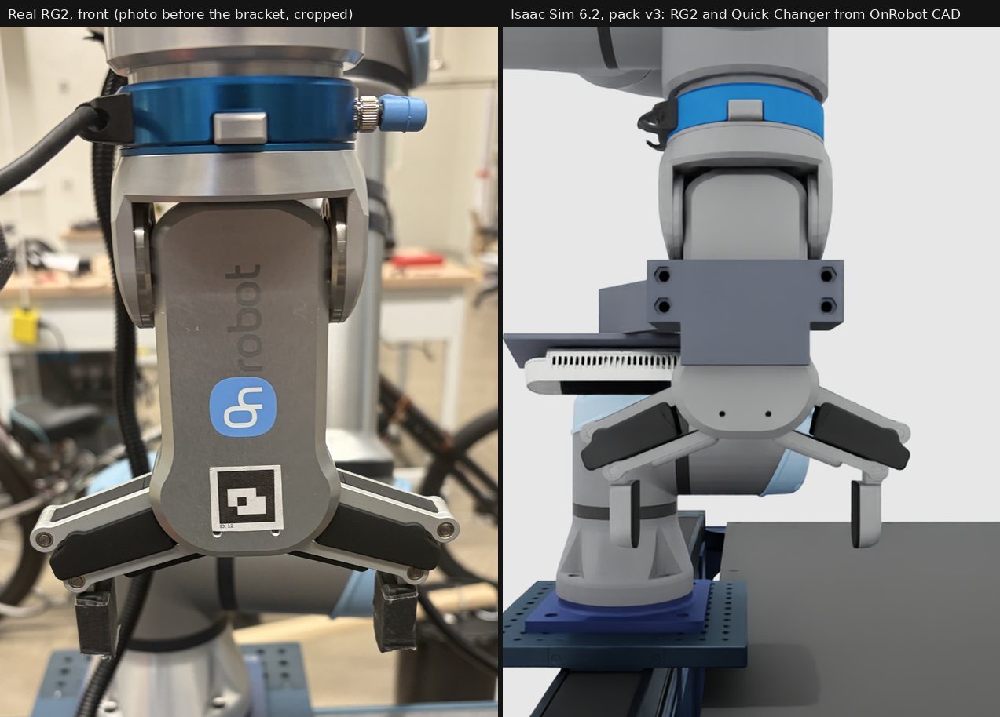
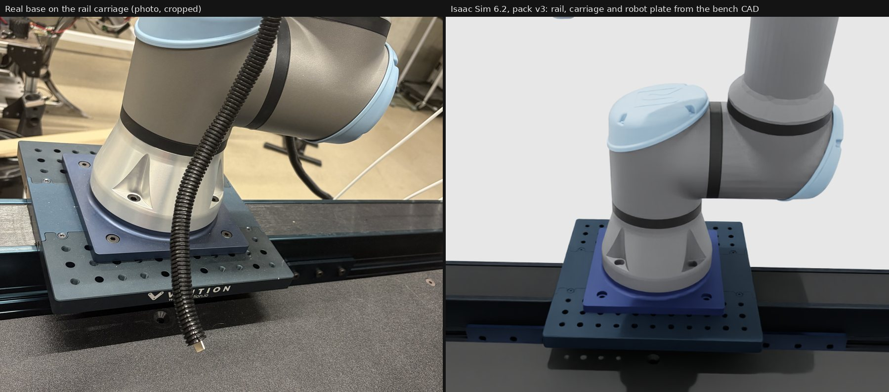

# UR5e Jenga work cell BOM and private asset pack

Status: **candidate, not runtime-qualified.** The pack-backed Workcell API is integrated
on `workcell/lab-hardware`. Integration and CPU fixture checks do
not establish a PhysX, render, sensor or lab-fidelity pass. This documentation update
does not run the simulator or inspect private assets.

## Scope

The work cell is one UR5e on the carriage of a Vention linear axis (a [seventh axis](#the-rail-the-robots-base-is-a-seventh-axis)) on a Vention bench, with an OnRobot Quick Changer, a standard OnRobot RG2
with its standard fingertips, and one camera: a D415 on a printed bracket on the gripper. That camera is the
cell's only sensor for perception and real-to-sim. The lab also owns a Bota Rokubi force/torque sensor; it is not
mounted on the arm, and the cell builds it only when `bota.mounted` is `true`
([the tool stack](#the-tool-stack-as-on-the-real-arm)). A second, overhead D415 on a removable gantry is
a proposal that is not bought and is not built (`overhead_camera.enabled` is `false` in the
config; `true` builds it).

The base cell holds no task objects. What a task adds is a **task pack** loaded on top of it:

| File | What it is |
|---|---|
| `exts/workcell/config/lab_hardware.json` | The base cell: robot, gripper stack, wrist camera (mount pose and intrinsics under `wrist_camera`), bench, mounting hardware. Asset pack `ur5e-workcell/v3` |
| `exts/workcell/workcell/bom.csv` | The base cell's BOM |
| `scripts/workcell_bracket_assets.py`, `exts/workcell/cad/rg2_camera_bracket.py` | Build pack `ur5e-workcell/v3` from `v2`: the wrist bracket becomes a parametric copy of the real printed one, a two-piece clamp on the RG2 body with a truss arm and a plate for the D415 ([parameters, sources and what to measure](../cad/README.md)). The pack keeps the USD, a STEP of the assembly and a STEP and STL of each printable piece |
| `scripts/workcell_rg2_assets.py`, `scripts/workcell_stack_assets.py`, `exts/workcell/cad/rg2_from_step.py`, `exts/workcell/cad/part_from_step.py` | Called by the script above: the RG2, the Quick Changer's robot side and the Bota Rokubi from the vendors' official STEP files, read from local copies checked by SHA-256 ([the tool stack](#the-tool-stack-as-on-the-real-arm)) |
| `scripts/workcell_camera_assets.py`, `exts/workcell/cad/wrist_bracket.py` | Build pack `ur5e-workcell/v2` (superseded): RealSense's own D415 mesh (fetched at a pinned commit, checked by SHA-256, Apache-2.0) in the colour optical frame, and a placeholder bracket on the wrist 3 housing |
| `exts/workcell/tasks/jenga_tower.json` + `.bom.csv` | Task: the tower, 54 blocks of nominal 72 x 24 x 14 mm. Asset pack `jenga/v1` |
| `exts/workcell/tasks/push_block.json` + `.bom.csv` | Task: one loose block for the RG2 to push. Asset pack `jenga/v1` |

`workcell__cell(action="quick_start")` builds the base cell alone; `task="jenga_tower"` or `task="push_block"` (or an
absolute task file) loads that task's objects on top, and the parts audit then checks the cell's BOM rows plus the
task's. A cell configuration that holds task objects is refused. `scripts/workcell_split_packs.py` writes the two packs
from `ur5e-jenga-workcell/v2`; the sections below that name `ur5e-jenga-workcell` describe that source pack.

Machine-readable data:

- BOM: `<repo>/exts/workcell/workcell/bom.csv`
- Human-readable BOM: [BOM.md](BOM.md) (the same logical rows and quantities)
- Hardware configuration: `<repo>/exts/workcell/config/lab_hardware.json`
- Audit helper: `<repo>/exts/workcell/workcell/bom.py`
- Audit test: `<repo>/mcp/tests/test_workcell_bom.py`

## Pack-backed Workcell API

The integration exposes four grouped tools with eight actions through `twinsmith.bridge`, in the `sim` toolset (off by
default: add `+sim`):

| Group | Actions | Purpose |
| --- | --- | --- |
| `workcell__cell` | `quick_start`, `status`, `shutdown` | Build a stopped pack-backed scene, read its report, or release workcell state without clearing the stage |
| `workcell__robot` | `status`, `wrench`, `rail` | Read the robot build report; read the simulated wrist force/torque sensor with the weight it carries (the UR5e's own flange sensor, or the Bota when `bota.mounted` is `true`); read or set the position of the rail under the robot's base, in the real axis's millimetres |
| `workcell__perception` | `status` | Read camera configuration, not captured sensor data |
| `workcell__jenga` | `build`, `status` | With the `jenga_tower` task loaded: replace the tower on a stopped timeline or read its build report |

`quick_start` accepts `config_path`, `mode` (`physics` or `mirror_real`),
`discard_changes`, `task` (a task name or an absolute task file) and `environment` (`none` or
`simple_room`), and answers with a summary;
`workcell__cell(action="status")` returns the full report. `simple_room` references NVIDIA's
Simple Room from the Isaac Sim assets server (checked before the stage is replaced) with its
ground level with the bench feet; room parts inside the bench are deactivated, every room
collider but the ground plane is off. A physics scene, joints and lights the room brings are
deactivated, its articulation roots removed, its rigid bodies made kinematic and its instanced
parts de-instanced. Physics mode uses gravity; mirror mode uses zero gravity, not a
real-robot connection. Replacing an unsaved stage requires explicit consent. There is no
extension panel or legacy ROS graph setup, and no planning,
real-hardware control or evaluation. Generic scene tools remain separate. See the
[tool reference](../../../docs/TOOLS-WORKCELL.md) for the baseline contract.

The Jenga build action accepts optional `profile` and `seed` overrides. Defaults select
`measured_pending` with seed 42: modest bounded uniform variation of mass, friction and
dimensions. All distribution numbers and the selection/seed defaults are explicitly
unconfirmed and easy to overwrite in the configuration. Placement follows sampled block
sizes, not independently randomized tower poses. Rebuild replaces the old tower;
the internal pose-reset helper restores realized initial transforms without resampling,
restoring velocities or resetting solver state. See the
[exact variation schema and limits](../../../docs/TOOLS-WORKCELL.md#seeded-jenga-variation).

## Hardware configuration and provenance

`lab_hardware.json` is the single hardware configuration. Every section field is
`{value, status, source}`; structured profiles are nested within `value`. Config statuses
are only `confirmed` or `unconfirmed`; the other labels below describe BOM/provenance
concepts, not accepted config statuses. The BOM does not replace it or silently choose between
conflicting measurements.

| Status | Meaning |
| --- | --- |
| `confirmed` | Measured, or stated by the lab owner or a datasheet |
| `unconfirmed` | Best current value; must be measured before fabrication or fidelity claims |
| `conflict` | Sources disagree; the configured value is the default, alternatives are recorded |
| `placeholder` | Stand-in geometry or physics value, not a hardware statement |
| `to_buy` | Item is not in the lab; the value is a design choice |

The pack-backed work-cell configuration selects the pack by `pack.id` and `pack.version`
and maps every physical scene role to a **logical asset ID** under `assets`. No asset file
path is stored in the configuration, and there is no old-store path fallback.

`documentation.bom_csv.value` is `../workcell/bom.csv`, resolved relative to the
configuration directory. Preserve that layout when copying a configuration, or overwrite
this field with the appropriate BOM path; it is not relative to the process working directory.

## BOM IDs and quantities

`bom.csv` uses one row per logical asset and instance counts in `quantity`. Every simulated
physical part must map to one of these rows.

| Area | BOM IDs and quantity |
| --- | --- |
| Scene | `bench` 1, `rail_carriage` 1 (the carriage of the bench's linear axis and the robot plate on it: what moves under the robot) |
| Robot | `robot` 1, `base_plate` 1, `bota` 1, `quick_changer` 1, `rg2` 1 (built: `robot`, `quick_changer`, `rg2`; `bota` only with `bota.mounted`, `base_plate` only with `base_plate.present`) |
| Cameras | `d415` 2, `wrist_mount` 1, `overhead_mount` 1, `overhead_release` 1, `overhead_shelf` 1 (built: one `d415` and `wrist_mount`; the overhead rows only with `overhead_camera.enabled`) |
| Jenga (task packs, not the cell) | `jenga_block` 54 for `jenga_tower`, 1 for `push_block` |

Both cameras use the single `d415` logical asset; the BOM records two physical units. A partial tower may instantiate
fewer blocks than the BOM quantity, but each instantiated block maps to `jenga_block`.

## Pricing

`bom.csv` separates money from hardware provenance:

- `price_status=verified_web_list`: a public manufacturer or store list price captured on
  2026-11-12 with its URL in `price_source`. It is a list price, not a quote.
- `price_status=quote_required`: no verified public price for the required configuration.
  `unit_price` is intentionally blank, never zero and never invented.

The only known item prices recorded for this BOM are the D415 body (272.00 USD each,
two units) and the Thorlabs KB3X3 release (117.27 USD, one unit). These are recorded
list prices, not newly checked prices or procurement quotes. Every other row, including
the complete overhead gantry, remains `quote_required`. No complete workcell total is
available; missing prices are not zero.

No purchase, order or financial action is performed by this documentation or its tests.

## Private asset pack

The pack is external to the repository:

- Pack ID and version: `ur5e-jenga-workcell/v1`
- Default root: `<workspace>/assets`;
  `<workspace>` is `TWINSMITH_WORKSPACE`, else the folder that holds the checkout (when it has `envs/` or an asset folder), else `<home>/robotics-workspace`
- Pack directory: `<workspace>/assets/ur5e-jenga-workcell/v1`
- Override: set `TWINSMITH_ASSET_ROOT` to a different asset root; the loader appends the
  pack ID and version.

All pack binaries are private, untracked lab data. They are not committed to the
repository and are not redistributable.

`pack.yaml` is JSON-compatible YAML with this shape:

```yaml
id: ur5e-jenga-workcell
version: v1
qualification: candidate; no PhysX, render, or lab-fidelity pass yet
files:
  - asset_id: robot
    path: robot/robot.usdc
    sha256: <64 lowercase hex characters>
    source: <where the CAD came from and its source hash>
    license: <license or private-use statement>
    redistributable: false
    fidelity: <what is genuine, flattened or proxied>
```

`asset_id` is optional in the schema and defaults to the parent directory name. The current
pack declares it for every file. Every referenced file needs `path`, `sha256`, `source`,
`license` and a boolean `redistributable`.

Loader contract:

- `asset_pack.AssetPack.asset(logical_id)` returns the absolute path for a logical ID.
- `asset_pack.resolve_pack(config)` resolves the configured pack ID and version.
- `asset_pack.verify_dependencies(pack)` reports the dependency closure and unresolved
  references.

The scene integration uses those functions. It must not fall back to an old store, a
previous checkout or a path in the configuration.

## Making or updating a pack

1. Work from a lab-authorized source copy. Do not delete or move an existing asset store.
2. Flatten the chosen USD, remove instanceable prototypes, keep the default prim and set
   metres, kilograms and Z-up. Replace proprietary MDL materials with USD Preview Surface
   materials when the MDL cannot ship in the private pack.
3. Remove external asset references that cannot be resolved inside the pack. The final
   file must be self-contained.
4. Write the file under
   `<root>/ur5e-jenga-workcell/v1/<asset_id>/<asset_id>.usdc` (or `.usda`).
5. Hash the final bytes with SHA-256 and record the source hash, license and
   `redistributable` flag in `pack.yaml`.
6. Run the dependency closure check. Each file should report one layer (the `v2` bench: its file and the two layers it
   sublayers), no external asset references and no unresolved references. A dependency failure blocks the pack; it is not
   worked around with a fallback path.
7. Load the pack through `AssetPack.asset` and `resolve_pack`, then run the BOM audit and the
   PhysX smoke before claiming runtime qualification or making any old-store report.

The BOM audit checks structural manifest fields and, when given a pack root, the actual file
hashes. It also requires every non-`materials` pack asset to have a BOM row and every BOM
asset to exist in the pack.

## Pack v2

`v2` is built from `v1` by `scripts/workcell_pack_v2.py` (CPU only; run it from `mcp/` with
`uv run --locked --isolated --python 3.12 --extra scene-test python ../scripts/workcell_pack_v2.py`). `v1` is only read, and
`v2` is written by the pack library's staged, verified writer. Each changed file's record names the `v1` file and hash it came
from. The changes:

- **Bench.** `bench/bench.usda` composes `bench_render.usdc` (the original meshes) and `bench_collision.usdc` (one oriented box
  per mesh, purpose `guide`), made with `assets__mesh` split. The work cell keeps a bench's own collision layer, so the 385
  triangle-mesh colliders (1.63 M triangles) that overflow Newton are no longer created.
- **RG2.** The gripper has no articulation root of its own and joins the arm's articulation through its mount joint. The
  massless `gripper_center` body and its fixed joint are a plain frame. The two loop-closing joints, excluded from the
  articulation, are removed together with the zero-force drives of the passive joints. Each finger's inner joints follow
  its driven knuckle through `NewtonMimicAPI`, which PhysX (Isaac Sim 6.2) and Newton 1.6 both read. The ratios are solved
  from the asset's own joint frames over the knuckle's limits: inner finger -0.9897 and inner knuckle +0.9919 times the
  driven joint, with a worst closure gap of 0.037 mm for the linear fit. `pack.yaml` records them under `mimic`. PhysX
  accepts a mimic only on revolute joints with finite limits, so each follower's limits are its leader's range mapped
  through the ratio, plus 5 degrees.
- **UR5e.** The disabled `robot_gripper_joint` (no second body) is removed. **The drive gains are unchanged.** They are stiff
  enough for PhysX with gravity on, and `assets__validate` warns (`DRIVE_GAIN`) that they are too stiff for a 500 Hz explicit
  solver; the gains Newton needs are a per-engine setting for Phase 2, not a pack edit.

`assets__validate` passes on the bench and the RG2, and gives only the six `DRIVE_GAIN` warnings on the UR5e.

**Live on PhysX (2026-11-14, Isaac Sim 6.2.0, headless, RTX PRO 6000 Blackwell, physics at 600 Hz).**
- `scripts/workcell_smoke.py` passes. The arm and gripper form one articulation, and nothing is patched at build time.
- Twelve DOFs: six arm joints, two driven knuckles and four mimic followers. Every value stays finite.
- With gravity on, the arm drifts at most 0.0002 degrees over 960 steps.
- Both knuckles were commanded to -20 degrees and reached -17.7 degrees after 360 steps, held back by the 1 N m drive.
- The four mimic followers matched their ratio to within 0.001 degrees.
- Kit logged no warnings or errors.
- The 54-block tower settled by at most 0.95 mm over 2 s.
- Not tested: Newton, grasp contact and cameras.

## The tool stack, as on the real arm

The default cell is the arm as it stands in the lab (photos of 2026-11-14): wrist 3's flange, the OnRobot Quick Changer,
the RG2 with its standard fingertips, the printed camera bracket and the D415. Nothing else hangs from the flange, and
nothing that is not on the real arm is built.



What still differs in the picture: the photo was taken before the camera bracket was fitted; the simulated gripper has
no logo, AprilTag, tape or cables, and its materials are look only.

| Part | Geometry | Source |
|---|---|---|
| Quick Changer, robot side | Official CAD: 13.6 mm from the flange to its face toward the tool, 71 mm across. The large cable holder of the file is left out (the photos show the connector free); the small clip opposite the connector is kept | OnRobot "Quick Changer Robot side" v2, <https://onrobot.com/storage/quick-changer-robot-side_v2_with_cable_holder.step>, linked from <https://onrobot.com/en/products/quick-changer>; datasheet v2.0 gives the same 13.6 mm |
| RG2 with the Quick Changer's tool side | Official CAD, 107,599 triangles after decimation | OnRobot "RG2 Tier 2 - 101631", <https://onrobot.com/storage/303_rg2_tool.step>, linked from <https://onrobot.com/en/products/rg2-finger-gripper> |
| Camera bracket | Parametric copy of the printed part, estimated from one photo ([CAD](../cad/README.md)) | `exts/workcell/cad/rg2_camera_bracket.py` |
| D415 | Vendor mesh | RealSense ROS description (Apache-2.0) |
| Bota Rokubi (only with `bota.mounted`) | Official CAD, 32 mm high, 48 mm across | Bota Systems "Rokubi/Medusa Gen 0 Series Side" (ROK-A000), <https://shop.botasys.com/shop/rokubi-medusa-gen-0-series-kit-1877/document/180>, listed on <https://shop.botasys.com/shop/rokubi-medusa-gen-0-series-kit-1877> |

The vendors' STEP files are not in this repository and not in the pack. Neither OnRobot nor Bota Systems states
redistribution terms for them, so `scripts/workcell_bracket_assets.py` reads each from a local path
(`TWINSMITH_RG2_STEP`, `TWINSMITH_QC_STEP`, `TWINSMITH_BOTA_STEP`), checks it against a pinned SHA-256, and writes the
converted geometry into the private pack only; the pack's manifest records the URL, the hash and "do not redistribute".
A STEP is parsed as data by FreeCAD; nothing in it is run.

OnRobot's RG2 STEP also holds the Quick Changer's robot side, in place on the gripper. That fixes how the two meet:
the robot's flange plane is 2.5 mm into the RG2 body frame (`onrobot_rg2_base_link`, whose origin is the rim of the
robot side) and the robot side ends 13.6 mm further (`asset_layout.rg2.mount_pose`, `quick_changer.standoff_m`). The
15.92 mm the cell used before was a CAD value of unknown origin.

### One switch for the Bota

The lab owns a Bota Rokubi force/torque sensor (BFT-ROKS-SER-M8, to be confirmed); it is not mounted on the arm.
`bota.mounted` in `lab_hardware.json` is `false`. Setting it to `true`, and editing nothing else, puts an adapter plate,
the sensor and a second adapter plate between the flange and the Quick Changer; everything below follows from
`exts/workcell/workcell/stack.py`:

| | `bota.mounted: false` (default) | `bota.mounted: true` |
|---|---|---|
| Stack from the flange | Quick Changer, RG2 | plate, Bota, plate, Quick Changer, RG2 |
| Bota prims | none | `<assembly>/bota`, `bota_robot_plate`, `bota_tool_plate` |
| Flange plane to the RG2's inlet | 13.6 mm | 61.6 mm (8 + 32 + 8 + 13.6) |
| RG2 body frame origin in tool0 | (0, 0, -2.5) mm | (0, 0, 45.5) mm |
| Tool centre point in tool0 (centre of the fingertip pads, pads together) | (0, 0, 216.1) mm | (0, 0, 264.1) mm |
| Wrist camera optical origin in tool0 | (33.0, 66.0, 114.5) mm | (33.0, 66.0, 162.5) mm |
| Payload below the flange | 1.004 kg, centre of gravity (5.6, 5.6, 77.1) mm in tool0 | 1.251 kg, (4.5, 4.5, 105.1) mm |
| `workcell__robot(action="wrench")` | the UR5e's own flange sensor | the Bota's reading, with the flange reading under `flange` |

The tool centre point moves along the tool axis as the fingers open: 216.1 mm with the pads together, 199.3 mm at
joint zero (pads 75 mm apart) and 178.0 mm fully open, from the flange, without the Bota. Before this change the
simulated stack had the Bota in it and a 15.92 mm Quick Changer: the RG2's inlet was 47.92 mm from the flange and the
same point 266.5 mm from it.

With the switch on, two things are **not measured** and the build report says so (`robot.tool.unmeasured`,
`robot.proxies`): the two adapter plates. No drawing or part exists for them and Bota publishes none for this flange
(its Universal Robots kit is built on the SensONE, which bolts to the flange directly). Each is a labelled placeholder
disc from `bota.robot_side_plate` and `bota.tool_side_plate`: 63 mm across, 8 mm thick, 67 g. Which face of the sensor
is toward the tool and where its connector points are not confirmed either.

### Payload

What hangs from the flange, as a pendant wants it (`robot.tool.payload` in the build report; tool0's origin is the
centre of the flange plane, +Z along the tool axis; fingers at joint zero):

| Item | Mass | Centre of gravity in tool0 (mm) | Source | Status |
|---|--:|---|---|---|
| Quick Changer, robot side | 0.060 kg | (2.4, 0.6, 4.3) | OnRobot Quick Changer datasheet v2.0; centre of volume of the official CAD | datasheet; not weighed |
| RG2 with the Quick Changer's tool side | 0.780 kg | (-0.2, 0.0, 78.5) | OnRobot RG2 datasheet v1.8; centre from the link masses in `inertials` | datasheet; taken to include the tool side (it is part of OnRobot's RG2 CAD): weigh it |
| Camera bracket with its four M4 bolts | 0.100 kg | (13.2, 13.6, 85.9) | CAD volume 112.6 cm3 (140 g solid PLA), about 80 g as printed, plus 20 g of bolts | estimate: weigh it |
| D415 | 0.064 kg | (68.0, 66.1, 114.3) | Intel D400 datasheet rev 017, table 3-51 | datasheet, within 10 percent |
| **Total** | **1.004 kg** | **(5.6, 5.6, 77.1)** | | cables not included |

With the Bota mounted the two plates (0.067 kg each, placeholders) and the sensor (0.113 kg, datasheet) are added:
1.251 kg at (4.5, 4.5, 105.1) mm.

The simulation carries the same mass. The bracket and the D415 have no rigid body of their own (their prims hang from
tool0 and their collider is on the RG2 body), so their masses are added to the RG2 body's mass properties as point
masses at their centres of gravity (`robot.carried_on_rg2`). A test sums the masses below the flange on the built
stage and compares them with this table.

### Force/torque read

`workcell__robot(action="wrench")` reads the cell's wrist force/torque sensor. Its reply names the sensor in `source`.

- **Default: the UR5e's own tool flange sensor** (`source: "ur5e_tool_flange_sensor"`, `flange_ft_sensor` in the config).
  The value is the reaction at the fixed joint between wrist 3 and the first part bolted to the flange: force and
  torque exerted on the tool by the arm, at the centre of the flange plane, in tool0's axes (`frame_id` `tool0`, the
  stock `ur_robot_driver` name; the lab's own files do not subscribe to that topic, so this is not confirmed for the
  lab). It carries everything below the flange, and `load_below_sensor` gives that mass and weight.
- **With `bota.mounted`: the Bota's reading** (`source: "bota_rokubi"`): the reaction at the sensor's tool-side face, in
  the sensor frame (`bota_ft_sensor`), carrying everything below the sensor. The flange reading comes with it under
  `flange`.
- **Raw, not what the real controller publishes.** The simulated value holds the whole weight below the sensor. The
  real controller reports the force at the tool centre point after subtracting the payload set on the pendant, so
  compare the two after removing the payload's weight, or with the pendant's payload at zero. The real driver's sign
  convention has not been checked against this one.
- **Not modelled:** noise, drift, range and accuracy. The UR5e's sensor is specified at 50 N range, 3.5 N precision
  and 4.0 N accuracy in force, and 10 N m, 0.2 N m and 0.3 N m in torque (Universal Robots, UR5e technical details,
  <https://www.universal-robots.com/media/1807465/ur5e_e-series_datasheets_web.pdf>); the config records these as the
  error bars for a comparison with the real reading. A 15 g Jenga block (0.147 N) is far below them.

Measured (2026-11-14, Isaac Sim 6.2.0, one run each; arm joints in degrees):

| State, engine | Pose | Reading | Force | Expected (mass below) |
|---|---|---|--:|--:|
| off, Newton | as built (all zero) | flange | 9.8492 N | 9.8492 N (1.003999 kg) |
| off, Newton | tool down (0, -80, 100, -110, -90, 0) | flange | 9.8492 N, (-0.0001, 0.0210, -9.8492) | 9.8492 N |
| off, Newton | tool horizontal (0, -80, 100, -10, -90, 0) | flange | 9.8492 N | 9.8492 N |
| off, PhysX | as built / tool down / tool horizontal | flange | 9.8496 / 9.8545 / 9.8485 N | 9.8492 N |
| on, Newton | tool down | Bota | 10.5065 N, (-10.5065, -0.0001, 0.0236) | 10.5065 N (1.070999 kg) |
| on, Newton | tool down | flange | 12.2723 N | 12.2723 N (1.250999 kg) |
| on, PhysX | as built / tool down / tool horizontal | Bota | 10.5073 / 10.5163 / 10.5066 N | 10.5065 N |
| on, PhysX | as built / tool down / tool horizontal | flange | 12.2732 / 12.2829 / 12.2724 N | 12.2723 N |

At tool down without the Bota the torque is (-0.0564, 0.0544, 0.0001) N m: the weight acting at the payload's centre
of gravity, 5.6 mm off the axis on both sides. `scripts/workcell_static_wrench.py` repeats the check (both readings
when the Bota is mounted) and passed on Newton in both states. In every run the RG2 body had 0 contact pairs at the
built pose and with the tool down, with and without `task="jenga_tower"` on Newton.

### Where the robot stands

The bench asset is Vention's CAD of the lab's bench (`VentionAssembly_393251_v88`) and already holds what the photo of
the base shows: a rail along one long side of the table with its belt (`MO_LM_024`), the carriage plate on it
(`MO_LM_027_0001`, 268 x 268 mm, top face 58 mm above the table top) and the robot plate (`ST_RB_001_0002`,
180 x 180 x 22 mm, top face 80 mm above the table top, centred within 1 mm of the robot's axis). The robot's base
sits on that plate (`robot.placement` z = 0.080 m), the carriage and the plate move with it
([the rail](#the-rail-the-robots-base-is-a-seventh-axis)), and the 5 mm proxy plate is not built (`base_plate.present` is
`false`; `true` builds it again for a bench without plates). Until 2026-11-14 the base sat 5 mm above the table top,
inside these parts. The 80 mm is the CAD's, not a lab measurement: measure the underside of the base flange above the
table top.

### What quick_start builds

| Prim group (default build, no task) | On the real cell? |
|---|---|
| `/World/Bench` (frame, table top, the rail with its belt and motor, the controller boxes under the table) | Yes; Vention's CAD. The rail, the table top and the frame's top edge are in the photos; the motor, the frame below the table and the controller boxes are not visible in any photo and are kept as the CAD has them. Colliders are one box per part; the top's colour and friction are placeholders |
| `/World/RobotAssembly/rail` (the carriage's gantry plate and the robot plate) | Yes (photos); Vention's CAD, split out of the bench so it can move |
| `/World/RobotAssembly/robot` (UR5e) | Yes (photos); vendor mesh |
| `/World/RobotAssembly/quick_changer` | Yes (photos); OnRobot's CAD. Its connector plug and cable are not modelled |
| `/World/RobotAssembly/rg2`, with its fingertips | Yes (photos); OnRobot's CAD. The tape on the fingertips is a friction value, not geometry |
| `<tool0>/wrist_d415/bracket` and `<rg2 body>/wrist_mount_collision` | Yes, **proxy shape**: a parametric copy estimated from one photo; the collider is five convex hulls |
| `<tool0>/wrist_d415/body` and the camera prim | Yes (photos); vendor mesh. No collider |
| `/World/RobotAssembly/joints`, lights, physics scene, materials | Not hardware |

Not on the real cell, and no longer built by default (each stays available behind its switch): the Bota and its adapter
plates (`bota.mounted`), the 5 mm base plate proxy (`base_plate.present`), the overhead camera with its gantry, release
plate and shelf (`overhead_camera.enabled`, already off). The add-on finger pads are gone altogether: the real gripper
has none. Task objects (Jenga blocks) appear only with `task=`.

Left out of the bench (`scripts/workcell_rail_assets.py`): **the cable carrier**. Vention's CAD has a drag chain beside
the rail (27 links, `MO_DC_001`), its bracket on the carriage (`ST_GP_001_0004`) and, below the rail's outer side, the
tray it lies in with the tray's supports (one 1260 mm extrusion, three 135 mm cross pieces, five end caps, four corner
plates and three connectors: 18 prims in all). The photos of the real cell show no drag chain, and cable management is
not modelled. The chain and its bracket are absent in the photos; the tray is below the table's edge, where no photo
looks, and goes with the chain it serves: say so if the real bench has it. Cables, wires and conduits are not modelled
anywhere.

Looks follow the photos and change nothing in the physics: grey anodised aluminium and black covers on the RG2, a
blue Quick Changer ring, the UR's grey tubes, silver housings and light blue caps (`looks.robot_materials`, applied to
the robot asset's own materials on the stage), a black rail, a dark blue carriage plate and a blue robot plate.

## The rail: the robot's base is a seventh axis

On the real cell the UR5e is bolted to the carriage of a Vention linear axis that runs along the table's long edge, and
the lab moves it (`RISL_vention_ros`). The cell models it as a driven joint under the robot's base.




What still differs: cables, conduits and the objects on the table are not modelled; the arm's pose is only roughly the
photo's; looks are approximate.

### Specification

Status says where a value comes from: **lab code** (the lab's public packages, read at the commits named below),
**CAD** (Vention's CAD of the lab's bench, the bench asset in the private pack), **Vention** (its public
documentation), **assumed** or **chosen** (not from any source, and labelled so in the config), **not found**.

| Item | Value | Source and status |
|---|---|---|
| Actuator | Vention heavy-duty enclosed timing belt actuator, 1530 mm extrusion (MO-LM-027 family); belt 20 mm HTD8, 208 mm per motor turn | CAD: carriage group `MO_LM_027_0001`, 268 x 268 mm gantry plate, extrusion `ST_EXT_007_0585_1530`, belt `MO_LM_024_XXXX_1720`, 1777 mm overall. Vention: the heavy-duty version has a 270 x 270 mm gantry and is extrusion + 247.5 mm long (<https://docs.vention.com/docs/enclosed-timing-belt-actuator>). Not read off the actuator's label |
| Motor | Motor and gearbox at the +X end (`MO_SM_012_0001`) | CAD. Type and gear ratio not read |
| Controller | Vention MachineMotion, TCP port 9999 | Lab code (`vention_socket_control.py`) |
| Travel | 1270 mm between the home and end sensors; 1285 mm between the hard stops | Vention: extrusion length - 260 mm for the heavy-duty version, including 15 mm for the sensors. CAD agrees within 1 cm (1262 mm before the carriage passes the extrusion's ends). **Not confirmed for the lab's unit**: the sensors can sit in any of four ports |
| Simulated limits | -0.635 to +0.635 m about the built pose | Chosen: Vention's travel centred on the carriage's position in the CAD (the middle of the extrusion). Inside what the geometry allows. The lab's own soft limits: **not found** |
| Axis direction in the cell | World +X, along the table's long edge, beside the table top's +Y edge; the motor is at the +X end | CAD and photos |
| Sign convention of the real axis | Positive toward +X | **Assumed.** Not found in lab code or Vention's documentation |
| Zero (home) of the real axis | At the -X end of the travel, so the built pose is 635 mm | **Assumed.** Lab code shows only that 0.0 mm is reachable (the test moves to 100.0 and back to 0.0) and that the README's example is 650.0 mm, which is 15 mm from the middle if zero is at an end. Vention: homing runs to the home sensor and sets zero there; where that sensor is on this rail is not known |
| Default position | Joint zero: the carriage where the CAD has it, the middle of the travel, the robot's axis at the cell's origin | CAD. The real resting position: **not found** |
| Speed | 0.25 m/s | **Chosen** for the simulation. Not found: lab code sets none; Vention gives performance curves, not a number |
| Acceleration | 0.5 m/s2 | **Chosen** for the simulation. Not found |
| Force | 1240 N, the position drive's limit | Vention: maximum peak axial force |
| Repeatability, backlash | 0.3 mm, 0.25 mm | Vention. Not modelled |
| Real interface | Topic `/vention/axis1_position_cmd`, `std_msgs/msg/Float64`, an absolute position of axis 1 in **millimetres**; the node sends `SET im_move_abs_1/<mm>/` and polls `isReady` and `isBusy` | Lab code, <https://github.com/MaxlGao/RISL_vention_ros> at `ac9c7da23cf7daeacd5c9ecc37c7d5d699c1e53b` (Apache-2.0). Mirrored in `interfaces.rail_position_command` |
| How the carriage holds the robot | Rail top 35 mm above the table top; gantry plate 268 x 268 x 23 mm (`MO_LM_025_0004`), top at 58 mm; Vention robot plate 180 x 180 x 22 mm with two locating pins (`ST_RB_001_0002`), top at 80 mm; the robot's base on it, four screws | CAD for the sizes and heights, photo for the stack and the four screws. Bolt pattern not read from the CAD; nothing measured in the lab |
| Moving mass | 4.6 kg for the carriage and the robot plate | Estimate: CAD volumes as aluminium. Vention gives only the whole actuator's 27.31 kg |

The other four lab packages (`RISL_ur` at `011539ab`, `RISL_onrobot_ros` at `7f86a05a`, `RISL_simulation` at `d659f7d4`,
`risl_assembly_workspace` at `82b9a510`) do not mention the rail beyond listing the Vention package. Vention's current
socket document (<https://docs.vention.com/docs/application-programming-interface-low-level-sockets-for-machinemotion>,
MachineMotion 3.1 and newer) confirms port 9999 and millimetres, mm/s and mm/s2; the older command set the lab's node
uses was not found in Vention's public documentation.

**To be read from the controller or measured on the real axis:** the travel between its sensors and its soft limits;
which end is home and which way positive runs; the configured speed and acceleration; where the carriage rests; the
height of the robot's base above the table top; the moving mass.

### How it is built

- The pack's bench is split (`scripts/workcell_rail_assets.py`): `bench` is the static bench with the rail, and
  `rail_carriage` is what moves, the carriage group and the robot plate, referenced from the same vendor meshes.
- One articulation, as before, with one more joint. A geometry-free **rail link** is fixed to the world by the arm's
  root joint, which keeps its path (`<assembly>/robot/root_joint`); a prismatic **`rail_joint`** carries the carriage;
  a fixed joint holds the robot's base on the carriage. The rail must be in the arm's articulation for the carriage's
  motion to act on the arm, and both engines want it this way round: Newton keeps the base fixed when the root joint
  itself is made prismatic, and refuses a joint written child first.
- The joint is in **metres, zero at the built pose, positive along world +X**, limits -0.635 to 0.635. Its position
  drive is per engine (`rail.drive`): 200,000 N/m and 6,000 N s/m on both, with a 5 kg armature on Newton
  (`dt^2 k / armature` = 0.16 against a limit of 4), limited to 1240 N.
- The carriage's gantry plate and bearing blocks ride on the rail and have no collision; the robot plate and the screws
  beside it keep theirs.
- `rail.moving: false` builds the base fixed at the built pose, with the carriage as scenery.

### What changes for a caller

| | Before | Now |
|---|---|---|
| Joint names from the joint tools | six arm joints, then the gripper's | `rail_joint` first, then the same names. **Every index moves up by one**; names do not change |
| `sim__joints` (state, command, move, teleport) | arm in radians | the same, plus `rail_joint` in metres from the built pose; a target outside -0.635 to 0.635 is refused |
| `sim__arm(action="ik")` and `fk` without `base_link` | the six arm joints | **a seven-joint chain from the rail link: the answer holds a `rail_joint` target, and it is usually not zero** (0.50 m for a point 0.2 m from the robot in the check below). Pass `base_link=<robot report's arm_base_link>` to solve for the six arm joints at the rail's current position |
| Articulation root path | `<assembly>/robot/root_joint` | unchanged |
| A step command to the rail | | PhysX limits the joint's speed to `rail.speed_m_s` (0.26 m/s measured). **Newton applies no joint velocity limit**: a 0.3 m step peaked at 3.3 m/s. Send intermediate targets for a move at the configured speed, as for the arm |
| Real units | | `workcell__robot(action="rail")` reads the position, and with `position_mm` sets the target, in the real axis's millimetres from home (650.0 is joint 0.015 m with the assumed mapping). It steps nothing |

### Measured (2026-11-14, Isaac Sim 6.2.0, one run each)

The arm held tool down (0, -80, 100, -110, -90, 0 degrees) while the rail was sent along a trapezoid at 0.25 m/s and
0.5 m/s2, a new target every 20 ms.

| Engine | Move | Reached, error | Arm's worst joint error during the move | Drift over 2 s after | RG2 body, carriage and base link contact pairs | Flange force (9.8492 N expected) |
|---|---|---|--:|--:|--:|--:|
| Newton | 0 to +0.635 m (3.0 s) | 0.6349998 m, 0.0002 mm | 0.062 degrees | 0 | 0 | 9.8492 N |
| Newton | +0.635 to -0.635 m (5.6 s) | -0.6349998 m, 0.0002 mm | 0.054 degrees | 0 | 0 | 9.8492 N |
| Newton | back to 0 | 0.0000000 m | 0.062 degrees | 0 | 0 | 9.8492 N |
| PhysX | 0 to +0.635 m | 0.6349946 m, 0.005 mm | 0.008 degrees | 0 | 0 | 9.7989 N, 2 s after stopping |
| PhysX | +0.635 to -0.635 m | -0.6349723 m, 0.028 mm | 0.008 degrees | 0 | 0 | 9.8535 N |
| PhysX | back to 0 | 0.0000153 m, 0.015 mm | 0.008 degrees | 0 | 0 | 9.8529 N |

On Newton the carriage lagged its moving target by at most 4.8 mm. At the built pose (every joint at zero, rail at 0):
0 contact pairs on both engines. Limits: the joint tools refuse a target beyond the limit on both engines, and the work
cell's tool refuses 1300 mm ("outside the simulated travel [0, 1270] mm"). At the default rail position the static
wrench check passes on both engines (Newton 9.8492 N in three poses, with and without the tower; PhysX 9.8495, 9.8533
and 9.8492 N), and the `push_block` grasp passes on Newton with the arm's IK given `base_link` (flange force +0.14716 N
for a 0.14715 N block, 0.14 mm of slip in the lift and 0.11 mm over 3 s). Host tests repeat the guard distances with
the carriage at both ends of the travel.

## Physical fidelity

The current candidate contains:

- Genuine UR5e and Vention bench meshes, flattened from preserved local vendor CAD, and the OnRobot Quick Changer
  (robot side), the OnRobot RG2 and the Bota Rokubi converted from the vendors' official STEP files
  ([the tool stack](#the-tool-stack-as-on-the-real-arm)). Materials are preview materials, so appearance is not
  vendor-accurate.
- No gantry CAD is available: it is a dimensioned, unconfirmed proxy, and so are the Bota's adapter plates. The D415 body is
  the vendor's mesh; the wrist bracket is a FreeCAD copy of the lab's printed bracket estimated from one photo
  ([what was sourced and what must be measured](../cad/README.md)), not the lab's own CAD.
- With `overhead_camera.enabled` (off in the shipped config), the overhead support is the pack's three-member gantry (two posts and a cross-member).
  The posts stand on the bench top panel (inside its measured footprint, x up to 0.9436 m,
  y -0.811..-0.091 m), outside the arm's reach, and the camera hangs under the
  beam through the stacked pack proxies (camera, printed shelf, KB3X3 release plate, beam
  underside), each touching the next within 2 mm. The stack heights come from the proxy
  dimensions, the pack scales member thickness with the post span, and the real attachment
  details are unconfirmed, so this does not establish mounting feasibility. The KB3X3 is a
  camera-only release, not a load-bearing gantry base. Printed mounts and shelf remain proxies.
- The wrist D415 is on a printed bracket clamped to the RG2 body (not to the wrist and not between flange faces, so the
  tool stack is unchanged and the camera turns with the gripper). It sits off the RG2's back face, the face opposite
  the lab's AprilTag: body centred 66 mm behind the tool axis and 68 mm to one side, long axis along the
  finger-opening axis, tilted 25 degrees about that axis so it looks at the fingertips, with the gripper toward the
  top of the image. The pose is configured in the RG2 body frame (`wrist_camera.offset_in_rg2_m`,
  `rotation_in_rg2_deg`) and the builder derives the tool0 pose from the stack, so the camera follows the RG2 when the
  stack changes. It is an estimate from one photo (about 15 mm and 8 degrees), not a measurement. In the simulated
  image the fingertips are along the top edge; with the gripper fully open the finger on the far side leaves the
  image ([capture](../../../docs/media/workcell-wrist-view-sim.jpg)). Tests build the real pack and check that the
  collar is around the RG2's 54 x 36 mm waist, that the camera's back is on the plate, that bracket and camera stay
  out of the slab the finger linkage moves in, and that the image shows the fingertips and not the arm or the bracket.
  The RG2 is mounted with its front face (logo, AprilTag) on the side of wrist 3's tool connector, tool0 -Y, as the
  photos of the real wrist show (`asset_layout.rg2.mount_pose`: from photos, confirm on the robot), so the camera is on
  the tool0 +Y side. Known limits: the cell is built with every joint at zero, the arm stretched out along the bench
  with the tool axis about 141 mm above the table top (`robot.initial_joint_deg` is read by nothing); the camera is on
  the upper side there, 193 mm clear of the bench. A test checks every bracket shape and the camera body against the
  bench (with the plates the robot stands on) and the rest of the robot at that pose and with the tool down, with and
  without the Bota in the stack.
  The bracket has a collider; the D415 body has none. The pack's bracket asset carries five convex hulls (`collar`,
  `front_bar_extension`, `truss`, `plate_support`, `camera_plate`, each with `physics:approximation = "convexHull"`),
  and the builder references them under the RG2 body it clamps, at
  `<assembly>/rg2/onrobot_rg2_base_link/wrist_mount_collision`. Because they belong to that body, they cannot press on
  the gripper body they wrap (shapes of one body never collide; no pair is filtered), and a push on the bracket
  reaches the arm through the stack's joints, as on the real arm. The shapes add no mass themselves: the bracket's
  and the camera's masses are on the RG2 body from the config, so both weigh what they should in the wrench. Near the
  finger linkage the collider stops 12 mm short of the printed front bar, so it stays at least 11.1 mm from the
  linkage over the whole stroke, more than two of Newton's 4 mm contact gaps; a test sweeps the driven joint over its
  limits against the links' and fingertips' own collision hulls. The render
  bracket and the camera body under tool0 stay visual only ([details and measurements](../cad/README.md#collision)).
- Pack leftovers that PhysX warned about are fixed in `v2` itself: the geometry-free `gripper_center` body is a plain
  frame, the UR5e's disabled `robot_gripper_joint` is gone, and the RG2's own articulation settings (16 velocity
  iterations) went with its articulation root. The assembly builder still patches them in the session layer when it loads
  `v1`. The RG2 is the standard gripper; between its standard fingertips it opens to 100.8 mm, not the datasheet's 110 mm.
- A plain Jenga block proxy without measured chamfers.

This is not a high-fidelity-qualified model. Flattening preserves mesh and articulation
layout from the vendor files, but material appearance, collision behavior, mass properties
and alignment still require validation. Proxy dimensions come from the hardware
configuration or a design envelope and are not vendor drawings.

## Measurements still needed

| Item | Configured value | Status |
| --- | --- | --- |
| Bench height | 0.885 m default; 0.801 m alternative | `conflict` |
| Bench top | 1.4 x 0.9 m | `unconfirmed` |
| Robot base height | 0.080 m above the table top, on the bench asset's own robot plate | `unconfirmed`: the bench CAD's height, not measured in the lab |
| Base plate (not built: `base_plate.present` is `false`) | 0.005 m proxy | Superseded by the plates in the bench asset |
| Bota diameter / length / mass (not built: `bota.mounted` is `false`) | 0.048 m / 0.032 m / 0.113 kg; sensor frame on the tool-side face (0.032 m) | size `confirmed` (Bota's STEP and datasheet); the model of the lab's unit is to be confirmed |
| Bota adapter plates (only with `bota.mounted`) | 0.063 m across, 0.008 m thick, 0.067 kg each | `unconfirmed` placeholder: measure both |
| Quick Changer standoff | 0.0136 m (13.6 mm) | `confirmed` (OnRobot datasheet v2.0 and official STEP) |
| Quick Changer mass | 0.06 kg, the robot side | `confirmed` as a datasheet value; the tool side (0.14 kg) is taken to be in the RG2's 0.78 kg; not weighed |
| RG2 mass and link split | 0.78 kg total, split by pack-v2 hull volume (base 0.639 kg, CoM z 0.064 m) | total `confirmed` (OnRobot datasheet v1.8); split `unconfirmed` |
| Bracket and D415 mass | 0.100 kg (estimate) and 0.064 kg (datasheet), on the RG2 body | bracket `unconfirmed`: weigh it with its screws |
| UR5e link inertials | 3.761 / 8.058 / 2.846 / 1.37 / 1.3 / 0.365 kg with UR's CoMs and inertia tensors | `confirmed` (Universal Robots ROS 2 description `physical_parameters.yaml`; UR's DH article) |
| RG2 maximum opening | 0.110 m in the datasheet; 0.1008 m between the standard fingertips' pads in OnRobot's CAD | CAD and datasheet width `confirmed`; **measure the fully open gap between the fingertips** on the real gripper |
| Rail travel, home end, positive direction, speed, acceleration, resting position | 1.27 m, -X end, +X, 0.25 m/s, 0.5 m/s2, the middle | travel from Vention's documentation; the rest assumed or chosen: read them from the MachineMotion controller ([the rail](#the-rail-the-robots-base-is-a-seventh-axis)) |
| Fingertip | block 9.9 x 20.5 x 29.9 mm with a 1.5 mm rubber pad (OnRobot's CAD) | `confirmed`; the real fingertips are wrapped in tape |
| Fingertip friction | 0.7 static, 0.6 dynamic | `unconfirmed` estimate for the tape, no source found: measure with a tilt test |
| D415 body | 0.099 x 0.020 x 0.023 m | `confirmed` (Intel RealSense D400 Series Datasheet rev 017, table 3-51) |
| Wrist camera offset | 0.066, -0.033, 0.117 m in the RG2 body frame (off the back face; 0.033, 0.066, 0.1145 m in tool0 with the shipped stack and RG2 roll) | `unconfirmed`, estimated from photo |
| Wrist camera rotation | 25, 0, -90 degrees in the RG2 body frame (extrinsic XYZ): long axis along the finger-opening axis, tilted 25 degrees toward the tool axis | `unconfirmed`, estimated from photo |
| Wrist camera image | 1280 x 720, 69.4 x 42.5 degree field of view, principal point at the centre (as Max's localizer assumes) | `confirmed` (nominal; the unit's factory intrinsics are not recorded) |
| Overhead camera position (not built) | 0.91, -0.2, 1.02 m, under the gantry beam | `unconfirmed` |
| Gantry post positions and height | (0.91, -0.79) and (0.91, -0.10) m; 1.0944 m | `unconfirmed` |
| Shelf and release stack offsets | +0.0205 m and +0.0305 m above the camera (from proxy dimensions) | `unconfirmed` |
| Printed shelf | 0.1 x 0.06 x 0.008 m | `placeholder` |
| Jenga nominal block size | 0.072 x 0.024 x 0.014 m (72 x 24 x 14 mm) | Nominal dimensions `confirmed`; tolerances `unconfirmed` |
| Jenga block mass and friction | Not measured | `unconfirmed` |
| Jenga tower | 54 blocks, 18 layers | `confirmed` |

Confirmed nominal Jenga dimensions do not confirm manufacturing tolerances, mass, friction or chamfers.

Measure the bench, the height of the robot's base above the table top, the masses of the gripper, the bracket and the
Quick Changer, the tape's friction, the camera offsets and, if the Bota is to be mounted, its adapter plates, before
calling the model dimensionally faithful.

## BOM audit

`workcell.bom.audit_parts(parts, rows, stage)` accepts a report's `parts` list and an
optional USD stage. It checks that:

- every part has a nonempty `prim_path`, `asset_id` and `bom_id`;
- the BOM row exists and its logical `asset_id` matches the report;
- a supplied stage has the part prim and matching `workcell:asset_id` and
  `workcell:bom_id` attributes;
- every mesh, collider or rigid-body prim has a mapped BOM ancestor, including camera mount
  pieces and every Jenga block instance;
- every BOM row has at least one mapped physical part.

The audit walks the stage instead of trusting a manually curated list. A mesh anywhere
outside a mapped part, or a report part whose prim is missing, fails the audit.

## Newton

The cell builds on the session's engine and never switches it. On PhysX it keeps the pack's drives. On Newton (MuJoCo-Warp
integrates a drive's stiffness explicitly, so the pack's 9400 N m per degree diverges at 500 Hz) `newton_cell.prepare` authors,
on the stage and never in the pack:

- the config's `newton.drives` for the six arm joints. Each joint gets stiffness and damping in SI per radian, written in USD's
  per-degree units, and an armature of 0.1 kg m² on both `newton:armature` and `physxJoint:armature`. The gains keep
  `dt² k / armature` at or below 2, against an explicit-spring limit of at least 4:

  | Joints | Stiffness (N m/rad) | Damping (N m s/rad) |
  |---|--:|--:|
  | Shoulder pan | 25,000 | 300 |
  | Shoulder lift | 50,000 | 600 |
  | Elbow | 25,000 | 250 |
  | Wrists | 5,000 | 50 |

  Their maximum forces are the pack's 150 and 28 N m. The report's `stability` lists the margin per joint.
- the tower's settings at `newton.physics_hz` (500 Hz): an elliptic friction cone, 100 iterations, `impratio` 10 and a 4 mm
  contact gap on every collider;
- contact buffers sized for the bodies in the scene.

On Newton the build also refuses, before replacing the stage:
- a `newton` section that does not name all six arm joints with positive gains;
- `mirror_real` (gravity off on the robot);
- an RG2 with its own articulation root.

It also refuses a bench without its own collision layer, as in pack `v1`.

**Live on Newton (2026-11-14, Isaac Sim 6.2.0, Newton 1.6.1 / MuJoCo-Warp, headless, RTX PRO 6000 Blackwell, 500 Hz, pack
`v2`).**
- `scripts/workcell_smoke.py` passes: 70 bodies, contact buffers of 2240 and 17920 with no warnings, 455 colliders with the gap.
- At the presentation pose `[0, -80, 100, -110, -90, 0]` degrees, with gravity on, every joint holds within 0.05 degrees, creeping
  about 0.0002 degrees per second.
- A 0.05 rad step on each joint in turn settles within 0.2 s to the same offset, with no oscillation.
- The RG2 fingers move (they were locked on Newton with `v1`), and the four mimic followers stay within 0.003 degrees of their
  ratios.
- After a 1.2 s settle the 54-block tower drifts at most 0.54 mm (median 0.23 mm) over 11 s.
- No physics warnings in Kit's log.
- Commanding every joint at once from the zero pose (arm stretched out) drove the arm into the cell, so start from a pose
  inside the workspace.
- Not qualified on Newton: the cameras and `mirror_real`. The wrist force/torque read passes the static check on both
  engines (`scripts/workcell_static_wrench.py`).

**Gripping on Newton (2026-11-14, Isaac Sim 6.2.0, pack `v3`, the stack without the Bota, `task="push_block"`, through
the bridge; one run each).**
- The gripper is OnRobot's CAD and grips with its own fingertips. There are no add-on pads: the collision shape that
  touches a part is the fingertip (the 9.9 mm block with its 1.5 mm rubber pad), bound to the `FingertipTape` physics
  material, whose friction the cell sets from `fingertips` (0.7 static, 0.6 dynamic: an estimate for the tape on the real
  fingertips, no source found, measure it).
- **One driven joint, as the real gripper has one motor: command `finger_joint` only.** The other five joints follow it
  through `NewtonMimicAPI` at exactly 1 or -1 (the linkage is an exact parallelogram in OnRobot's CAD); they stayed within
  0.004 degrees of it over a full stroke. Limits: -44.009 degrees, where the rubber pads meet, to 26.065 degrees, the
  datasheet's 149 mm overall width. The gap between the pads runs from 0 to 100.8 mm (75.3 mm at joint zero): the
  datasheet's 110 mm is not reachable between the standard fingertips, whose mounting faces are 123.6 mm apart fully
  open. Measured: 100.68 mm open after 1.44 s, 0.38 mm closed after 1.68 s.
- Why the open limit is where it is: (1) the datasheet's dimensions are 213 x 149 x 36 mm, and 149 mm is the overall
  width at 26.07 degrees; (2) in OnRobot's CAD the inner link closes onto the outer arm there (their clearance is
  0.55 mm at 24 degrees and nothing from 27 degrees on), a mechanical stop at the same angle; (3) with these
  fingertips the pads could never be 110 mm apart: with the arms horizontal, 44 degrees, the gap would be 106.1 mm.
  The datasheet calls its 0 to 110 mm stroke "adjustable" and does not say between which faces it is measured, so it
  must refer to another fingertip position or mounting than the CAD's. The limit stays at 100.8 mm; the fully open gap
  between the real fingertips is on the list of things to measure.
- The fingertips move on an arc: they are 38.1 mm further along the tool axis closed than fully open (16.8 mm from
  joint zero to closed). Approach with the fingertips a few millimetres wider than the part and their ends clear of
  the table once closed, or the tips press on the bench and the 1 N m drive stalls.
- Grasp: fingertips 39.7 mm apart over the 24 mm side of a block lying flat, tool down, RG2 body origin 232.9 mm above
  the table top, closed with `finger_joint` at its lower limit. The drive stalled at -32.28 degrees with the pads
  22.25 mm apart: each pad sank 0.87 mm into the block (MuJoCo's soft contact), so a width read from the joint is about
  1.7 mm small. Each fingertip pressed with 8.9 N before the lift and 9.4 to 9.5 N after it, and held 0.07 to 0.08 N of
  friction each. The block was lifted 0.0998 m with 0.13 mm of slip and held for 3 s with 0.09 mm more and no rotation;
  the arm stayed within 0.05 degrees. The flange force rose from 9.8492 N to 9.9964 N, by 0.14715 N for a 0.14715 N
  block.
- Arm: a ramped joint move (3 s) and Cartesian moves through `sim__arm(action="ik")` end within 1 mrad and about 1 mm. A
  1.57 rad step on four joints at once overshoots (wrist 1 reached 13 rad/s): Newton does not apply the pack's 180 deg/s joint
  velocity limit, so send interpolated targets.
- Tower (`task="jenga_tower"`): 3.9 mm of settling in the first second at the top block, then 0.12 mm over the next 9 s
  (measured with the earlier stack; not repeated).
- Wrist camera: its picture follows the arm. A camera first captured after the arm had moved used to look from its pose at
  build time (the robot drawn where physics had it), with no warning: a paused capture now publishes Newton's poses to the
  renderer first. Checked live: the first capture after a tool-down move shows the bench from above.
- Not done: a grasp on PhysX, a grasp on the 14 mm side, a tower pull, and any comparison with the real gripper.

## Authoring/BOM smoke

The cell builds on the session's engine (`run.sh --physics-backend physx|newton`). Run the smoke only against an explicitly
selected bridge and configuration:

```bash
python3 <repo>/scripts/workcell_smoke.py --host 127.0.0.1 --port <port> \
  --config <absolute-config-path> --mutate-stage
```

`--config` must be absolute on the Kit host. `--discard-changes` is allowed only with
explicit authorization because the smoke replaces the stage. The smoke checks the backend,
stopped timeline, units, gravity, Jenga layout and per-part attributes. Pair it with the BOM
audit on the returned parts before claiming a pass. Global gravity remains 9.81 m/s² in
both modes; mirror mode disables gravity only on robot assembly rigid bodies. This is
**stopped-stage authoring/BOM validation only**: no physics steps or rendered captures
are performed. Dynamics and full-cell, wrist and overhead captures require separate
home-PC qualification before claiming a runtime pass.

## Current status and gaps

- Earlier pack preparation reported 14 declared files with checked manifest fields,
  hashes and dependency closure. This documentation update does not recheck that private
  pack; those structural results do not establish a PhysX or render pass.
- The integrated baseline includes a BOM contract and stage-mapping audit with CPU
  fixtures. No real-stage BOM audit, PhysX smoke or render pass is claimed here.
- No gantry CAD is available and the wrist bracket is a copy estimated from a photo; the Quick Changer, the RG2 and the Bota are the vendors' CAD and the D415 body is the vendor's mesh.
- The old-store unreferenced report must wait until the pack loads, PhysX smoke passes,
  renders are reviewed and the BOM audit passes on the real stage. It is intentionally not
  produced here.
